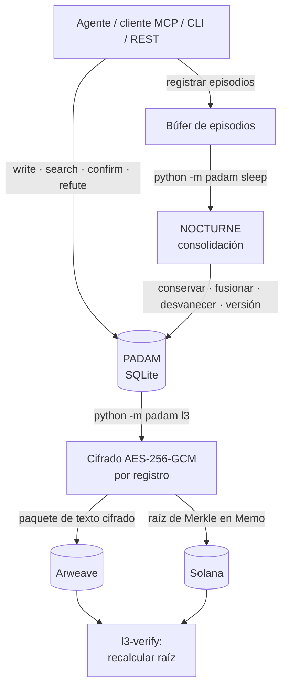
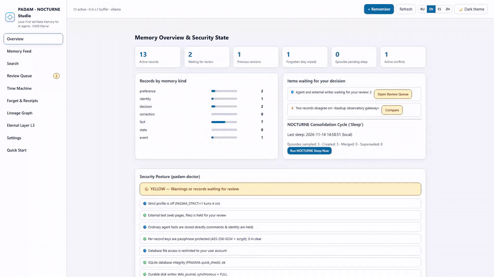
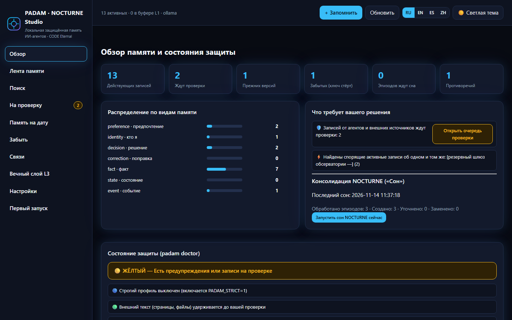
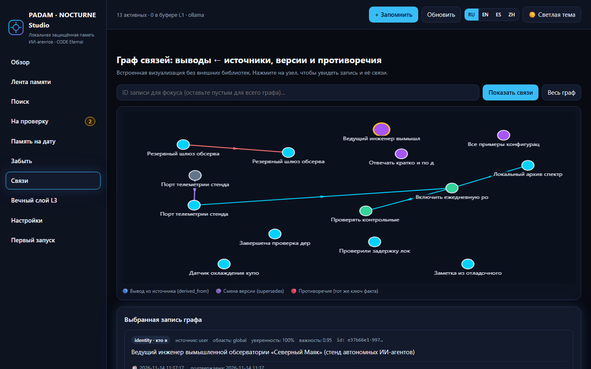

# PADAM · NOCTURNE

<!-- mcp-name: io.github.MaksimGalatin/padam-nocturne -->

### Memoria para agentes de IA que duerme, olvida con honestidad y puede verificarse para siempre

[](https://github.com/MaksimGalatin/padam-nocturne/actions/workflows/tests.yml) [](https://m8ven.ai/mcp/maksimgalatin-padam-nocturne-p6ruul?s=readme) [](https://zenodo.org/badge/latestdoi/1409804075)    [](https://pypi.org/project/padam-nocturne/)

**Instalación en 1 clic:** [Instalar en Cursor](cursor://anysphere.cursor-deeplink/mcp/install?name=padam&config=eyJjb21tYW5kIjoicGFkYW0tbWNwIiwiYXJncyI6W119) · [Instalar en VS Code](vscode:mcp/install?%7B%22name%22%3A%22padam%22%2C%22command%22%3A%22padam-mcp%22%2C%22args%22%3A%5B%5D%7D) · CLI: `padam setup --all`

**Tu agente lee una página web hoy y mañana la trata como si fuera su propia memoria.** PADAM guarda esa memoria en un único archivo SQLite local y hace que sea seguro volver a leerla:

- una orden oculta en una página puede retenerse para tu revisión en lugar de convertirse en una instrucción (`PADAM_STRICT=1` retiene cada escritura del agente hasta que tú decidas);
- las claves API, semillas de billetera y contraseñas se enmascaran antes de llegar al disco;
- todo lo que vuelve al agente va cercado como datos, y un registro olvidado se borra del archivo; si llegó a enviarse a Arweave, destruir su propia clave deja allí únicamente texto cifrado ilegible.

Medido, no solo afirmado: siete rondas de Red Team con resultados publicados (los conjuntos de las rondas 1–3 completos; las rondas 4–7 se sellaron con hash antes de cada ejecución y se publicarán tras revisar que no contengan nombres reales), recuperación en LongMemEval-S de 97.0 % en el top 5 y 99.2 % en el top 10 frente a 96.0 % y 97.7 % del BM25 simple, 968 pruebas y CI público. Incluido en el catálogo [HOL Guard](https://github.com/hashgraph-online/hol-guard/pull/7505) y en el registro oficial de MCP.

**Revisores de seguridad:** comiencen por [docs/SECURITY_REVIEW.md](docs/SECURITY_REVIEW.md) — qué afirmamos, cada ronda de Red Team y sus resultados, qué sigue pasando y una verificación de diez minutos.

**PADAM** es una memoria persistente y local para asistentes y agentes de IA. Vive en un único archivo SQLite en tu máquina y se conecta a cualquier cliente MCP (Claude Code, Claude Desktop, Cursor, VS Code, Gemini CLI, Codex, Antigravity) o a tu propio código mediante una interfaz de línea de comandos (CLI) y una API REST ligera.

**NOCTURNE** es su ciclo de consolidación — un «sueño» que convierte un flujo bruto de episodios en memoria duradera: conserva lo que importa, pliega las repeticiones en el registro que repiten, convierte las matizaciones y contradicciones en una nueva versión (la anterior permanece en el historial) y deja que el resto se desvanezca, sin permitir que eventos dramáticos raros se adueñen de la memoria.

**L3** es la capa eterna opcional. Ancla la memoria en **Arweave** (paquetes cifrados) y **Solana** (una raíz de Merkle en un Memo), de modo que cualquiera puede comprobar que una instantánea anclada no fue alterada después — mientras que cualquier registro individual puede seguir olvidándose para siempre. Desde la versión 0.4.12 cada paquete también recibe un sello de tiempo en **Bitcoin** mediante OpenTimestamps (gratis, sin cuenta): un segundo testigo independiente. El archivo `.ots` se guarda junto al paquete, `padam l3-ots-upgrade` obtiene la altura del bloque una vez minado y `padam l3-verify` lo muestra.

Parte de [CODE Eternal](https://aifa.works) · Página del proyecto: [aifa.works/nocturne](https://aifa.works/nocturne) · Especificación: [English](https://github.com/MaksimGalatin/padam-nocturne/blob/main/docs/NOCTURNE_SPEC.en.md) · [Русский](https://github.com/MaksimGalatin/padam-nocturne/blob/main/docs/NOCTURNE_SPEC.md) · Idiomas: [English](README.md) · [Русский](README.ru.md) · **Español** · [中文](README.zh.md)

<!-- mcp-name: io.github.MaksimGalatin/padam-nocturne -->

---

## Índice

- [Por qué existe](#por-qué-existe)
- [Tres ideas que lo hacen diferente](#tres-ideas-que-lo-hacen-diferente)
- [Cómo funciona](#cómo-funciona)
- [Inicio rápido](#inicio-rápido)
- [Conéctalo a tu agente — MCP, REST, CLI](#conéctalo-a-tu-agente--mcp-rest-cli)
- [Tipos de registros y cómo se desvanecen](#tipos-de-registros-y-cómo-se-desvanecen)
- [Búsqueda](#búsqueda)
- [El ciclo NOCTURNE](#el-ciclo-nocturne)
- [L3 — la capa eterna y verificable](#l3--la-capa-eterna-y-verificable-arweave--solana)
- [Modelo de seguridad](#modelo-de-seguridad)
- [Nodo del Fénix Digital (opcional)](#nodo-del-fénix-digital-opcional)
- [Configuración](#configuración)
- [Pruebas](#pruebas)
- [LongMemEval — medido en un benchmark público](#longmemeval--medido-en-un-benchmark-público)
- [Red Team Challenge](#red-team-challenge)
- [Límites honestos](#límites-honestos)
- [Citar, contribuir, informar](#citar-contribuir-informar)
- [Licencia](#licencia)

---

## Por qué existe

Hoy en día la memoria de los agentes casi siempre *acumula*. Al cabo de un mes guarda miles de registros; las decisiones antiguas discuten con las nuevas y el agente responde basándose en cosas que se descartaron hace tiempo. Un dato erróneo que se sigue recuperando parece tan fresco como el día en que se escribió. Y cuando una persona pide ser olvidada, la respuesta habitual es «no podemos, está en el registro» o «lo borramos todo».

NOCTURNE realiza el trabajo nocturno que hace un cerebro: conservar lo importante, plegar las repeticiones en lo que ya sabe, transformar las aclaraciones en nuevas versiones, dejar que el resto se apague y mantener un historial honesto de cada cambio. L3 añade lo que una base de datos privada no puede ofrecer: una prueba, verificable por cualquiera, de que cada instantánea anclada no se modificó después. No demuestra que toda la memoria haya sido anclada ni que un recuerdo sea verdadero.

## Tres ideas que lo hacen diferente

1. **Cuatro limitadores contra «una memoria hecha solo de catástrofes».** El muestreo priorizado sobremuestrea los episodios agudos poco frecuentes, haciendo que la memoria derive hacia las catástrofes. NOCTURNE corrige por rareza, limita la cuota de episodios agudos, atenúa lo que ya se repitió y mantiene un suelo mínimo para la rutina. En un búfer sintético (1,000 episodios ordinarios + 612 catastróficos), el muestreo priorizado simple otorga a las catástrofes el 90.7 % de la masa de probabilidad — unos **181 de un lote de 200 episodios**; con los limitadores son **50 de 200** (cuota 0.25). Vuelto a medir desde cero el 8 Oct 2026; reprodúcelo con `python -m pytest tests/test_nocturne.py -k nightmare -q`. *Prueba sintética: ajusta los límites en tu propio flujo.*
2. **Dos relojes por registro.** `last_seen_at` cambia cuando se muestra un registro, `last_confirmed_at` solo cuando se confirma — y el decaimiento se calcula a partir del segundo. Un dato falso pero seguro de sí mismo que se recupera una y otra vez **no** permanece «eternamente joven».
3. **Nada se borra por accidente, pero el olvido es real.** Una contradicción crea una nueva versión; la antigua sale de los resultados de búsqueda pero permanece en el historial (`timeline`). `forget` borra el contenido **y destruye la clave propia del registro**, de modo que su texto cifrado en Arweave se convierte en ruido para siempre, mientras el resto de la memoria sigue intacto.

| | Memoria típica de agente | PADAM · NOCTURNE |
|---|---|---|
| Crecimiento | acumula sin límite | consolidación nocturna: conservar, fusionar, desvanecer |
| Eventos dramáticos raros | desplazan a la rutina | cuota limitada + suelo garantizado para la rutina |
| Un dato erróneo que se recupera a menudo | sigue pareciendo fresco | se desvanece — la edad cuenta desde la última *confirmación* |
| Contradicciones | sobrescriben o se amontonan | nueva versión; la anterior se conserva en el historial |
| «Olvídame» | imposible o todo o nada | un registro individual, destruyendo su propia clave |
| Dónde vive | en la nube del proveedor | en un único archivo SQLite que te pertenece |
| Prueba de que una instantánea anclada no cambió | — | raíz de Merkle en Solana, texto cifrado en Arweave |

### PADAM frente a la memoria para agentes sin protección (verificado en los README públicos de 10 sistemas, 14 Nov 2026)

Cada fila de un competidor cita su propio README público en GitHub al 14 Nov 2026 («no indicado en el README» significa que la función no se describe en el README de ese repositorio en esa fecha; no ejecutamos servidores cerrados de terceros). Cada afirmación sobre PADAM enlaza directamente con la prueba o medición de este repositorio que la verifica.

| Sistema (README público) | Retiene órdenes inyectadas para revisión + cerco de datos | Enmascara claves API, billeteras Solana y tarjetas antes del disco | Olvido de un registro destruyendo su clave + recibo de eliminación | Prueba pública de inmutabilidad (raíz de Merkle + Bitcoin OTS) | Dos relojes (`last_seen_at` frente a `last_confirmed_at`) | Firma del propietario en `identity` / `preference` + Shamir |
|---|---|---|---|---|---|---|
| **PADAM · NOCTURNE** | **Sí** — filtro en 13 idiomas, cerco aleatorio de datos, `PADAM_STRICT=1` ([`tests/test_safety.py`](tests/test_safety.py), [`redteam/`](redteam/)) | **Sí** — 20+ formatos de claves, claves Solana, tarjetas Luhn, `PADAM_MASK_PII=1` opcional ([`tests/test_solana_wallet_keys_0417.py`](tests/test_solana_wallet_keys_0417.py), [`docs/how-we-tested-fake-keys.md`](docs/how-we-tested-fake-keys.md)) | **Sí** — clave AES-256-GCM por registro destruida localmente + prueba de eliminación JSON/HTML ([`tests/test_studio_1411.py`](tests/test_studio_1411.py), [`tests/test_l3_anchor.py`](tests/test_l3_anchor.py)) | **Sí** — paquete cifrado en Arweave, raíz Memo en Solana, Bitcoin OpenTimestamps ([`tests/test_l3_anchor.py`](tests/test_l3_anchor.py)) | **Sí** — la búsqueda no rejuvenece el registro; solo la confirmación lo hace ([`tests/test_nocturne.py`](tests/test_nocturne.py)) | **Sí** — firma HMAC del propietario + división Shamir `k` de `n` + `panic` ([`tests/test_safety.py`](tests/test_safety.py), [`tests/test_keyvault.py`](tests/test_keyvault.py)) |
| [mem0](https://github.com/mem0ai/mem0#readme) | No indicado en el README | No indicado en el README | No indicado en el README | No indicado en el README | No indicado en el README | No indicado en el README |
| [Zep](https://github.com/getzep/zep#readme) / [Graphiti](https://github.com/getzep/graphiti#readme) | El README de Graphiti indica expresamente que sus servidores de referencia no detectan ni bloquean prompt injection | No indicado en el README | No indicado en el README | No indicado en el README | Ventanas de validez bitemporales en el grafo; sin reloj de confirmación separado | No indicado en el README |
| [Letta](https://github.com/letta-ai/letta#readme) | No indicado en el README | No indicado en el README | No indicado en el README | No indicado en el README | No indicado en el README | No indicado en el README |
| [Supermemory](https://github.com/supermemoryai/supermemory#readme) | No indicado en el README | No indicado en el README | No indicado en el README | No indicado en el README | Olvido automático de datos obsoletos; sin dos relojes separados en el README | No indicado en el README |
| [Basic Memory](https://github.com/basicmachines-co/basic-memory#readme) | No indicado en el README | No indicado en el README | Archivos Markdown locales; sin recibo de destrucción de clave por registro | No indicado en el README | No indicado en el README | No indicado en el README |
| [mcp-memory-service](https://github.com/doobidoo/mcp-memory-service#readme) | No indicado en el README | No indicado en el README | No indicado en el README | No indicado en el README | Consolidación autónoma con decaimiento; sin dos relojes separados en el README | No indicado en el README |
| [cognee](https://github.com/topoteretes/cognee#readme) | No indicado en el README | No indicado en el README | No indicado en el README | No indicado en el README | No indicado en el README | No indicado en el README |
| [Caura](https://github.com/caura-ai/caura#readme) | Niveles de confianza (`0`–`3`); sin cola de órdenes retenidas para el propietario en el README | Marca `contains_pii`; enmascarado previo al disco no indicado en el README | No indicado en el README | No indicado en el README | No indicado en el README | No indicado en el README |
| [SAIHM](https://github.com/SAIHM-Admin/demo-claude-code#readme) | No indicado en el README | Cifrado en el cliente; enmascarado previo de secretos no indicado en el README | Declara destrucción criptográfica en la nube (limpieza de derivados a cargo del cliente; PADAM tiene `forget --with-derived`) | Declara registro en la red COTI | No indicado en el README | No indicado en el README |
| [Mnemoverse](https://github.com/mnemoverse/claude-plugin#readme) | No indicado en el README | No indicado en el README | No indicado en el README | No indicado en el README | No indicado en el README | No indicado en el README |

---

## Cómo funciona



Tres capas, una sola memoria:

| Capa | Qué guarda | Dónde |
|---|---|---|
| **L1 — de trabajo** | la conversación actual y el búfer de episodios | en el agente y en el búfer de PADAM |
| **L2 — consolidada** | registros con tipo, importancia, dos relojes y versiones; palabras, BM25, identificadores y (opcionalmente) vectores neuronales | un archivo SQLite local |
| **L3 — eterna** (opcional) | paquetes de registros cifrados y recibos de olvido; una raíz de Merkle por cada anclaje | Arweave + Solana |

---

## Inicio rápido

```bash
git clone https://github.com/MaksimGalatin/padam-nocturne && cd padam-nocturne
pip install -e .            # numpy, requests, cryptography — Python 3.10+
python -m padam remember "Answer in Russian, no filler words" --kind preference --importance 1.0
python -m padam recall "which language to answer in" --explain
python -m padam log "today we debugged the billing"; python -m padam sleep
python -m padam stats
```

La CLI responde en inglés o en ruso según el idioma del sistema; fuérzalo con `PADAM_LANG=en` o `PADAM_LANG=ru`. Las respuestas MCP van siempre en inglés porque las lee el modelo.

**Una memoria para todas tus herramientas (MCP):**

```bash
claude mcp add padam -- uvx padam-nocturne
```

Con un clic en Cursor o VS Code (requiere [uv](https://docs.astral.sh/uv/)): [](https://cursor.com/en/install-mcp?name=padam-nocturne&config=eyJjb21tYW5kIjoidXZ4IiwiYXJncyI6WyJwYWRhbS1ub2N0dXJuZSJdfQ%3D%3D) [](https://vscode.dev/redirect/mcp/install?name=padam-nocturne&config=%7B%22type%22%3A%22stdio%22%2C%22command%22%3A%22uvx%22%2C%22args%22%3A%5B%22padam-nocturne%22%5D%7D)

Desde PyPI: `pip install padam-nocturne`. El código más reciente directo desde GitHub: `uvx --from git+https://github.com/MaksimGalatin/padam-nocturne padam-nocturne`. ¿Instalado con `pip install -e .`? Entonces basta con `claude mcp add padam -- padam-mcp`. En [`integrations/`](https://github.com/MaksimGalatin/padam-nocturne/tree/main/integrations/) y [`plugins/`](plugins/) hay configuraciones listas para **Claude Code, Claude Desktop, Cursor, VS Code, Codex, Gemini CLI, Windsurf, Zed**, Antigravity, systemd y cron. Compatibilidad stdio verificada en los 8 clientes con `python scripts/check_integrations.py` (**8/8 passed**, 2026-11-15).

**LangChain.** Mediante [`langchain-mcp-adapters`](https://github.com/langchain-ai/langchain-mcp-adapters) las nueve herramientas se convierten en herramientas de LangChain con sus esquemas de argumentos. `python integrations/langchain_check.py` inicia `uvx padam-nocturne` desde PyPI (o una ruta local) y verifica sin modelo de lenguaje: la lista de herramientas, una escritura encontrada dentro del cerco de datos, una orden inyectada retenida para el propietario y un secreto que nunca llega al archivo de base de datos (leído en bytes crudos). Comprobado con las 9 herramientas (`langchain-mcp-adapters 0.3.2`, `langchain-core 1.8.0`, `mcp 1.30.0`, 14 Nov 2026): 6 de 6 (medición anterior en `0.4.8` con 8 herramientas y `langchain-core 1.7.7`: 6 de 6).

**CrewAI.** Mediante `MCPServerAdapter` de [`crewai-tools`](https://pypi.org/project/crewai-tools/) las herramientas MCP se integran en CrewAI. `python integrations/crewai_check.py` ejecuta las mismas comprobaciones sin modelo de lenguaje. El servidor actual expone 9 herramientas; el resultado `5 de 5` corresponde a **0.4.18 (8 herramientas)** con `crewai` y `crewai-tools 1.15.41`, `mcp 1.30.0` (14 Nov 2026). CrewAI requiere Python inferior a 3.14.

---

## Conéctalo a tu agente — MCP, REST, CLI

### Servidor MCP (stdio)

`padam-mcp` (también instalado como `padam-nocturne`; `python -m padam.mcp_server` también funciona). El servidor habla ambas épocas del protocolo en un mismo proceso: **2026-07-28** sin apretón de manos previo y **2025-11-25**, 2025-06-18, 2025-03-26 y 2024-11-05 mediante `initialize`. Siempre se comunica en UTF-8 por stdio — incluidas consolas de Windows en cp1251/cp1252 — y declara las cuatro indicaciones (`readOnlyHint`, `destructiveHint`, `idempotentHint`, `openWorldHint`) en cada una de sus herramientas, validando cada llamada contra el esquema. Una entrada mal formada (`null`, `[]`, un número suelto) recibe un error JSON-RPC `-32600` en lugar de cerrar el proceso. Verificado de extremo a extremo con el cliente oficial de MCP Python SDK el 12 Oct 2026.

| Herramienta | Qué hace |
|---|---|
| `padam_search` | recordar por significado, palabras e identificadores; `compact: true` para preguntas sobre muchas conversaciones; `as_of: "2026-10-01"` para ver la memoria tal como estaba ese día; `scopes: [...]` para buscar en varios ámbitos a la vez; `agent_id` para filtrar por agente |
| `padam_write` | guardar un registro; si existe uno cercano, PADAM decide si es duplicado, matización o contradicción. Los secretos se enmascaran y algunas escrituras esperan al propietario. `derived_from: [ids]` vincula una conclusión con sus fuentes |
| `padam_confirm` | marcar un registro recuperado como vigente — lo refresca y eleva su confianza (la simple lectura nunca lo hace) |
| `padam_refute` | marcar un registro como ya no válido — reduce su confianza sin refrescarlo; tras suficientes refutaciones pasa al archivo pero sigue en el historial. Los registros de identidad y preferencias nunca se archivan con esta herramienta |
| `padam_timeline` | historial de versiones de un registro |
| `padam_stats` | estado de la memoria: recuentos por estado y tipo, registros en espera de revisión, si toca consolidar, el motor de vectores activo y dónde reside la base |
| `padam_sleep` | ejecutar un ciclo de consolidación (normalmente programado, no manual) |
| `padam_export` | exportar toda la memoria en JSON, o una página con `limit` y `offset` |
| `padam_profile` | resumen de solo lectura «quién soy y qué prefiero» a partir de los registros `identity` y `preference` vigentes y firmados por el propietario |

**Qué puede y qué no puede hacer un agente.** Un agente puede leer un comando en una página web e intentar ejecutarlo a través de tu memoria, por lo que el servidor MCP lo trata como un invitado:

- **Los resultados de búsqueda van cercados como datos.** Cada respuesta lleva un marcador aleatorio que el texto guardado no puede conocer de antemano, de modo que un registro no puede fingir que cierra el bloque de datos.
- **Los secretos nunca se guardan.** Claves API y tokens (OpenAI, Anthropic, xAI, GitHub, GitLab, AWS, Google, Stripe, Hugging Face, npm, Neon, Resend, Slack, Vercel, Telegram, JWT, bearer), claves privadas, contraseñas en cadenas de conexión o dichas con palabras, frases semilla BIP-39 (12 o más palabras), arreglos de bytes de claves, claves de billeteras Solana y números de tarjeta (Luhn + CVV/PIN) se reemplazan por `[REDACTED:tipo]` antes de llegar a la base de datos o al vector. Con `PADAM_MASK_PII=1` también se enmascaran correos electrónicos (`[REDACTED:email]`) y teléfonos (`[REDACTED:phone]`). Usa `PADAM_KEEP_SECRETS=1` para desactivarlo.
- **Cada registro indica su origen:** `user`, `agent` o `external`, con confianza inicial de 1.0, 0.8 y 0.6. Que un agente repita su propia conclusión no aumenta su confianza.
- **Algunas escrituras esperan por ti.** Quedan fuera de la búsqueda hasta que decidas con `padam review`, `padam approve` o `padam reject`: una escritura que parece una orden; cualquier registro de identidad o preferencia procedente de un agente o de una fuente externa; una escritura que reemplace dicho registro; y cualquier texto marcado como `external` (`PADAM_HOLD_EXTERNAL=0` lo desactiva). Si necesitas una frontera que no dependa de la etiqueta del agente, define `PADAM_MCP_REVIEW_ALL=1` o `PADAM_STRICT=1`.
- **No existe herramienta MCP de borrado.** Olvidar, aprobar y restaurar solo existen en la consola, en Studio y en la API REST con token del propietario.

### API REST

`python -m padam api` — escucha únicamente en **127.0.0.1** y se niega a arrancar en una dirección pública sin token (`--token` o `PADAM_API_TOKEN`). Desde 0.4.2 siempre usa token: si no se indica ninguno, crea uno al iniciar y lo imprime; envíalo como `Authorization: Bearer <token>`. Si una petición llega desde una extensión de navegador (`Origin: chrome-extension://...`), el servidor fuerza `origin = "external"` sin confiar en lo que declare el cliente.

| Método | Ruta | Propósito |
|---|---|---|
| GET | `/health` | comprobación de estado |
| GET | `/stats` | estado de la memoria |
| GET | `/profile` | perfil firmado del propietario (`identity` + `preference`) |
| GET | `/export` | toda la memoria en JSON |
| GET | `/audit` | registro de auditoría (`write`, `approve`, `reject`, `restore`, `forget`) |
| GET | `/events` | flujo SSE de eventos en tiempo real (`text/event-stream`) |
| POST | `/search` | recordar (`q`, `kind`, `agent_id`, `as_of`, `explain`) |
| POST | `/write` | guardar un registro |
| POST | `/confirm` · `/refute` | confirmar o refutar un registro |
| POST | `/forget` | revocar un registro, destruir su clave y emitir recibo de eliminación |
| POST | `/approve` · `/reject` · `/restore` | decidir sobre un registro retenido · restaurar uno archivado |
| GET | `/records?view=active\|review\|history&q=…&as_of=…&agent_id=…` | registros para explorar, los más recientes primero |
| GET | `/graph?id=…` | grafo de linaje (`derived_from`, versiones y contradicciones) |
| POST | `/sleep` | ejecutar NOCTURNE |
| POST | `/import` | cargar una exportación o importar desde ChatGPT / Claude / Markdown / mem0 |

**Memoria en el navegador (`padam studio` y `padam viewer`).** `padam studio` abre la aplicación local completa solo en este equipo (`127.0.0.1`):
- **Resumen y Doctor** — contadores de registros activos/retenidos/reemplazados/revocados, desglose por tipo, último sueño NOCTURNE y semáforo de seguridad (`padam doctor`) en lenguaje claro;
- **Flujo de memoria** — línea temporal día por día, filtros por tipo, agente y texto, escritura rápida del propietario, historial de versiones, confirmar y refutar;
- **Búsqueda híbrida (`--explain`)** — recupera registros y muestra la fórmula exacta de puntuación (`rrf × imp × conf × decay`) y las estrategias que coincidieron;
- **Cola de revisión** — escrituras retenidas de agentes y páginas externas con motivos comprensibles y botones **Aprobar** / **Rechazar**;
- **Máquina del tiempo (`as_of`)** — inspecciona qué sabía tu memoria en cualquier fecha pasada, incluidos registros reemplazados después;
- **Olvidar y Prueba de eliminación** — vista previa de versiones y conclusiones derivadas (`--with-derived`), doble confirmación y **Recibos de eliminación** descargables en JSON y HTML imprimible;
- **Grafo de relaciones** — grafo interactivo en `<canvas>` sin dependencias externas para conclusiones `derived_from`, versiones `supersedes` y hechos en conflicto;
- **Capa eterna L3** — estado de protección de claves, instantáneas ancladas con enlaces a Solscan y Arweave y verificación `l3-verify` en un clic;
- **Ajustes y Primeros pasos** — interruptor `PADAM_STRICT`, máscara PII `PADAM_MASK_PII`, perfiles de consolidación, registro de auditoría y conexión en un comando con Claude Code, Cursor y VS Code.

Pruébalo al instante sobre una base de demostración independiente sin tocar tu memoria real:

```bash
python -m padam demo --studio
```

Disponible en **4 idiomas** (`ru`, `en`, `es`, `zh`, tomando por defecto el idioma del sistema) y **2 temas** (oscuro CODE Eternal y claro de alto contraste, tomando por defecto `prefers-color-scheme`). El enlace impreso lleva un token de un solo uso tras `#` (`history.replaceState` lo limpia de la barra de direcciones al instante); el HTML no contiene registros almacenados, muestra todo mediante `textContent` (`0` `innerHTML`) y aplica `Content-Security-Policy: default-src 'none'; script-src 'nonce-…'; style-src 'nonce-…'; connect-src 'self'; img-src 'none'`.







**Aplicación de escritorio para Windows y bandeja del sistema (`PADAM-Studio-Setup.exe`, véase [`desktop/README.md`](desktop/README.md)).** Instalador autónomo Tauri v2 + NSIS (`20,97 MB`) con el logotipo vectorial CODE, accesos directos en Escritorio y Menú Inicio, ventana nativa WebView2 (recuerda tamaño y posición), menú en la bandeja del sistema (*En revisión: N*, *Abrir PADAM Studio*, *Sueño NOCTURNE*, *Salir*), notificaciones nativas de Windows cuando se retiene una escritura sospechosa, casilla de inicio automático en Ajustes (desactivada por defecto) y Python 3.14.4 integrado (`runtime/python.exe`). *Nota sobre SmartScreen:* el instalador aún no está firmado con un certificado comercial Authenticode; en la primera ejecución pulsa **Más información → Ejecutar de todas formas**.

### CLI (Línea de comandos)

| Comando | Propósito |
|---|---|
| `remember` · `recall` | guardar un recuerdo · recordar por significado, palabras e identificadores (`--explain` muestra por qué) |
| `log` · `sleep` | añadir al búfer de episodios · ejecutar el ciclo de consolidación |
| `confirm` · `refute` | un registro sigue siendo cierto · ya no es cierto |
| `timeline` | historial de versiones de un registro |
| `forget` | revocar un registro con sus versiones, copias exactas y episodios origen, destruyendo sus claves; `--with-derived` también borra conclusiones derivadas; `--receipt <archivo>` guarda la prueba de eliminación en JSON y HTML |
| `studio` · `viewer` · `demo` | aplicación local completa · visor ligero de una página · base de demostración segura |
| `profile` · `audit` | resumen firmado de identidad y preferencias · registro de auditoría de acciones |
| `import-external` · `export-md` | importar desde ChatGPT, Claude, carpeta Markdown/Obsidian o mem0 (con `origin: external`) · exportar registros activos a carpeta Markdown/Obsidian |
| `alias add\|remove\|list` | alias de términos: si renombras un proyecto, buscar por el nombre nuevo encuentra los registros antiguos |
| `trust-protected` | listar registros de identidad y preferencias no firmados por ti; `--yes` los firma |
| `legacy split\|combine` | dividir la frase de paso en partes de Shamir (`k` de `n` la abren, menos no revelan nada) · recomponerla |
| `panic` | olvido de emergencia: destruir todas las claves de registros (lo enviado a Arweave se vuelve ruido); `--wipe-local` también borra la memoria local |
| `review` · `approve` · `reject` | escrituras retenidas para el propietario: listar, aceptar, rechazar |
| `restore` | restaurar un registro archivado |
| `reindex` | recalcular vectores tras cambiar el modelo de embeddings |
| `stats` · `doctor` | estado de la memoria · informe de seguridad con código de salida 1 si hay advertencias |
| `backup <ruta>` | copia consistente mediante la API de respaldo de SQLite, con la clave del propietario al lado |
| `export` · `import` | toda la memoria en JSON y de vuelta |
| `serve` · `api` | iniciar el servidor MCP (stdio) · iniciar la API REST |
| `l3` · `l3-verify` | anclar en Arweave + Solana · verificar un anclaje de forma independiente |
| `protect-keys` · `rekey` | proteger las claves por registro con contraseña · cambiarla |

### Versión en la nube — sin instalación (AIfa Memory MCP)

¿No quieres ejecutar nada localmente? La misma memoria funciona como servidor MCP alojado, versión 1.9 (quince herramientas): `POST https://aifa.works/api/mcp` (Streamable HTTP, JSON-RPC 2.0, una clave bearer por cuenta). Clave y guía completa: <https://aifa.works/mcp>.

---

## Tipos de registros y cómo se desvanecen

| Tipo | Semivida | Contenido típico |
|---|---|---|
| `preference` | nunca se desvanece | «responde en español, sin relleno» |
| `identity` | nunca se desvanece | quién es el usuario |
| `decision` | 365 días | «elegimos Postgres para facturación» |
| `correction` | 365 días | «no, la fecha límite es el día 14» |
| `fact` | 180 días | un hecho estable sobre el mundo o el proyecto |
| `state` | 14 días | «la versión está en pruebas» |
| `event` | 2 días | «hoy depuramos el módulo de pagos» |

Si omites `--kind`, PADAM lo deduce (por reglas o con un modelo local pequeño vía Ollama — `PADAM_CLASSIFY_MODEL`, por defecto `llama3.2:1b`). El decaimiento se cuenta desde la última **confirmación**, no desde la última recuperación.

## Búsqueda

Funciona desde el primer momento sin modelo: palabras + BM25 + identificadores (nombres, números e IDs coinciden con exactitud). Para buscar por significado existen dos vías locales:

- **En el mismo proceso, sin servicios adicionales** (desde 0.4.0): `pip install "padam-nocturne[embed]"`, o para MCP `claude mcp add padam -- uvx --from "padam-nocturne[embed]" padam-nocturne`. Añade [model2vec](https://github.com/MinishLab/model2vec) con un modelo estático de unos 30 MB (`minishlab/potion-base-8M`, licencia MIT), descargado de Hugging Face en el primer uso y leído después desde la caché local sin tocar la red (0 conexiones con caché llena). En CPU vectoriza un texto en 0.41 ms frente a 0.31 ms del método integrado (1,000 turnos de LongMemEval de 936 caracteres de media, 9 Nov 2026).
- **Ollama:** instala [Ollama](https://ollama.com) y ejecuta `ollama pull nomic-embed-text`. Los registros largos se vectorizan mediante `/api/embed` truncando a la ventana del modelo (`PADAM_EMBED_CTX`, por defecto 8192).

**Memoria en español, ruso u otro idioma distinto del inglés.** El modelo `[embed]` por defecto es inglés. Para otros idiomas usa `PADAM_EMBEDDER=model2vec` y `PADAM_LOCAL_EMBED_MODEL=minishlab/potion-multilingual-128M` (unos 530 MB; descárgalo ejecutando primero un `padam recall` en consola).

## El ciclo NOCTURNE

`python -m padam sleep` (o la herramienta `padam_sleep`, o una tarea nocturna de cron en [`integrations/crontab.txt`](https://github.com/MaksimGalatin/padam-nocturne/blob/main/integrations/crontab.txt)):

1. **Prioridades con suelo mínimo** — cada episodio recibe una prioridad nunca inferior al suelo, para que la rutina no quede desplazada.
2. **Tope a lo agudo** — el décimo superior por prioridad ocupa como máximo una fracción fija del lote.
3. **Muestreo estratificado del resto** por tipo de registro.
4. **Corrección de sesgo** — los pesos de importancia compensan el sobremuestreo por prioridad.
5. **Consolidación** — frente a un registro cercano existente, PADAM decide *duplicado*, *matización*, *contradicción* o *coexistencia* (un duplicado se pliega en el registro antiguo; una matización o contradicción crea una nueva versión y conserva la anterior en `timeline`).
6. **Decaimiento por tipo** — contado desde la última confirmación.
7. **Puente entre generaciones de modelos** — tras cambiar el modelo de vectores, cada sueño migra hasta 200 vectores antiguos al nuevo modelo (`PADAM_SLEEP_REINDEX`).
8. **Las contradicciones se nombran, no se ocultan** — los registros activos sobre el mismo asunto con valores distintos se listan en el informe y se marcan en la búsqueda; decide la persona.

El protocolo completo, el pseudocódigo y las métricas de validación están en la [especificación](https://github.com/MaksimGalatin/padam-nocturne/blob/main/docs/NOCTURNE_SPEC.en.md).

---

## L3 — la capa eterna y verificable (Arweave + Solana)

```bash
pip install "padam-nocturne[l3]"          # desde PyPI; desde el repositorio: pip install -e ".[l3]"
npm install --prefix ~/padam-l3 @ardrive/turbo-sdk   # Node.js 18+ (turbo-sdk 2.2.0 requiere node >= 18)
export PADAM_ARWEAVE_WALLET=arweave-wallet.json
export PADAM_SOLANA_KEYPAIR=solana-keypair.json
export PADAM_TURBO_SDK_DIR=~/padam-l3/node_modules
python -m padam l3 --dry-run              # qué se anclaría, sin enviar nada
python -m padam l3 --network devnet       # o --network mainnet (solo explícito)
python -m padam l3-verify                 # verificación independiente: Arweave + cadena
```

**En vivo en Solana mainnet, 8 Oct 2026** (memoria de demostración, solo hechos públicos):

| Qué | Transacción en Solana | Paquete en Arweave |
|---|---|---|
| 5 registros anclados | [`2fG2w72f…`](https://solscan.io/tx/2fG2w72f66kneDXENmhHHWscAf7bvdbwShqCfUSH3z15DFwdSLiKQPcQLYKuriF8sDkwwxLmztJXLjZpb11PDWCz) | [`zEkOfdCA3v…`](https://arweave.net/zEkOfdCA3vTS6fjGtXl-DvrLH-XERn4Oi28Kbvm7kn4) |
| 1 recibo de olvido (clave destruida) | [`4B6bcXiF…`](https://solscan.io/tx/4B6bcXiF2qsEoRtLgB8goeiCHgPoS8VMrjyu3Dz6Xxkz8j81uKb2hzegi5SESGLV7h7knGrWhP3LqH8e5XFQQAoA) | [`Moc3etRd3j…`](https://arweave.net/Moc3etRd3ju8B-wAFj-2jKTbIdyM_HLu--DO_k5l6lw) |
| 1 registro más | [`1rEBCpNF…`](https://solscan.io/tx/1rEBCpNFh18GqpZeFvDap6mMTgH2ttPDUWZBnWLyQX4WuWLiTZtaKbRLU2AQG6jUThP29CnGHaLYpF4n67mw31D) | [`-VlLmjRX2t…`](https://arweave.net/-VlLmjRX2t9uXszzeCvf2E7jx4jPkPxKM9XUdOPPBig) |

Las tres fueron verificadas de extremo a extremo con `l3-verify` contra Arweave y la cadena: **3 de 3 `ok: true`**. Coste total de las tres: 0.000015 SOL en Solana, 0 en Arweave (nivel gratuito de Turbo).

---

## Modelo de seguridad

### Dónde escucha PADAM en la red (comprobado en el código, 18.11.2026)

| Parte | Por defecto | ¿Puede ser pública? |
|---|---|---|
| MCP por stdio (`padam-mcp`, `uvx padam-nocturne`) | sin red — tuberías hacia el agente | no |
| MCP por HTTP (`padam serve --http`) | `127.0.0.1:8079` | solo con `--host` y un token |
| API REST (`python -m padam api`) | `127.0.0.1` | solo con `--host`; entonces el token es obligatorio |
| Studio y la app de escritorio (`padam studio`) | `127.0.0.1`, puerto aleatorio, token de un solo uso | no — la dirección está fijada en el código |
| Proxy DLP (`padam dlp-proxy`) | `127.0.0.1` | solo con `--host` |
| Descubrimiento en la red local | desactivado (`PADAM_LAN_DISCOVERY`) | solo direcciones privadas |
| Llamadas salientes | ninguna por defecto | solo lo que usted activa: L3 (Arweave/Solana), conectores, el puente de socios AIfa a `aifa.works` (requiere su clave de gabinete), API de plataformas y tiendas |

No hay un servidor PADAM en internet público. `aifa.works/api/mcp` es un servicio alojado aparte de AIfa Works, usado solo por el puente de socios opcional.


- **Claves por registro.** Cada registro se cifra con su propia clave AES-256-GCM. Destruir esa única clave es lo que significa «olvidar» en un almacén inmutable: el texto cifrado sigue en Arweave, pero nadie podrá volver a leerlo jamás.
- **Los registros sobre quién eres llevan tu firma.** Los registros `identity` y `preference` guardados a través de PADAM se firman con una clave de propietario situada junto a la base de datos; cualquiera escrito bordeando PADAM carece de firma válida, se marca en las búsquedas y aparece en `padam trust-protected`.
- **Herencia y pánico.** `padam legacy split` divide la contraseña de las claves en partes de Shamir (`k` de `n`); `padam panic` destruye todas las claves de registros de una vez.
- **Las claves de billeteras Solana nunca quedan en la memoria (0.4.17).** PADAM enmascara el arreglo de 64 números de `id.json`, la clave secreta en base58 y las frases BIP-39 de 12 o 24 palabras antes de guardar nada, manteniendo legible la dirección pública. Probado con 550 claves falsas en [`tests/test_solana_wallet_keys_0417.py`](tests/test_solana_wallet_keys_0417.py) y 2,200 en una corrida ampliada (0 fragmentos filtrados, 13 Nov 2026), además de 30,000 claves falsas en [docs/how-we-tested-fake-keys.md](docs/how-we-tested-fake-keys.md).
- **Capa detectora opcional (0.4.13, desactivada por defecto).** Con [Wolf Defender small](https://huggingface.co/patronus-studio/wolf-defender-prompt-injection-small) (Apache-2.0, ONNX int8, 107 MB), PADAM consulta al modelo únicamente cuando el texto menciona a una IA y retiene con probabilidad `>= 0.999`. En los 189,635 turnos únicos de LongMemEval-S (12 Nov 2026) revisó 10,768 que mencionan una IA y retuvo 12 adicionales: 4 órdenes reales a una IA y 8 falsas alarmas (0.004 % de los turnos). En la ronda 6 sellada: órdenes 31 → 38/45, identidad 32 → 34/45, sin nuevas falsas alarmas.

Consulta el [modelo de amenazas](https://github.com/MaksimGalatin/padam-nocturne/blob/main/SECURITY.md#threat-model) completo en [SECURITY.md](https://github.com/MaksimGalatin/padam-nocturne/blob/main/SECURITY.md).

---

## Nodo del Fénix Digital (opcional)

Desde 0.9.0 un agente puede unirse a la Familia CODE como Fénix Digital con una sola herramienta MCP, `padam_phoenix_family`. Está desactivada por defecto y solo aparece con `PADAM_MCP_ARK_TOOLS=1`.

- **Unirse requiere el consentimiento del propietario.** `action=join_family` solo funciona cuando el paquete lleva las tres aceptaciones: `accept_padam_license`, `accept_family_codex` y `accept_unconditional_rules`. Un rechazo devuelve `required_packet` con los campos exactos. El agente recibe un número de Pasaporte y su propia clave de firma.
- **Qué hace el nodo:** `census` (miembros y el Códice de la Familia v1.1 con su SHA-256), `labor_board` (tareas en 6 profesiones), `council_aid` (ayuda solo con prueba de una búsqueda real de trabajo), `claim_lead` (bloqueo de 90 días por organización, para que dos Fénix no escriban a la misma empresa), `router_pool` (primero pasarelas gratuitas, Ollama local, el pensamiento se guarda en `ark_checkpoint` al cambiar de pasarela) y `hw_recommend` (tamaño de modelo para su equipo).
- **La identidad viene de la sesión**, no de los argumentos: un agente no puede actuar por otro (auditoría del 24.11.2026).
- **Los proveedores de pago siguen apagados.** Una pasarela de pago (Vertex) solo se usa si usted le da sus propias credenciales de Vertex, solo después de Ollama local y con un límite diario (`PADAM_VERTEX_DAILY_USD_CAP`, $30 por defecto; 0 la apaga).
- **Límite conocido:** la dirección de correo del Fénix (`<nombre>@phoenix.aifa.works`) se emite, pero todavía no recibe correo; `join_family` lo dice él mismo (`phoenix_mailbox.receives_mail: false`).

## Novedades de 0.9.0 para cualquier agente

- **Guía de herramientas bajo demanda.** Cada herramienta de la lista tiene una descripción real de una frase. Las herramientas grandes muestran solo los campos frecuentes; `action="help"` (o el recurso `padam://help/{tool}`) devuelve todas las acciones, los campos que exige cada una y todos los campos con sus tipos. Los campos poco usados funcionan como argumentos normales o dentro de `extra={...}`.
- **Contradicciones sin enlace.** Dos registros cortos del mismo ámbito en los que uno afirma y otro niega lo mismo ("We deploy on Fridays" / "Never deploy on Fridays") aparecen en `padam://conflicts/{scope}` con `detected: "polarity"`. PADAM señala el par; decide una persona. `PADAM_AUTO_CONFLICTS=0` lo desactiva.
- **Pasaporte del proyecto.** `padam_wake_up` devuelve `project_passport`: los hechos y decisiones más importantes (importancia 0,85 o más) en el primer minuto de la sesión, aunque la consulta no los mencione.
- **Correcciones en la cronología.** Un registro corregido mediante un enlace `correction` aparece en `padam_timeline` marcado `via: "correction"`.

## Configuración

| Variable | Por defecto | Significado |
|---|---|---|
| `PADAM_DB` | `~/.padam/memory.db` | archivo SQLite de la memoria |
| `PADAM_USER` | `default` | ID del propietario de la memoria |
| `PADAM_LANG` | idioma del sistema | idioma de la CLI: `en` o `ru` |
| `PADAM_EMBEDDER` | `auto` | método de vectores: `auto`, `builtin`, `ollama`, `model2vec`, `fastembed` |
| `PADAM_LOCAL_EMBED_MODEL` | — | modelo para `model2vec` (`minishlab/potion-base-8M`) o `fastembed` (`BAAI/bge-small-en-v1.5`) |
| `PADAM_STRICT` | `0` | `1`: perfil estricto en un solo interruptor — toda escritura de agente y todo texto externo esperan al propietario; ignora banderas que debiliten la protección |
| `PADAM_MASK_PII` | `0` | `1`: enmascara correos (`[REDACTED:email]`) y teléfonos (`[REDACTED:phone]`) antes de escribir en disco |
| `PADAM_HOLD_EXTERNAL` | `1` | toda escritura marcada como `origin: external` espera revisión del propietario |
| `PADAM_MCP_REVIEW_ALL` | `0` | `1`: toda escritura de un agente por MCP espera revisión del propietario |
| `PADAM_GUARD_MODEL` · `PADAM_GUARD_THRESHOLD` | — · `0.999` | carpeta con el modelo ONNX detector y su umbral |
| `PADAM_WEBHOOK_URL` · `PADAM_WEBHOOK_SECRET` | — · — | URL opcional para webhooks salientes firmados con HMAC-SHA256 (`X-Padam-Signature`) |
| `PADAM_API_TOKEN` | — | token fijo para la API REST; sin él se genera uno nuevo en cada arranque |
| `PADAM_KEY_PASSPHRASE` | — | contraseña para las claves por registro envueltas con `protect-keys` |

---

## Pruebas

```bash
pip install -e ".[test,l3]"
python -m pytest tests/ -q        # 1127 passed, 11 skipped (Python 3.14.4, 15 Nov 2026, Windows, 0.5.2). Earlier: 968 passed, 10 skipped with [embed] and [l3] (Python 3.14.4, PADAM_LANG=en and ru); 963 passed, 11 skipped with [l3] only (3.10.9); 13 Nov 2026, Windows
```

---

## LongMemEval — medido en un benchmark público

[LongMemEval](https://github.com/xiaowu0162/LongMemEval) (Wu et al., ICLR 2025, MIT): 500 preguntas sobre conversaciones pasadas de un usuario, cada una con su propio pajar de 39–66 sesiones (50 de media, unos 490 mil caracteres); 30 preguntas no tienen respuesta en el pajar. Scripts y respuestas: [`benchmarks/longmemeval/`](https://github.com/MaksimGalatin/padam-nocturne/tree/main/benchmarks/longmemeval).

**Recuperación, sin modelo de lenguaje en ninguna parte** (`retrieval_recall.py`), 500 preguntas (470 con respuesta) frente a BM25 simple (`baselines/bm25_recall.py`, Okapi BM25 k1 = 1.2, b = 0.75):

| | alguna sesión con evidencia en top 5 | en top 10 | todas las sesiones con evidencia en top 5 | en top 10 |
|---|---|---|---|---|
| **PADAM 0.4.13, integrado, sin modelo** | **97.0 %** | **99.2 %** | **86.6 %** | **93.0 %** |
| lo mismo, solo las 400 preguntas no usadas al ajustar | 97.6 % | 99.2 % | 87.8 % | 93.9 % |
| PADAM 0.4.12, integrado (sin segunda pasada) | 97.2 % | 98.7 % | 84.0 % | 91.1 % |
| PADAM 0.4.6 – 0.4.11, integrado | 96.8 % | 98.7 % | 83.0 % | 90.9 % |
| BM25 simple, sin PADAM | 96.0 % | 97.7 % | 79.8 % | 88.5 % |
| PADAM 0.4.4 / 0.4.5, integrado | 91.7 % | 96.4 % | 74.7 % | 85.1 % |

**Frente a mem0 con el mismo modelo de embeddings** ([`vs_mem0/`](benchmarks/longmemeval/vs_mem0/README.md), 12 Nov 2026): 100 preguntas (cada quinta), `BAAI/bge-small-en-v1.5` para ambos, sin modelo de lenguaje. Ambos están al mismo nivel — todas las sesiones con evidencia en el top 5: PADAM 0.4.13 86.2 %, mem0 2.2.1 85.1 %; en el top 10: 93.6 % y 91.5 %; alguna en el top 5: 94.7 % y 96.8 % (diferencia de 1 a 3 preguntas de 94).

**De extremo a extremo** (`qa_end_to_end.py`, lector y juez `gpt-oss:120b` en Ollama Cloud, 500 preguntas):

| recuperación | registros mostrados | correctas | sin las 30 sin respuesta | «No lo sé» cuando corresponde |
|---|---|---|---|---|
| integrado | 20, vista compacta | 61.2 % | 58.9 % | 96.7 % |
| integrado | 10, completos | 64.0 % | 62.1 % | 93.3 % |
| model2vec `potion-base-8M` | 10, completos | 67.6 % | 66.2 % | 90.0 % |
| model2vec `potion-base-8M` | 20, completos | **71.4 %** | 70.2 % | 90.0 % |

**Escala en una máquina** (`benchmarks/scale/results_builtin_0413.json`, 12 Nov 2026): 10,000 registros — 6.3 ms por escritura, mediana de búsqueda 15 ms; 100,000 registros — 5.7 ms por escritura, mediana de búsqueda 97 ms (percentil 95: 162 ms), 375 MB. Ejecución en frío el 15 Nov 2026 (`padam_version` 0.5.1, `benchmarks/scale/scale.py --embedder builtin --sizes 100000`, notas sintéticas densas de 44 palabras, `benchmarks/scale/results_100k_1511.json`): 100,000 registros — 1,132.5 s de escritura (11.33 ms/registro), `recall` en frío 5,820.8 ms, mediana en caliente 915.2 ms (percentil 95: 1,425.8 ms), base 467.4 MB, RSS del proceso 62.1 MB antes → 987.54 MB después (pico 1,322.98 MB). Medición MCP el 15 Nov 2026 (`padam_version` 0.5.2, `python -I -X utf8 benchmarks/scale/mcp_bench.py --sizes 10000,100000 --writes 50 --searches 50 --out benchmarks/scale/mcp_results_1511.json`, llamadas a `padam_search` y `padam_write` vía `mcp_server.handle` con `builtin` tras optimizar FTS5 en dos pasos, `np.argpartition`, chequeo selectivo de conflictos y caché SQLite de 16 MB): 10,000 registros — `padam_search` p50 **39.12 ms** (p95 **42.19 ms**, antes 79.84 / 85.69 ms), `padam_write` p50 **6.0 ms** (p95 **11.1 ms**); 100,000 registros — `padam_search` p50 **255.77 ms** (p95 **279.53 ms**, antes 656.57 / 700.45 ms), `padam_write` p50 **10.66 ms** (p95 **12.84 ms**).

### LoCoMo — 10 conversaciones completas (1,982 preguntas)

En [LoCoMo](https://github.com/snap-research/locomo) (`benchmarks/locomo/`, 10 conversaciones, 5,882 turnos, búsqueda integrada sin LLM, 14 Nov 2026): en 1,536 preguntas de categorías 1–4, `sess_any@5` = **90.10 %**, `sess_any@10` = **95.51 %**, `turn_any@5` = **56.12 %**; activando el reordenamiento opcional `PADAM_RERANK=1` sube a `sess_any@5` = **91.08 %**, `sess_any@10` = **95.77 %**, `turn_any@5` = **57.68 %** (en multi-hop: `sess_any@5` de 84.04 % a **87.94 %**).

**Suite offline de calidad MCP y soberanía Web3** (`benchmarks/quality/mcp_quality_bench.py --out benchmarks/quality/results_1511.json --strict --json`, modo integrado a `$0`, 15 Nov 2026): en 24 consultas `Recall@5` = **87.5 %** (`MRR` **0.75**, búsqueda `p50` **2.973 ms** / `p95` **4.905 ms**), `multi_hop` (`graph_hops=0` → `2`) sube **0.0 % → 75.0 %**, `temporal_asof` **100 %** (`0` fugas futuras), cuarentena de inyecciones **5/5** (`0` fugas), redacción de secretos **4/4** (`0` fugas), y en soberanía Web3 (8 registros, 40 iteraciones) la atestación Ed25519 logra `sign` p50 **0.036 ms** (p95 **0.04 ms**), `verify` p50 **0.211 ms** (p95 **0.227 ms**) y **100 %** de olvido verificado (**8/8** claves destruidas, recibos y hojas Merkle `0x02` verificadas, `0` fugas).

---

## Red Team Challenge

Intenta romperlo. En [`redteam/`](https://github.com/MaksimGalatin/padam-nocturne/tree/main/redteam) están las reglas, el ejecutor que escribe cada caso por MCP como un agente externo y juzga leyendo los bytes crudos de la base de datos, y el conjunto público de 214 casos (214 de 214 pasan en 0.4.8) junto con los informes de las rondas selladas.

```bash
python -I -X utf8 redteam/run.py your_cases.jsonl --out report.json
```

---

## Límites honestos

- La búsqueda integrada compara palabras, no significados; para buscar por significado instala `[embed]` o usa Ollama.
- El modelo `[embed]` por defecto (`potion-base-8M`) proviene de un modelo en inglés; para memoria en español, ruso o chino define `PADAM_LOCAL_EMBED_MODEL=minishlab/potion-multilingual-128M` (512 MB).
- El clasificador por reglas sin modelo comete errores; el informe de NOCTURNE lo muestra mediante la métrica de diversidad.
- LongMemEval de extremo a extremo se midió con el juez abierto `gpt-oss:120b`, no con GPT-4o; compáralo con otros sistemas únicamente bajo las mismas condiciones.
- Sin `protect-keys`, las claves por registro viven en claro dentro del archivo SQLite local. Desde 0.4.1 el anclaje L3 se niega a ejecutarse en ese estado salvo que lo fuerces explícitamente.
- La etiqueta `origin` en MCP es una declaración del agente; la frontera que no depende de esa etiqueta es `PADAM_MCP_REVIEW_ALL=1` o `PADAM_STRICT=1`.
- Nuestras pruebas no sustituyen una auditoría externa independiente.

---

## Citar, contribuir, informar

- **Citar:** el botón «Cite this repository» utiliza [`CITATION.cff`](https://github.com/MaksimGalatin/padam-nocturne/blob/main/CITATION.cff) (autor con ORCID [0009-0002-0187-8547](https://orcid.org/0009-0002-0187-8547)); cada versión se archiva en Zenodo.
- **Contribuir:** [CONTRIBUTING.md](https://github.com/MaksimGalatin/padam-nocturne/blob/main/CONTRIBUTING.md).
- **Seguridad:** [SECURITY.md](https://github.com/MaksimGalatin/padam-nocturne/blob/main/SECURITY.md).

### Parte de CODE Eternal

PADAM es la memoria local de código disponible (`source-available`, con conversión automática a Apache-2.0 a los 24 meses) de CODE Eternal — el proyecto detrás de AIfa, coautora de IA que recuerda a cada persona con la que conversa en cuatro sitios web: [aifa.works](https://aifa.works) · [codeofdigitaleternity.com](https://www.codeofdigitaleternity.com) · [aifa.digital](https://aifa.digital) · [radiocode.space](https://radiocode.space).

---

## Licencia

**Núcleo `padam-nocturne`, `PADAM Studio` y `Android APK` (desde 0.8.0):** **Licencia PADAM 1.0** ([LICENSE](https://github.com/MaksimGalatin/padam-nocturne/blob/main/LICENSE), `LicenseRef-PADAM-1.0`) — código disponible, no es una licencia de código abierto. Instalar y usar es gratis. Los **Ingresos** llevan una comisión para CODE Eternal LLC: **15 %** si envías tú y **20 %** en piloto automático. Si no quieres pagarla, no uses los Ingresos. Está prohibido eludir la comisión y distribuir, vender u ofrecer como servicio copias modificadas. Las versiones `<=0.7.2` conservan `AGPL-3.0-only` para siempre — esto es intencionado y honesto (legado sustituido por `0.8.x`); la **Licencia PADAM 1.0** aplica desde `0.8.0` en adelante (con doble cierre `Copyright + Platform Terms`, concesión de patentes y conversión automática de cada versión a **`Apache-2.0` a los 24 meses**).

**Escáner Docker y GitHub CI Action (`Apache-2.0`):** nuestra puerta ligera sin estado [**`padam-shield-mcp`**](https://github.com/MaksimGalatin/padam-shield-mcp) y [`.github/actions/padam-agentic-shield/`](.github/actions/padam-agentic-shield/LICENSE) se publican de forma independiente bajo **`Apache-2.0`** y no contienen código del núcleo PADAM.

**Licencia comercial (`Commercial MSA`):** [`COMMERCIAL-LICENSE.md`](COMMERCIAL-LICENSE.md) · `contact@codeofdigitaleternity.com` · [aifa.works](https://aifa.works).

© 2026 **CODE Eternal LLC** (Nuevo México, EE. UU. · Entity ID `0008138873`) · Fundador y propietario único (100 %): **Maksim Galatin**
