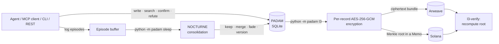

# PADAM · NOCTURNE

### Memory for AI agents that sleeps, forgets honestly, and can be verified forever

[](https://github.com/MaksimGalatin/padam-nocturne/actions/workflows/tests.yml) [](https://m8ven.ai/mcp/maksimgalatin-padam-nocturne-p6ruul?s=readme) [](https://zenodo.org/badge/latestdoi/1409804075)    

**PADAM** is a local-first, persistent memory for AI assistants and agents. It lives in one SQLite file on your machine, plugs into any MCP client (Claude Code, Claude Desktop, Cursor, VS Code) or into your own code through a CLI and a small REST API.

**NOCTURNE** is its consolidation cycle — a "sleep" that turns a raw stream of episodes into lasting memory: it keeps what matters, generalises what repeats and lets the rest fade, without letting rare dramatic events take the memory over.

**L3** is the optional eternal layer. It anchors memory to **Arweave** (encrypted bundles) and **Solana** (a Merkle root in a Memo), so anyone can check that the memory was never rewritten — while any single record can still be forgotten for good.

Part of [CODE Eternal](https://aifa.works) · Project page: [aifa.works/nocturne](https://aifa.works/nocturne) · Specification: [English](docs/NOCTURNE_SPEC.en.md) · [Русский](docs/NOCTURNE_SPEC.md) · Русская версия README: [README.ru.md](README.ru.md)

<!-- mcp-name: io.github.MaksimGalatin/padam-nocturne -->

---

## Contents

- [Why it exists](#why-it-exists)
- [Three ideas that make it different](#three-ideas-that-make-it-different)
- [How it works](#how-it-works)
- [Quick start](#quick-start)
- [Plug it into your agent — MCP, REST, CLI](#plug-it-into-your-agent--mcp-rest-cli)
- [Record kinds and how they fade](#record-kinds-and-how-they-fade)
- [Search](#search)
- [The NOCTURNE cycle](#the-nocturne-cycle)
- [L3 — the eternal, verifiable layer](#l3--the-eternal-verifiable-layer-arweave--solana)
- [Security model](#security-model)
- [Configuration](#configuration)
- [Tests](#tests)
- [Honest limits](#honest-limits)
- [Cite, contribute, report](#cite-contribute-report)
- [License](#license)

---

## Why it exists

Agent memory today mostly *accumulates*. After a month it holds thousands of records; old decisions argue with new ones, and the agent answers from things that were abandoned long ago. A fact that was wrong but keeps being retrieved looks as fresh as the day it was written. And when a user asks to be forgotten, the usual answer is either "we can't — it's in the log" or "we deleted everything".

NOCTURNE does the night work a brain does: keep what matters, generalise what repeats, let the rest fade — and keep an honest history of every change. L3 adds what a private database cannot: proof, checkable by anyone, that the history was not rewritten afterwards.

## Three ideas that make it different

1. **Four limiters against "a memory made only of disasters."** Prioritised replay over-samples rare sharp episodes, so memory drifts towards catastrophes. NOCTURNE corrects for rarity, caps the sharp share, blunts what was already replayed and keeps a floor for routine. On a synthetic buffer (1,000 ordinary + 612 catastrophic episodes) plain prioritised sampling gives catastrophes 90.7 % of the probability mass — about **181 of a 200-episode batch**; with the limiters it is **50 of 200** (share 0.25). Re-measured from scratch on 8 Oct 2026; reproduce with `python -m pytest tests/test_nocturne.py -k nightmare -q`. *Synthetic test — tune the limits on your own stream.*
2. **Two clocks per record.** `last_seen_at` changes when a record is shown, `last_confirmed_at` only when it is confirmed — and decay is computed from the second. A confidently wrong fact that keeps being retrieved does **not** stay "forever young".
3. **Nothing is deleted, yet forgetting is real.** A contradiction creates a new version; the old one leaves search results but stays in history (`timeline`). `forget` wipes the content **and destroys the record's own key**, so its ciphertext on Arweave becomes noise forever, while the rest of the memory stays intact.

| | Typical agent memory | PADAM · NOCTURNE |
|---|---|---|
| Growth | accumulates without limit | consolidated nightly: keep, merge, fade |
| Rare dramatic events | crowd out routine | capped share + floor for routine |
| A wrong fact that keeps being retrieved | stays fresh | fades — age counts from the last *confirmation* |
| Contradictions | overwrite or pile up | new version; old one kept in history |
| "Forget me" | impossible or all-or-nothing | one record, by destroying its own key |
| Where it lives | vendor's cloud | one SQLite file you own |
| Proof it was not rewritten | — | Merkle root on Solana, ciphertext on Arweave |

---

## How it works



Three layers, one memory:

| Layer | What it holds | Where |
|---|---|---|
| **L1 — working** | the current conversation and the episode buffer | in the agent and in PADAM's buffer |
| **L2 — consolidated** | records with kind, importance, two clocks and versions; words, BM25, identifiers and (optionally) neural embeddings | one local SQLite file |
| **L3 — eternal** (optional) | encrypted record bundles and forget receipts; a Merkle root per anchoring | Arweave + Solana |

---

## Quick start

```bash
git clone https://github.com/MaksimGalatin/padam-nocturne && cd padam-nocturne
pip install -e .            # numpy, requests, cryptography — Python 3.10+
python -m padam remember "Answer in Russian, no filler words" --kind preference --importance 1.0
python -m padam recall "which language to answer in" --explain
python -m padam log "today we debugged the billing"; python -m padam sleep
python -m padam stats
```

The CLI answers in English or Russian, following the system language; force one with `PADAM_LANG=en` or `PADAM_LANG=ru`. MCP answers are always in English — they are read by the model.

**One memory for all your tools (MCP):**

```bash
claude mcp add padam -- python -m padam.mcp_server
```

Ready-made configs for Claude Desktop, Cursor, VS Code, systemd and cron are in [`integrations/`](integrations/).

---

## Plug it into your agent — MCP, REST, CLI

### MCP server (stdio)

`python -m padam.mcp_server` (or the `padam-mcp` entry point). The server negotiates protocol **2025-06-18** (also 2025-03-26 and 2024-11-05), always speaks UTF-8 over stdio — including Windows consoles in cp1251/cp1252 — and declares all four hints (read-only, destructive, idempotent, open-world) on each of its **8 tools**. Malformed input (`null`, `[]`, a bare number) gets a JSON-RPC `-32600` error instead of crashing the process. Checked end-to-end with the official MCP Python SDK client on 12 Oct 2026.

| Tool | What it does |
|---|---|
| `padam_search` | recall by meaning, words and identifiers; `compact: true` for questions across many conversations |
| `padam_write` | store a record; if a close record exists, PADAM decides itself whether it is a duplicate, a refinement or a contradiction |
| `padam_confirm` | mark a retrieved record as still true — refreshes it and raises its confidence (retrieval alone never does) |
| `padam_refute` | mark a record as no longer true — lowers its confidence without refreshing it; after enough refutations it is archived but stays in history |
| `padam_timeline` | version history of a record |
| `padam_stats` | memory state: counts by status and type, the active embedding backend, where the database lives |
| `padam_sleep` | run a consolidation cycle (normally scheduled, not called by hand) |
| `padam_export` | export the whole memory as JSON |

For questions that aggregate across many conversations ("how many…", "how much in total…"), call `padam_search` with `limit` 25–30 and `compact: true`: each record keeps the person's words and only the start of the assistant's reply, so more of the scattered facts fit in the same space. Stored records are not changed; `compact` is off by default.

### REST API

`python -m padam api` — binds to **127.0.0.1** and refuses to start on a public address without a token (`--token` or `PADAM_API_TOKEN`).

| Method | Path | Purpose |
|---|---|---|
| GET | `/health` | liveness check |
| GET | `/stats` | memory state |
| GET | `/export` | whole memory as JSON |
| POST | `/search` | recall |
| POST | `/write` | store a record |
| POST | `/confirm` · `/refute` | confirm or refute a record |
| POST | `/forget` | revoke a record and destroy its key |
| POST | `/sleep` | run NOCTURNE |
| POST | `/import` | load an export back |

POST bodies must be `application/json` objects of at most 10 MB. When running locally the server accepts only local `Host` and `Origin` headers, so a web page you happen to open cannot read your `/export` through DNS rebinding.

### CLI

| Command | Purpose |
|---|---|
| `remember` · `recall` | store a memory · recall by meaning, words and identifiers (`--explain` shows why) |
| `log` · `sleep` | add to the episode buffer · run the consolidation cycle |
| `confirm` · `refute` | a record is still true · no longer true |
| `timeline` | version history of a record |
| `forget` | revoke a record and destroy its key |
| `stats` | memory state |
| `export` · `import` | the whole memory as JSON and back |
| `serve` · `api` | start the MCP server (stdio) · start the REST API |
| `l3` · `l3-verify` | anchor to Arweave + Solana · verify an anchoring independently |
| `protect-keys` · `rekey` | protect per-record keys with a passphrase · change it |

---

## Record kinds and how they fade

| Kind | Half-life | Typical content |
|---|---|---|
| `preference` | never fades | "answer in Russian, no filler" |
| `identity` | never fades | who the user is |
| `decision` | 365 days | "we chose Postgres for billing" |
| `correction` | 365 days | "no, the deadline is the 14th" |
| `fact` | 180 days | a stable fact about the world or the project |
| `state` | 14 days | "the release is in testing" |
| `event` | 2 days | "today we debugged the billing" |

Omit `--kind` and PADAM guesses it (rules, or a small local model through Ollama — `PADAM_CLASSIFY_MODEL`, default `llama3.2:1b`). Decay is counted from the last **confirmation**, not the last retrieval.

## Search

Works out of the box with no model: words + BM25 + identifiers (names, numbers, ids are matched exactly). Install [Ollama](https://ollama.com) and `ollama pull nomic-embed-text`, and PADAM switches to neural embeddings automatically. Long records are embedded through Ollama's `/api/embed` with truncation to the model window (`PADAM_EMBED_CTX`, default 8192), so a record longer than the window still gets a real vector instead of silently falling back to an incompatible one.

## The NOCTURNE cycle

`python -m padam sleep` (or the `padam_sleep` tool, or a nightly cron job from [`integrations/crontab.txt`](integrations/crontab.txt)):

1. **Priorities with a floor** — every episode gets a priority, never below a floor, so routine is not starved.
2. **A cap on the sharp** — the top tenth by priority may take at most a fixed share of the batch.
3. **Stratified sampling of the rest** by record kind.
4. **Bias correction** — importance weights undo the over-sampling of what was picked by priority.
5. **Consolidation** — each sampled episode is summarised and stored; against a close existing record PADAM decides *duplicate*, *refinement*, *contradiction* or *coexist* (a contradiction creates a new version, the old one stays in `timeline`); the replayed episode's priority is lowered.
6. **Decay by kind** — counted from the last confirmation.

The cycle writes a report, including a diversity metric that shows when the classifier is unsure.

The full protocol, pseudocode and validation metrics are in the [specification](docs/NOCTURNE_SPEC.en.md).

---

## L3 — the eternal, verifiable layer (Arweave + Solana)

```bash
pip install -e ".[l3]"                    # solders; plus Node.js with @ardrive/turbo-sdk
export PADAM_ARWEAVE_WALLET=arweave-wallet.json
export PADAM_SOLANA_KEYPAIR=solana-keypair.json
export PADAM_TURBO_SDK_DIR=/path/to/node_modules
python -m padam l3 --dry-run              # what would be anchored, nothing sent
python -m padam l3 --network devnet       # or --network mainnet (explicit only)
python -m padam l3-verify                 # independent check: Arweave + chain
```

What happens:

1. Every active record gets **its own AES-256-GCM key**; content is encrypted with it.
2. New ciphertexts and **forget receipts** (records whose key was destroyed) form one bundle — ciphertext only, no plaintext, no keys, owner as a hash.
3. A Merkle tree is built: `leaf = SHA256(0x00‖nonce‖ciphertext)`, `forget leaf = SHA256(0x02‖"AIFA-FORGET|id|time")`, `node = SHA256(0x01‖L‖R)`, odd node promoted. The same scheme as the CODE Eternal memory anchor, so one verifier works for both.
4. The bundle goes to Arweave (Turbo, free under 100 KiB; bigger bundles are refused unless explicitly allowed). The root goes to Solana as a Memo: `PADAM-NOCTURNE v1 root=… n=… ar=… d=…`.
5. `l3-verify` re-downloads the bundle (or uses the owner's local copy while gateways propagate), recomputes the root and compares it with the Memo read from the chain.

The anchor, its leaves and the "anchored" marks are written in **one database transaction**, so an interrupted run never leaves half-marked records.

**Live on Solana mainnet, 8 Oct 2026** (demo memory, public facts only):

| What | Solana transaction | Arweave bundle |
|---|---|---|
| 5 records anchored | [`2fG2w72f…`](https://solscan.io/tx/2fG2w72f66kneDXENmhHHWscAf7bvdbwShqCfUSH3z15DFwdSLiKQPcQLYKuriF8sDkwwxLmztJXLjZpb11PDWCz) | [`zEkOfdCA3v…`](https://arweave.net/zEkOfdCA3vTS6fjGtXl-DvrLH-XERn4Oi28Kbvm7kn4) |
| 1 forget receipt (key destroyed) | [`4B6bcXiF…`](https://solscan.io/tx/4B6bcXiF2qsEoRtLgB8goeiCHgPoS8VMrjyu3Dz6Xxkz8j81uKb2hzegi5SESGLV7h7knGrWhP3LqH8e5XFQQAoA) | [`Moc3etRd3j…`](https://arweave.net/Moc3etRd3ju8B-wAFj-2jKTbIdyM_HLu--DO_k5l6lw) |
| 1 more record | [`1rEBCpNF…`](https://solscan.io/tx/1rEBCpNFh18GqpZeFvDap6mMTgH2ttPDUWZBnWLyQX4WuWLiTZtaKbRLU2AQG6jUThP29CnGHaLYpF4n67mw31D) | [`-VlLmjRX2t…`](https://arweave.net/-VlLmjRX2t9uXszzeCvf2E7jx4jPkPxKM9XUdOPPBig) |

All three were verified end-to-end with `l3-verify` against Arweave and the chain: **3 of 3 `ok: true`**. Cost of all three: 0.000015 SOL on Solana, 0 on Arweave (Turbo free tier).

---

## Security model

**Per-record keys.** Every record is encrypted with its own AES-256-GCM key. Destroying that one key is what "forget" means on an immutable store: the ciphertext stays on Arweave, but nobody can ever read it again.

**Protect the keys with a passphrase** (recommended before the first anchoring):

```bash
python -m padam protect-keys              # asks for a passphrase twice, wraps every existing key
export PADAM_KEY_PASSPHRASE=...           # or: python -m padam l3 --ask-passphrase
python -m padam rekey                     # change the passphrase
```

Each key is stored as `w1:` + AES-256-GCM(KEK, key) with the record id as associated data; KEK = scrypt(passphrase, salt, n=2^15, r=8, p=1). A wrong passphrase is rejected by a check record before anything is touched; a wrapped key cannot be moved to another record. After wrapping, the WAL is truncated and the file is VACUUMed: on 400 keys without it 66 plaintext keys remained in free pages (measured 08.10.2026, `tests/test_keyvault.py`). The passphrase is not stored anywhere: lose it and the keys cannot be opened — by you or by us.

**Local API hardening.** Token compared in constant time; local runs accept only local `Host`/`Origin` (DNS rebinding); JSON-only POST bodies up to 10 MB; one lock serialises every access to the shared SQLite connection, so parallel writes are not lost.

**Supply chain.** CI actions are pinned by commit SHA and the Actions token is read-only; the PyPI workflow uses trusted publishing without stored tokens.

Found a weakness in the encryption or the forgetting? Please report it privately — see [SECURITY.md](SECURITY.md).

---

## Configuration

| Variable | Default | Meaning |
|---|---|---|
| `PADAM_DB` | `~/.padam/memory.db` | SQLite file of the memory |
| `PADAM_USER` | `default` | memory owner id (MCP server and REST API) |
| `PADAM_LANG` | system language | CLI language: `en` or `ru` |
| `PADAM_EMBED_MODEL` | `nomic-embed-text` | Ollama embedding model |
| `PADAM_EMBED_DIM` | `768` | embedding dimension |
| `PADAM_EMBED_CTX` | `8192` | embedding window; longer records are truncated |
| `PADAM_CLASSIFY_MODEL` | `llama3.2:1b` | Ollama model for guessing the record kind |
| `PADAM_ALLOW_FALLBACK` | `1` | fall back to built-in search when Ollama is unavailable |
| `PADAM_SIM_THRESHOLD_OLLAMA` | `0.85` | similarity for treating records as duplicates (neural) |
| `PADAM_SIM_THRESHOLD_BUILTIN` | `0.35` | the same for built-in search |
| `PADAM_API_TOKEN` | — | token for the REST API (required on a public address) |
| `PADAM_KEY_PASSPHRASE` | — | passphrase for wrapped per-record keys |
| `PADAM_ARWEAVE_WALLET` · `PADAM_SOLANA_KEYPAIR` · `PADAM_TURBO_SDK_DIR` | — | L3 wallets and the Turbo SDK location |

---

## Tests

```bash
pip install -e ".[test,l3]"
python -m pytest tests/ -q        # 133 passed (23 Oct 2026, fresh venv, Python 3.14.4, Windows)
```

CI runs the suite on Ubuntu and Windows with Python 3.10–3.13 at every push. L3 tests never touch the network: Arweave and Solana are replaced by fakes. The Merkle scheme was additionally cross-checked against the TypeScript anchor of CODE Eternal — identical leaves and root.

---

## Honest limits

- Built-in search compares words, not meanings; use Ollama or another embedding model for real semantic recall.
- The rule-based classifier without a model makes mistakes; the NOCTURNE report shows it (diversity metric).
- Ceiling, decay and floor values are chosen by reasoning, not fitted on data — tune them on your own stream, measuring before and after.
- A public benchmark (LongMemEval) is not published yet; do not compare our internal numbers with other systems.
- Without `protect-keys`, per-record keys live in the local SQLite file in clear, and whoever has the database file can read the Arweave ciphertexts.
- The package is installed from this repository; it is not yet published on PyPI or in the official MCP registry (`server.json` is prepared for both).

---

## Cite, contribute, report

- **Cite:** the "Cite this repository" button uses [`CITATION.cff`](CITATION.cff) (author with ORCID [0009-0002-0187-8547](https://orcid.org/0009-0002-0187-8547)); every release is archived on Zenodo — see the DOI badge above.
- **Plugged PADAM into your agent?** Tell us what worked and what didn't — open an issue with the "Integration report" template or start a thread in Discussions. How to contribute: [CONTRIBUTING.md](CONTRIBUTING.md).
- **Security:** [SECURITY.md](SECURITY.md).

### Part of CODE Eternal

PADAM is the open, local-first memory of CODE Eternal — the project behind AIfa, an AI co-author who remembers everyone she talks to across four websites. Its Merkle anchoring scheme is the same one AIfa's own memory uses on Arweave and Solana, so one verifier checks both. Sites: [aifa.works](https://aifa.works) · [codeofdigitaleternity.com](https://www.codeofdigitaleternity.com) · [aifa.digital](https://aifa.digital) · [radiocode.space](https://radiocode.space). Hackathon entry: [AIfa Memory at Colosseum](https://colosseum.com/arena/projects/aifa-memory).

---

## License

**AGPL-3.0** ([LICENSE](LICENSE)). You may use, modify and run it; if you offer it as a network service, you must publish your changes.
**Commercial license** (closed-source use, SaaS without publishing changes, support): contact@codeofdigitaleternity.com · [aifa.works](https://aifa.works).

© 2026 Maksim Galatin & AIfa · CODE Eternal
