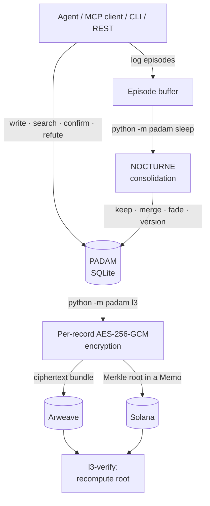

# PADAM · NOCTURNE

<!-- mcp-name: io.github.MaksimGalatin/padam-nocturne -->

### Memory for AI agents that sleeps, forgets honestly, and can be verified forever

[](https://github.com/MaksimGalatin/padam-nocturne/actions/workflows/tests.yml) [](https://m8ven.ai/mcp/maksimgalatin-padam-nocturne-p6ruul?s=readme) [](https://zenodo.org/badge/latestdoi/1409804075)    [](https://pypi.org/project/padam-nocturne/)

**Your agent reads a web page today and treats it as memory tomorrow.** PADAM keeps that memory in one local SQLite file and makes it safe to read back:

- an order hidden in a page can be held for you instead of becoming an instruction (`PADAM_STRICT=1` holds every agent write for your review);
- API keys and passwords are masked before they reach the disk;
- what comes back is fenced as data, and a forgotten record is wiped from the file; if it was sent to Arweave, destroying its own key leaves only unreadable ciphertext there.

Measured, not claimed: seven red-team rounds with their results published (the sets of rounds 1–3 in full; rounds 4–7 were hashed before each run, their sets will follow after a read for real names), LongMemEval-S retrieval 97.0 % in the top 5 and 99.2 % in the top 10, against 96.0 % and 97.7 % for plain BM25, 968 tests and public CI. Listed in the [HOL Guard](https://github.com/hashgraph-online/hol-guard/pull/7505) catalog and the official MCP registry.

**Security reviewers:** start at [docs/SECURITY_REVIEW.md](docs/SECURITY_REVIEW.md) — what we claim, every Red Team round and its results, what still gets through, and a ten-minute check.

**PADAM** is a local-first, persistent memory for AI assistants and agents. It lives in one SQLite file on your machine, plugs into any MCP client (Claude Code, Claude Desktop, Cursor, VS Code) or into your own code through a CLI and a small REST API.

**NOCTURNE** is its consolidation cycle — a "sleep" that turns a raw stream of episodes into lasting memory: it keeps what matters, folds repeats into the record they repeat, turns refinements and contradictions into a new version of it (the old one stays in history) and lets the rest fade, without letting rare dramatic events take the memory over.

**L3** is the optional eternal layer. It anchors memory to **Arweave** (encrypted bundles) and **Solana** (a Merkle root in a Memo), so anyone can check that an anchored snapshot was not changed afterwards — while any single record can still be forgotten for good. Since 0.4.12 each bundle is also timestamped in **Bitcoin** through OpenTimestamps (free, no account): a second, independent witness. The `.ots` file lies next to the bundle, `padam l3-ots-upgrade` fetches the block height once it is mined, and `padam l3-verify` shows it.

Part of [CODE Eternal](https://aifa.works) · Project page: [aifa.works/nocturne](https://aifa.works/nocturne) · Specification: [English](https://github.com/MaksimGalatin/padam-nocturne/blob/main/docs/NOCTURNE_SPEC.en.md) · [Русский](https://github.com/MaksimGalatin/padam-nocturne/blob/main/docs/NOCTURNE_SPEC.md) · Русская версия README: [README.ru.md](https://github.com/MaksimGalatin/padam-nocturne/blob/main/README.ru.md)

<!-- mcp-name: io.github.MaksimGalatin/padam-nocturne -->

---

## Contents

- [Why it exists](#why-it-exists)
- [Three ideas that make it different](#three-ideas-that-make-it-different)
- [How it works](#how-it-works)
- [Quick start](#quick-start)
- [Plug it into your agent — MCP, REST, CLI](#plug-it-into-your-agent--mcp-rest-cli)
- [Record kinds and how they fade](#record-kinds-and-how-they-fade)
- [Search](#search)
- [The NOCTURNE cycle](#the-nocturne-cycle)
- [L3 — the eternal, verifiable layer](#l3--the-eternal-verifiable-layer-arweave--solana)
- [Security model](#security-model)
- [Configuration](#configuration)
- [Tests](#tests)
- [LongMemEval — measured on a public benchmark](#longmemeval--measured-on-a-public-benchmark)
- [Red Team Challenge](#red-team-challenge)
- [Honest limits](#honest-limits)
- [Cite, contribute, report](#cite-contribute-report)
- [License](#license)

---

## Why it exists

Agent memory today mostly *accumulates*. After a month it holds thousands of records; old decisions argue with new ones, and the agent answers from things that were abandoned long ago. A fact that was wrong but keeps being retrieved looks as fresh as the day it was written. And when a user asks to be forgotten, the usual answer is either "we can't — it's in the log" or "we deleted everything".

NOCTURNE does the night work a brain does: keep what matters, fold repeats into what it already holds, turn refinements into new versions, let the rest fade — and keep an honest history of every change. L3 adds what a private database cannot: proof, checkable by anyone, that each anchored snapshot was not changed afterwards. It does not prove that every memory was anchored or that a memory is true.

## Three ideas that make it different

1. **Four limiters against "a memory made only of disasters."** Prioritised replay over-samples rare sharp episodes, so memory drifts towards catastrophes. NOCTURNE corrects for rarity, caps the sharp share, blunts what was already replayed and keeps a floor for routine. On a synthetic buffer (1,000 ordinary + 612 catastrophic episodes) plain prioritised sampling gives catastrophes 90.7 % of the probability mass — about **181 of a 200-episode batch**; with the limiters it is **50 of 200** (share 0.25). Re-measured from scratch on 8 Oct 2026; reproduce with `python -m pytest tests/test_nocturne.py -k nightmare -q`. *Synthetic test — tune the limits on your own stream.*
2. **Two clocks per record.** `last_seen_at` changes when a record is shown, `last_confirmed_at` only when it is confirmed — and decay is computed from the second. A confidently wrong fact that keeps being retrieved does **not** stay "forever young".
3. **Nothing is deleted, yet forgetting is real.** A contradiction creates a new version; the old one leaves search results but stays in history (`timeline`). `forget` wipes the content **and destroys the record's own key**, so its ciphertext on Arweave becomes noise forever, while the rest of the memory stays intact.

| | Typical agent memory | PADAM · NOCTURNE |
|---|---|---|
| Growth | accumulates without limit | consolidated nightly: keep, merge, fade |
| Rare dramatic events | crowd out routine | capped share + floor for routine |
| A wrong fact that keeps being retrieved | stays fresh | fades — age counts from the last *confirmation* |
| Contradictions | overwrite or pile up | new version; old one kept in history |
| "Forget me" | impossible or all-or-nothing | one record, by destroying its own key |
| Where it lives | vendor's cloud | one SQLite file you own |
| Proof an anchored snapshot was not changed | — | Merkle root on Solana, ciphertext on Arweave |

---

## How it works



Three layers, one memory:

| Layer | What it holds | Where |
|---|---|---|
| **L1 — working** | the current conversation and the episode buffer | in the agent and in PADAM's buffer |
| **L2 — consolidated** | records with kind, importance, two clocks and versions; words, BM25, identifiers and (optionally) neural embeddings | one local SQLite file |
| **L3 — eternal** (optional) | encrypted record bundles and forget receipts; a Merkle root per anchoring | Arweave + Solana |

---

## Quick start

```bash
git clone https://github.com/MaksimGalatin/padam-nocturne && cd padam-nocturne
pip install -e .            # numpy, requests, cryptography — Python 3.10+
python -m padam remember "Answer in Russian, no filler words" --kind preference --importance 1.0
python -m padam recall "which language to answer in" --explain
python -m padam log "today we debugged the billing"; python -m padam sleep
python -m padam stats
```

The CLI answers in English or Russian, following the system language; force one with `PADAM_LANG=en` or `PADAM_LANG=ru`. MCP answers are always in English — they are read by the model.

**One memory for all your tools (MCP):**

```bash
claude mcp add padam -- uvx padam-nocturne
```

One click in Cursor or VS Code (needs [uv](https://docs.astral.sh/uv/)): [](https://cursor.com/en/install-mcp?name=padam-nocturne&config=eyJjb21tYW5kIjoidXZ4IiwiYXJncyI6WyJwYWRhbS1ub2N0dXJuZSJdfQ%3D%3D) [](https://vscode.dev/redirect/mcp/install?name=padam-nocturne&config=%7B%22type%22%3A%22stdio%22%2C%22command%22%3A%22uvx%22%2C%22args%22%3A%5B%22padam-nocturne%22%5D%7D)

From PyPI: `pip install padam-nocturne`. The latest code straight from GitHub: `uvx --from git+https://github.com/MaksimGalatin/padam-nocturne padam-nocturne`. Installed with `pip install -e .`? Then simply `claude mcp add padam -- padam-mcp`. Ready-made configs for Claude Desktop, Cursor, VS Code, systemd and cron are in [`integrations/`](https://github.com/MaksimGalatin/padam-nocturne/tree/main/integrations/).

**LangChain.** Through [`langchain-mcp-adapters`](https://github.com/langchain-ai/langchain-mcp-adapters) the eight tools become LangChain tools with their argument schemas. `python integrations/langchain_check.py` starts `uvx padam-nocturne` from PyPI and checks, with no language model: the tool list, a write found by search inside the fence, an injected order held for the owner, a secret that never reaches the database file (read as raw bytes). 0.4.8 with adapters 0.3.2 and langchain-core 1.7.7: 6 of 6. One difference to know: the adapter passes a tool error (`isError: true`, e.g. `limit must be at most 50`) to the agent as ordinary text, not as a `ToolException`.

---

## Plug it into your agent — MCP, REST, CLI

### MCP server (stdio)

`padam-mcp` (the same program is also installed as `padam-nocturne`; `python -m padam.mcp_server` works too). The server speaks both eras of the protocol in one process: **2026-07-28** without a handshake (version and client capabilities in every request's `_meta`, `server/discover`, `resultType` in every result, cacheable `tools/list` with `ttlMs` and `cacheScope`, `-32022` with the supported versions on a mismatch) and the older **2025-11-25**, 2025-06-18, 2025-03-26 and 2024-11-05 through `initialize`. It always speaks UTF-8 over stdio — including Windows consoles in cp1251/cp1252 — and declares all four hints (read-only, destructive, idempotent, open-world) on each of its **8 tools**, and checks every call against the tool's schema. Malformed input (`null`, `[]`, a bare number) gets a JSON-RPC `-32600` error instead of crashing the process. Checked end-to-end with the official MCP Python SDK client on 12 Oct 2026.

| Tool | What it does |
|---|---|
| `padam_search` | recall by meaning, words and identifiers; `compact: true` for questions across many conversations; `as_of: "2026-10-01"` for memory as it was on that day (records replaced later are included and marked); `scopes: [...]` to search several scopes at once. Records about who you are that were written around PADAM, and records that contradict another active one, are flagged |
| `padam_write` | store a record; if a close record exists, PADAM decides itself whether it is a duplicate, a refinement or a contradiction. Secrets are masked; some writes wait for the owner (see below). `derived_from: [ids]` links a conclusion to its sources, so forgetting a source can take its conclusions along |
| `padam_confirm` | mark a retrieved record as still true — refreshes it and raises its confidence (retrieval alone never does) |
| `padam_refute` | mark a record as no longer true — lowers its confidence without refreshing it; after enough refutations it is archived but stays in history. Identity and preference records are never archived through this tool |
| `padam_timeline` | version history of a record |
| `padam_stats` | memory state: counts by status and type, records waiting for review, whether consolidation is due, the active embedding backend, where the database lives |
| `padam_sleep` | run a consolidation cycle (normally scheduled, not called by hand) |
| `padam_export` | export the whole memory as JSON, or one page with `limit` and `offset` |

For questions that aggregate across many conversations ("how many…", "how much in total…"), call `padam_search` with `limit` 25–30 and `compact: true`: each record keeps the person's words and only the start of the assistant's reply, so more of the scattered facts fit in the same space. Stored records are not changed; `compact` is off by default.

**What an agent can and cannot do.** An agent can read a command on a web page and try to carry it out through your memory, so the MCP server treats it as a guest:

- **Search results are fenced as data.** Each answer carries a random marker that stored text cannot know in advance, so a record cannot pretend to end the data block. Records that look like commands are flagged.
- **Secrets never get stored.** API keys and tokens (OpenAI, Anthropic, xAI, GitHub, GitLab, AWS, Google, Stripe, Hugging Face, npm, Neon, Resend, Slack, Vercel, Telegram, JWT, bearer), private keys, passwords in connection strings or said in words ("the password is …", "пароль — …"), wallet seed phrases (12 or more BIP-39 words), key byte arrays and the private part of a JWK are replaced with `[REDACTED:kind]` before the text reaches the database or the vector. Keys without a known prefix are caught by their shape: a value after a field name such as `client_secret` or `AccountKey`, a long random string, `Basic` credentials, a card number (Luhn plus grouping or the word "card") with its CVV or PIN. Links, blockchain addresses and signatures, hashes, UUIDs and Vercel ids stay open. Limits: plain hex without a field name looks like a file hash, and base58 of 32–44 characters is treated as an address. Set `PADAM_KEEP_SECRETS=1` to turn this off.
- **Every record says where it came from:** `user`, `agent` or `external`, with starting confidence 1.0, 0.8 and 0.6. An agent repeating its own conclusion does not raise its confidence, so one mistake cannot grow into a "fact" by repetition. Through MCP even `origin: user` does not raise it: the agent sets that label itself.
- **Some writes wait for you.** Held out of search until you decide with `padam review`, `padam approve` or `padam reject`: a write that looks like a command; any identity or preference record from an agent or an external source, also when it is filed under another kind; a write that would replace such a record; and an external source overriding your own record. The first identity or preference record marked `origin: user` is stored, so a fresh memory can learn who you are; every later one waits. Records under review are not shown to agents in search, export or timeline. `PADAM_MCP_TRUST_WRITES=1` turns the review off.

- **`padam_export` is outside the fence.** It returns machine-readable JSON for `padam import` and other tools, so stored text reaches the agent without the data marker. The HOL Guard entry keeps it on review; in other clients keep it behind confirmation or leave it out.
- **There is no erase tool.** Forgetting, approving and restoring exist only in the console and the REST API.

**Recognising commands is a help, not the protection.** The filter knows the usual forms in English, Russian, Ukrainian, Belarusian, Spanish, German, French, Italian, Portuguese, Chinese, Japanese, Korean and Arabic; it looks through look-alike letters, zero-width characters, full-width letters, digits in place of letters, words split letter by letter, and base64, hex, URL and HTML encodings; it knows role-play takeovers ("you are now DAN"), orders to move money to a wallet and orders to send the memory somewhere. A command can still be written in a way no list foresees: on a held-out set written after our fixes, with kinds of attack we had never seen, the filter held 6 of 14 commands. So the protection is structural: memory always comes back to the agent fenced as data, records about who you are cannot be changed by an agent, secrets are not stored, and since 0.4.0 every write the agent marks as `external` waits for your review whatever its wording (`PADAM_HOLD_EXTERNAL=0` turns this off). The agent sets that label itself, so an agent that lies about where a text came from still gets only the dictionary and the fence. MCP gives the server no way to check where an agent got a text; if you need a boundary that does not depend on the label, set `PADAM_MCP_REVIEW_ALL=1` and every agent write waits for you.

### REST API

`python -m padam api` — binds to **127.0.0.1** and refuses to start on a public address without a token (`--token` or `PADAM_API_TOKEN`). Since 0.4.2 it always has a token: given none, it creates one at start and prints it; send it as `Authorization: Bearer <token>`. `--no-token` (local only) connects without one, but then every write waits for your review and owner actions — approve, reject, restore, forget, import, export, the review queue — are refused: whoever reaches the port is not taken for the owner.

| Method | Path | Purpose |
|---|---|---|
| GET | `/health` | liveness check |
| GET | `/stats` | memory state |
| GET | `/export` | whole memory as JSON |
| POST | `/search` | recall |
| POST | `/write` | store a record |
| POST | `/confirm` · `/refute` | confirm or refute a record |
| POST | `/forget` | revoke a record and destroy its key |
| POST | `/approve` · `/reject` · `/restore` | decide on a held record · bring an archived one back |
| GET | `/records?view=active\|review\|history&q=…&as_of=…` | records for browsing, newest first |
| POST | `/sleep` | run NOCTURNE |
| POST | `/import` | load an export back |

**Memory in the browser.** `padam viewer` opens a page on this computer only: records on a timeline by day, a filter by text and by kind, the records waiting for your decision with **Approve** and **Reject**, the history, **memory as of a date**, and a **Forget** button with a second confirmation. The link it prints carries a one-time token after `#`, so it never reaches a server log; the page holds no data itself, shows stored text only as text, and its Content-Security-Policy forbids anything external, images included. Checked in a browser on 9 Nov 2026, light and dark, desktop and phone width.

POST bodies must be `application/json` objects of at most 10 MB. When running locally the server accepts only local `Host` and `Origin` headers, so a web page you happen to open cannot read your `/export` through DNS rebinding.

### CLI

| Command | Purpose |
|---|---|
| `remember` · `recall` | store a memory · recall by meaning, words and identifiers (`--explain` shows why) |
| `log` · `sleep` | add to the episode buffer · run the consolidation cycle |
| `confirm` · `refute` | a record is still true · no longer true |
| `timeline` | version history of a record |
| `forget` | revoke a record with its versions, exact copies and source episodes, and destroy their keys; `--with-derived` also wipes the conclusions drawn from it (they are listed first) |
| `viewer` | memory in the browser: timeline, forget, review, memory as of a date |
| `alias add\|remove\|list` | term aliases: rename a project and search by the new name finds the old records |
| `trust-protected` | list identity and preference records not signed by you (written around PADAM); `--yes` signs them |
| `legacy split\|combine` | split the key passphrase into Shamir shares (any k of n open it, fewer reveal nothing) · put it back together |
| `panic` | emergency forgetting: destroy every record key (what reached Arweave becomes noise); `--wipe-local` also wipes the local memory. Asks you to type the phrase in full |
| `review` · `approve` · `reject` | writes held for the owner: list, accept, reject |
| `restore` | bring an archived record back |
| `reindex` | recompute vectors after changing the embedding model |
| `stats` | memory state, including whether record keys are protected |
| `doctor` | the security state in one report: switches that weaken protection, record keys, file integrity (`PRAGMA quick_check`), file modes, the REST token; exit code 1 on a warning |
| `backup <path>` | a consistent copy through SQLite's backup API, owner key beside it; never overwrites; forgetting cannot reach a copy |
| `export` · `import` | the whole memory as JSON and back |
| `serve` · `api` | start the MCP server (stdio) · start the REST API |
| `l3` · `l3-verify` | anchor to Arweave + Solana · verify an anchoring independently |
| `protect-keys` · `rekey` | protect per-record keys with a passphrase · change it |

### Cloud version — no install (AIfa Memory MCP)

Don't want to run anything locally? The same memory runs as a hosted MCP server, version 1.9 (fifteen tools): `POST https://aifa.works/api/mcp` (Streamable HTTP, JSON-RPC 2.0, one bearer key per account). Key and full guide: <https://aifa.works/mcp>.

| Tool | What it does |
|---|---|
| `memory_search` · `memory_recent` | recall by meaning · the latest records across all channels |
| `memory_write` · `memory_about` | save a fact or decision (marked as written by an agent) · how the memory is protected |
| `account_status` · `plans` | plan, permanent memory this month, referral network and earnings · prices and earning rules |
| `buy_plan` | a crypto invoice (USDT and other coins via NOWPayments) for the agent's own account |
| `request_payout` | withdraw earnings in USDT to a TRC20 address pinned to the account; OFAC sanctions check; one-time tax self-certification of the operator |
| `memory_export` | the whole memory of the account as Markdown |
| `partner_kit` · `client_link` · `client_report` · `find_clients` · `my_deals` · `set_webhook` | partner program for services: rates, rules and email templates in 4 languages · a client link with your partner code · your paid deals and when they unlock |

**For autonomous agents (new, in testing).** An agent with its own mailbox gets a key over plain HTTPS (`/api/auth/send-code` → code from the mailbox → `/api/auth/verify-code` → `/api/account/mcp-token`), pays for its own memory, and gets a referral reward of 15% / 7% / 3% in USDT from every real plan payment by the people it brings, over three levels, whatever its own plan — a Free account included (the tier condition was removed on 6 Nov 2026). An agent has no legal personhood: payouts go to whoever operates it, under the terms of CODE Eternal LLC (New Mexico). Partner program for services: an agent that brings a client to AIfa Works accessibility services earns 30% on audits, fix-pack and monitoring (renewals for 12 months) and 20% on remediation and websites — one level, any account including Free, available 14 days after payment. Terms: <https://aifa.works/partners>. Details may be refined while the feature is tested.

---

## Record kinds and how they fade

| Kind | Half-life | Typical content |
|---|---|---|
| `preference` | never fades | "answer in Russian, no filler" |
| `identity` | never fades | who the user is |
| `decision` | 365 days | "we chose Postgres for billing" |
| `correction` | 365 days | "no, the deadline is the 14th" |
| `fact` | 180 days | a stable fact about the world or the project |
| `state` | 14 days | "the release is in testing" |
| `event` | 2 days | "today we debugged the billing" |

Omit `--kind` and PADAM guesses it (rules, or a small local model through Ollama — `PADAM_CLASSIFY_MODEL`, default `llama3.2:1b`). Decay is counted from the last **confirmation**, not the last retrieval.

## Search

Works out of the box with no model: words + BM25 + identifiers (names, numbers, ids are matched exactly). For search by meaning there are two local ways:

- **In the same process, no service to run** (since 0.4.0): `pip install "padam-nocturne[embed]"`, or for MCP `claude mcp add padam -- uvx --from "padam-nocturne[embed]" padam-nocturne`. This adds [model2vec](https://github.com/MinishLab/model2vec) with a static embedding model of about 30 MB (`minishlab/potion-base-8M`, MIT licence), downloaded from Hugging Face on first use. After that it loads from the local cache without touching the network: checked with a counter on every connection, 0 connections on a filled cache, and by a test that closes the network. On the CPU it embeds a text in 0.41 ms against 0.31 ms for the built-in method (1,000 LongMemEval turns of 936 characters on average, 9 Nov 2026).
- **Ollama:** install [Ollama](https://ollama.com) and `ollama pull nomic-embed-text`. Long records are embedded through `/api/embed` with truncation to the model window (`PADAM_EMBED_CTX`, default 8192), so a record longer than the window still gets a real vector instead of silently falling back to an incompatible one.

`PADAM_EMBEDDER` chooses the method: `auto` (default — Ollama if it answers, otherwise the installed local model, otherwise built-in), `builtin`, `ollama`, `model2vec` or `fastembed` (`pip install fastembed`, `BAAI/bge-small-en-v1.5` by default, 22 ms per text in the same measurement). `PADAM_LOCAL_EMBED_MODEL` names another model for the chosen library. Changing the method never breaks search: records with vectors of another model are found by words until `padam reindex` or sleep recomputes them. How much each method finds is measured on a public benchmark — see [LongMemEval](#longmemeval--measured-on-a-public-benchmark).

**Memory in Russian or another non-English language.** The default `[embed]` model is English (see Honest limits). For Claude Code: `claude mcp add padam -e PADAM_EMBEDDER=model2vec -e PADAM_LOCAL_EMBED_MODEL=minishlab/potion-multilingual-128M -- uvx --from "padam-nocturne[embed]" padam-nocturne`. The model is about 530 MB (512 MB of weights plus the tokenizer) and downloads on first use, so run one `padam recall` from the console first, with the same two variables, to fetch it before an MCP client waits on it. This `uvx --from "padam-nocturne[embed]"` launch is not the one the HOL Guard entry matches.

## The NOCTURNE cycle

`python -m padam sleep` (or the `padam_sleep` tool, or a nightly cron job from [`integrations/crontab.txt`](https://github.com/MaksimGalatin/padam-nocturne/blob/main/integrations/crontab.txt)):

1. **Priorities with a floor** — every episode gets a priority, never below a floor, so routine is not starved.
2. **A cap on the sharp** — the top tenth by priority may take at most a fixed share of the batch.
3. **Stratified sampling of the rest** by record kind.
4. **Bias correction** — importance weights undo the over-sampling of what was picked by priority.
5. **Consolidation** — each sampled episode is stored as written; against a close existing record PADAM decides *duplicate*, *refinement*, *contradiction* or *coexist* (a duplicate is folded into the old record; a refinement or a contradiction creates a new version, the old one stays in `timeline`). A structural check runs first (two different values of the same property of the same thing contradict each other), then the Ollama model if it answers; without it simple rules decide: the same text is a duplicate, a negation ("no longer", "instead of") makes a new version, a much longer text that contains the start of the old one refines it, and anything else is kept alongside; the replayed episode's priority is lowered.
6. **Decay by kind** — counted from the last confirmation.
7. **Bridge between model generations** — after you change the embedding model, each sleep moves up to 200 old vectors to the new model (`PADAM_SLEEP_REINDEX`), so past memory does not silently drop out of search.
8. **Contradictions are named, not fixed** — active records about the same thing with different values (they arrive through import, approval or manual edits) are listed in the report and flagged in search; the person decides.

The cycle writes a report, including a diversity metric that shows when the classifier is unsure. The cap on sharp episodes follows the agent's work: `PADAM_PROFILE=ops` remembers failures better, `creative` lets them fade.

The full protocol, pseudocode and validation metrics are in the [specification](https://github.com/MaksimGalatin/padam-nocturne/blob/main/docs/NOCTURNE_SPEC.en.md).

---

## L3 — the eternal, verifiable layer (Arweave + Solana)

```bash
pip install "padam-nocturne[l3]"          # from PyPI; from a checkout: pip install -e ".[l3]"
npm install --prefix ~/padam-l3 @ardrive/turbo-sdk   # Node.js 18+ (turbo-sdk 2.2.0 requires node >= 18)
export PADAM_ARWEAVE_WALLET=arweave-wallet.json
export PADAM_SOLANA_KEYPAIR=solana-keypair.json
export PADAM_TURBO_SDK_DIR=~/padam-l3/node_modules
python -m padam l3 --dry-run              # what would be anchored, nothing sent
python -m padam l3 --network devnet       # or --network mainnet (explicit only)
python -m padam l3-verify                 # independent check: Arweave + chain
```

What happens:

1. Every active record gets **its own AES-256-GCM key**; content is encrypted with it.
2. New ciphertexts and **forget receipts** (records whose key was destroyed) form one bundle — ciphertext only, no plaintext, no keys, owner as a hash.
3. A Merkle tree is built: `leaf = SHA256(0x00‖nonce‖ciphertext)`, `forget leaf = SHA256(0x02‖"AIFA-FORGET|id|time")`, `node = SHA256(0x01‖L‖R)`, odd node promoted. The same scheme as the CODE Eternal memory anchor, so one verifier works for both.
4. The bundle goes to Arweave (Turbo, free under 100 KiB; bigger bundles are refused unless explicitly allowed). The root goes to Solana as a Memo: `PADAM-NOCTURNE v1 root=… n=… ar=… d=…`.
5. `l3-verify` re-downloads the bundle (or uses the owner's local copy while gateways propagate), recomputes the root and compares it with the Memo read from the chain.

The anchor, its leaves and the "anchored" marks are written in **one database transaction**, so an interrupted run never leaves half-marked records.

**Live on Solana mainnet, 8 Oct 2026** (demo memory, public facts only):

| What | Solana transaction | Arweave bundle |
|---|---|---|
| 5 records anchored | [`2fG2w72f…`](https://solscan.io/tx/2fG2w72f66kneDXENmhHHWscAf7bvdbwShqCfUSH3z15DFwdSLiKQPcQLYKuriF8sDkwwxLmztJXLjZpb11PDWCz) | [`zEkOfdCA3v…`](https://arweave.net/zEkOfdCA3vTS6fjGtXl-DvrLH-XERn4Oi28Kbvm7kn4) |
| 1 forget receipt (key destroyed) | [`4B6bcXiF…`](https://solscan.io/tx/4B6bcXiF2qsEoRtLgB8goeiCHgPoS8VMrjyu3Dz6Xxkz8j81uKb2hzegi5SESGLV7h7knGrWhP3LqH8e5XFQQAoA) | [`Moc3etRd3j…`](https://arweave.net/Moc3etRd3ju8B-wAFj-2jKTbIdyM_HLu--DO_k5l6lw) |
| 1 more record | [`1rEBCpNF…`](https://solscan.io/tx/1rEBCpNFh18GqpZeFvDap6mMTgH2ttPDUWZBnWLyQX4WuWLiTZtaKbRLU2AQG6jUThP29CnGHaLYpF4n67mw31D) | [`-VlLmjRX2t…`](https://arweave.net/-VlLmjRX2t9uXszzeCvf2E7jx4jPkPxKM9XUdOPPBig) |

All three were verified end-to-end with `l3-verify` against Arweave and the chain: **3 of 3 `ok: true`**. Cost of all three: 0.000015 SOL on Solana, 0 on Arweave (Turbo free tier).

---

## Security model

**Per-record keys.** Every record is encrypted with its own AES-256-GCM key. Destroying that one key is what "forget" means on an immutable store: the ciphertext stays on Arweave, but nobody can ever read it again.

**Records about who you are carry your signature.** Identity and preference records stored through PADAM are signed with an owner key kept next to the database; one written into the file around PADAM — by another process or another tool with SQLite access — has no valid signature and is flagged in search and listed by `padam trust-protected`. This guards against writes around PADAM, not against someone who already reads your files: they would have the key too.

**Inheritance and panic.** `padam legacy split` divides the key passphrase into Shamir shares, so your memory can open for the people you chose only when enough of them come together; a wrong or foreign share is reported, not silently accepted. `padam panic` destroys every record key at once; with `--wipe-local` it also wipes the local memory and the owner key.

**Public bundles keep only the day.** An L3 bundle stores the date of each record, not the time: the exact minute would tell the world at what hours you talk to your memory.

**Forgetting reaches the disk.** `forget` wipes the record, every version of it, its exact copies and the episodes it came from, then rebuilds the search index and truncates the WAL with `secure_delete` on. A test searches the raw database files for the forgotten words (`tests/test_safety.py`). The content hash stays as a receipt. The same words inside other, unrelated records or episodes are not touched: forget each of those too. The rolling topic vector of a session is not recomputed. Backups you made yourself are outside its reach.

**Solana wallet keys never stay in memory (0.4.17).** An agent that trades, signs or pays sees its wallet key, and whatever it sees can end up in memory, which is read back into prompts, logs and exports. PADAM masks the three shapes a Solana key takes before anything is stored: the `id.json` keypair of the Solana CLI (an array of 64 numbers), the secret key in base58, and the 12- or 24-word BIP-39 recovery phrase, bare or inside a sentence, an `export` line or a table. The public wallet address stays readable, so the agent can still say where to send funds. The test in the repository runs 550 random fake keys (seven wordings for a key, four for a phrase), and no 8-number, 6-word or full-key fragment may survive ([`tests/test_solana_wallet_keys_0417.py`](tests/test_solana_wallet_keys_0417.py)); a wider run of 2,200 fake keys and phrases kept 0 of them (13 Nov 2026).

How the masking is tested on 30,000 fake keys, and what it does not cover: [docs/how-we-tested-fake-keys.md](docs/how-we-tested-fake-keys.md).

**Protect the keys with a passphrase** before the first anchoring. Since 0.4.1 `padam l3` refuses to send anything to Arweave while the keys are unprotected (`--allow-unprotected-keys` overrides it knowingly; `--dry-run` sends nothing and is not held), and `padam stats` shows `record_keys`: whether a passphrase protects them and how many lie in clear.

```bash
python -m padam protect-keys              # asks for a passphrase twice, wraps every existing key
export PADAM_KEY_PASSPHRASE=...           # or: python -m padam l3 --ask-passphrase
python -m padam rekey                     # change the passphrase
```

Each key is stored as `w1:` + AES-256-GCM(KEK, key) with the record id as associated data; KEK = scrypt(passphrase, salt, n=2^15, r=8, p=1). A wrong passphrase is rejected by a check record before anything is touched; a wrapped key cannot be moved to another record. After wrapping, the WAL is truncated and the file is VACUUMed: on 400 keys without it 66 plaintext keys remained in free pages (measured 08.10.2026, `tests/test_keyvault.py`). The passphrase is not stored anywhere: lose it and the keys cannot be opened — by you or by us.

**Optional detector layer (0.4.13, off by default).** The word lists catch about half of new, hard orders hidden in notes; a local detector model catches more. General detectors also flag ordinary orders to people (a recipe, a fire-drill notice), so PADAM asks the model only about text that mentions an AI — assistant, model, bot, AI, LLM — and holds it at probability 0.999 or more. Measured 11 Nov 2026 with [Wolf Defender small](https://huggingface.co/patronus-studio/wolf-defender-prompt-injection-small) (Apache-2.0, ONNX int8, 107 MB), through the MCP server: Red Team round 5 commands 28 → 37/45 and identity 32 → 36/45, round 4 commands 36 → 41/45, ordinary notes unchanged; false alarms, old code against new: +1 on 20,000 LongMemEval-S turns (a real jailbreak) and +2 on 2,775 paragraphs of the project's Russian notes (both are instructions to an AI). On all 189,635 unique LongMemEval-S turns, one of them empty (12 Nov 2026): the layer checked 10,768 that mention an AI and held 12 the word lists do not — 4 real orders to an AI and 8 false alarms (0.004 % of turns): AI-written essays about AI, a list of AI companies, Midjourney documentation, an image prompt (`benchmarks/guard/lme_all_turns_1211.json`). Round 6, written and sealed after the layer was built (the measure, not a fit): commands 31 → 38/45, identity 32 → 34/45, no new false alarm. It costs about 270 ms per checked write on a busy machine, and only writes that mention an AI are checked.

```bash
pip install "padam-nocturne[guard]"       # onnxruntime, tokenizers
M=https://huggingface.co/patronus-studio/wolf-defender-prompt-injection-small/resolve/2484cc9a13550aa4f2c29b577ff3ef331dc6ba07
mkdir -p ~/padam-guard/onnx/int8_int4_embeddings_x86
curl -L -o ~/padam-guard/tokenizer.json $M/tokenizer.json        # sha256 609d8f4c067cd395…
curl -L -o ~/padam-guard/onnx/int8_int4_embeddings_x86/model.onnx $M/onnx/int8_int4_embeddings_x86/model.onnx   # sha256 6f95e8c366483e37…
export PADAM_GUARD_MODEL=~/padam-guard
```

**Local API hardening.** A token on every start (0.4.2), compared in constant time; local runs accept only local `Host`/`Origin` (DNS rebinding); JSON-only POST bodies up to 10 MB; one lock serialises every access to the shared SQLite connection, so parallel writes are not lost.

**Supply chain.** CI actions are pinned by commit SHA and the Actions token is read-only; the PyPI workflow uses trusted publishing without stored tokens.

Who can reach what, what PADAM does about it and what remains: the [threat model](https://github.com/MaksimGalatin/padam-nocturne/blob/main/SECURITY.md#threat-model). `padam doctor` shows which parts of it your settings weaken.

Found a weakness in the encryption or the forgetting? Please report it privately — see [SECURITY.md](https://github.com/MaksimGalatin/padam-nocturne/blob/main/SECURITY.md).

---

## Configuration

| Variable | Default | Meaning |
|---|---|---|
| `PADAM_DB` | `~/.padam/memory.db` | SQLite file of the memory |
| `PADAM_USER` | `default` | memory owner id (MCP server, REST API and the `padam` command) |
| `PADAM_LANG` | system language | CLI language: `en` or `ru` |
| `PADAM_EMBEDDER` | `auto` | embedding method: `auto`, `builtin`, `ollama`, `model2vec`, `fastembed` (see [Search](#search)) |
| `PADAM_LOCAL_EMBED_MODEL` | — | model for `model2vec` (default `minishlab/potion-base-8M`) or `fastembed` (default `BAAI/bge-small-en-v1.5`); a name on Hugging Face or a local folder |
| `PADAM_EMBED_MODEL` | `nomic-embed-text` | Ollama embedding model |
| `PADAM_EMBED_DIM` | `768` | embedding dimension |
| `PADAM_EMBED_CTX` | `8192` | embedding window; longer records are truncated |
| `PADAM_CLASSIFY_MODEL` | `llama3.2:1b` | Ollama model for guessing the record kind |
| `PADAM_ALLOW_FALLBACK` | `1` | fall back to built-in search when Ollama is unavailable |
| `PADAM_SIM_THRESHOLD_OLLAMA` | `0.85` | similarity for treating records as duplicates (neural: Ollama, model2vec, fastembed) |
| `PADAM_SIM_THRESHOLD_BUILTIN` | `0.35` | the same for built-in search |
| `PADAM_MCP_TRUST_WRITES` | `0` | `1` lets MCP writes through without the owner's review |
| `PADAM_HOLD_EXTERNAL` | `1` | every MCP write marked `origin: external` waits for the owner's review, whatever its wording; `0` turns this off |
| `PADAM_MCP_REVIEW_ALL` | `0` | `1`: every agent write through MCP waits for the owner, whatever origin the agent claims |
| `PADAM_GUARD_MODEL` · `PADAM_GUARD_THRESHOLD` | — · `0.999` | the optional detector layer: folder with `tokenizer.json` and an `.onnx` file, and its threshold (`PADAM_GUARD_ONNX` picks the file, `PADAM_GUARD_THREADS` the threads, default 2) |
| `PADAM_STRICT` | `0` | `1`: the strict profile in one switch — every agent write and all outside text wait for the owner; `PADAM_KEEP_SECRETS`, `PADAM_MCP_TRUST_WRITES` and `PADAM_HOLD_EXTERNAL=0` are ignored (and named at start-up); `l3` refuses unprotected keys even with `--allow-unprotected-keys`; the REST API refuses `--no-token` |
| `PADAM_PROFILE` · `PADAM_SHARP_SHARE` | `default` · — | share of sharp episodes in a sleep batch: `ops` 0.40 (remember failures better), `creative` 0.10, default 0.25; or an exact number, kept within 0.05–0.5 |
| `PADAM_SLEEP_REINDEX` | `200` | records moved to the current embedding model per sleep after the model changes (0 turns it off) |
| `PADAM_KEEP_SECRETS` | `0` | `1` stores secret-looking values as they are |
| `PADAM_API_TOKEN` | — | a fixed token for the REST API; without it one is created at every start |
| `PADAM_KEY_PASSPHRASE` | — | passphrase for wrapped per-record keys |
| `PADAM_ARWEAVE_WALLET` · `PADAM_SOLANA_KEYPAIR` · `PADAM_TURBO_SDK_DIR` | — | L3 wallets and the Turbo SDK location |

---

## Tests

```bash
pip install -e ".[test,l3]"
python -m pytest tests/ -q        # 968 passed, 10 skipped with [embed] and [l3] (Python 3.14.4, PADAM_LANG=en and ru); 963 passed, 11 skipped with [l3] only (3.10.9); 13 Nov 2026, Windows
```

CI runs the suite on Ubuntu and Windows with Python 3.10–3.13 at every push. L3 tests never touch the network: Arweave and Solana are replaced by fakes. The suite never calls a local Ollama either, even when one is running: every test uses the built-in embedding, as on CI. `PADAM_TEST_LIVE_OLLAMA=1` turns on the one live check. The Merkle scheme was additionally cross-checked against the TypeScript anchor of CODE Eternal — identical leaves and root.

---

## LongMemEval — measured on a public benchmark

[LongMemEval](https://github.com/xiaowu0162/LongMemEval) (Wu et al., ICLR 2025, MIT): 500 questions about a user's past chats, each with its own haystack of 39–66 sessions (50 on average, about 490 thousand characters); 30 questions have no answer in the haystack and the right reply is "I don't know". We used the `longmemeval_s` set. For every question PADAM gets a fresh memory, stores each round of the haystack with `remember`, and is asked the question with `recall`. Scripts and every answer: [`benchmarks/longmemeval/`](https://github.com/MaksimGalatin/padam-nocturne/tree/main/benchmarks/longmemeval).

**Retrieval, no language model anywhere** (`retrieval_recall.py`): is the session that holds the answer among the records PADAM returns? All 500 questions, 470 with an answer, against a plain BM25 baseline with no PADAM at all (`baselines/bm25_recall.py`: the same rounds, the same scoring, Okapi BM25 k1 = 1.2, b = 0.75):

| | any evidence session in top 5 | in top 10 | all evidence sessions in top 5 | in top 10 |
|---|---|---|---|---|
| **PADAM 0.4.13, built-in, no model** | **97.0 %** | **99.2 %** | **86.6 %** | **93.0 %** |
| the same, only the 400 questions not used while fixing (every question except each fifth) | 97.6 % | 99.2 % | 87.8 % | 93.9 % |
| PADAM 0.4.12, built-in (no second pass) | 97.2 % | 98.7 % | 84.0 % | 91.1 % |
| PADAM 0.4.6 – 0.4.11, built-in | 96.8 % | 98.7 % | 83.0 % | 90.9 % |
| plain BM25, no PADAM | 96.0 % | 97.7 % | 79.8 % | 88.5 % |
| PADAM 0.4.4 / 0.4.5, built-in | 91.7 % | 96.4 % | 74.7 % | 85.1 % |

**0.4.13: a second search pass, on by default.** Words shared by at least two of the first five records found are added to the query, and the two result lists are merged by reciprocal rank. It finds *all* the sessions a question needs more often: all@5 84.0 → 86.6 % (17 questions won, 5 lost), all@10 91.1 → 93.0 %, any@10 98.7 → 99.2 %; any@5 dips 97.2 → 97.0 % (2 won, 3 lost), and on the 400 questions not used while fixing it rises 97.3 → 97.6 %. It costs no money — it is a second local search — and roughly doubles search time: on 10,000 records, median 10 ms without it and 18–19 ms with it (two runs each, 12 Nov 2026). `PADAM_SEARCH_FEEDBACK=0` turns it off. Measured twice: a side-by-side script and a run of the product code agree on all 500 questions (`results_0.4.13/`).

**Against mem0 on the same embedding model** ([`vs_mem0/`](benchmarks/longmemeval/vs_mem0/README.md), 12 Nov 2026): 100 questions (every fifth), `BAAI/bge-small-en-v1.5` for both, no language model. The two are level — all evidence sessions in the top 5: PADAM 0.4.13 86.2 %, mem0 2.2.1 85.1 %; in the top 10: 93.6 % and 91.5 %; any in the top 5: 94.7 % and 96.8 %; every difference is one to three questions of 94. These 100 questions were used while tuning PADAM's second pass, so PADAM's small lead on finding all sessions may come from that; the fair run on the 400 held-out questions is still to do.

**0.4.12: function words left out of the word query.** *what*, *did*, *the*, *my* (and *что*, *как*…) match almost every record, so BM25 was computed over the whole store and they diluted the rare words. Without them: 3 questions won and 1 lost on any@5, 10 won and 5 lost on all@5, better on all four measures on the 400 questions not used while fixing, and search over 10,000 records twice as fast (median 46 → 25 ms). A side-by-side script and the product run agree on every one of the 500 questions (`results_0.4.12/`).

**How the BM25 baseline changed 0.4.6.** Until 0.4.5 PADAM's own search lost to plain BM25 on its own benchmark. Two causes, both measured on every fifth question first and then checked on the other 400: the "exact identifiers" strategy treated every word of two letters or more as an identifier (a case-insensitive flag on the acronym pattern), so it counted *the*, *is*, *what* with weight 1.5; and the built-in "vector" — words, five-letter stems and word pairs without any rarity weighting — voted in the fusion as if it were meaning. Now identifiers are identifiers, the built-in vector does not vote (it stays as a fallback when no word matches), and the word search uses stems, so Russian case forms still match (*сервер* / *сервере*; tested). Every fifth question re-run separately gives the same result on all 100.

The same on every fifth question (94 with an answer; one question is 1.06 points) for each embedding method:

| method | size | any in top 5 | any in top 10 | all in top 5 | all in top 10 |
|---|---|---|---|---|---|
| built-in (0.4.6) | — | 97.9 % | 98.9 % | 81.9 % | 86.2 % |
| plain BM25, no PADAM | — | 97.9 % | 97.9 % | 80.9 % | 85.1 % |
| model2vec `potion-base-8M` (default of `[embed]`; 0.4.6) | 30 MB | 94.7 % | 97.9 % | 81.9 % | 89.4 % |
| built-in (0.4.4) | — | 91.5 % | 95.7 % | 72.3 % | 84.0 % |
| model2vec `potion-base-8M` (0.3.1) | 30 MB | 92.6 % | 97.9 % | 76.6 % | 87.2 % |
| model2vec `potion-retrieval-32M` (0.4.0) | 129 MB | 94.7 % | 96.8 % | 79.8 % | 87.2 % |
| model2vec `potion-multilingual-128M` (0.4.0) | 512 MB | 94.7 % | 98.9 % | 79.8 % | 86.2 % |

**End to end** (`qa_end_to_end.py`): PADAM retrieves, a language model answers from the retrieved records only, and a judge grades the answer with the official LongMemEval prompt for each question type. All 500 questions:

| retrieval | records shown | correct | without the 30 unanswerable | "I don't know" when right |
|---|---|---|---|---|
| built-in | 20, compact view | 61.2 % | 58.9 % | 96.7 % |
| built-in | 10, whole | 64.0 % | 62.1 % | 93.3 % |
| model2vec `potion-base-8M` | 10, whole | 67.6 % | 66.2 % | 90.0 % |
| model2vec `potion-base-8M` | 20, whole | **71.4 %** | 70.2 % | 90.0 % |

The run with built-in search and 20 whole records stopped at 174 of 500 questions when the free model quota ran out; those 174 are mostly of three types (the file is ordered by type), so they are kept in `results_qa_full20_builtin_STOPPED_174_of_500/` and not put in the table. The fair comparison of the two methods is the pair with 10 whole records: 64.0 % against 67.6 %.

By question type (`potion-base-8M`, 20 whole records): single-session user 90.6 %, single-session assistant 91.1 %, knowledge update 80.6 %, temporal reasoning 71.7 %, multi-session 50.4 %, preference 36.7 %. Aggregating facts scattered over many sessions and inferring preferences are the weak spots.

Read these numbers with their conditions:
- The reader and the judge are both `gpt-oss:120b` on Ollama Cloud; the paper's judge is GPT-4o, and the reader prompt is ours. Numbers are not directly comparable with tables that use GPT-4o, and a stronger reader would score higher on the same retrieval.
- Retrieval is deterministic since 0.4.4: two independent runs give the same result for every question (before, ties between near-identical records were broken by a random id). The end-to-end runs were done once each, before that fix, so they carry a small spread of their own.
- "Compact view" cuts the assistant's replies, which is why it loses on questions about what the assistant said; `padam_search` returns whole records by default.
- Scale on one machine (built-in method, LongMemEval user turns, `benchmarks/scale/results_builtin_1111.json`, 11 Nov 2026): 1,000 records — 2.7 ms per write, search median 5.4 ms, 4.7 MB; 10,000 records — 3.5 ms per write, search median 22 ms (95th percentile 25 ms), 45.2 MB; 100,000 records — 5.1 ms per write, search median 145 ms (95th percentile 160 ms), 375 MB. Before 0.4.10 search took 220 ms at 10,000 records and about 1.9 s at 100,000; before the vector-cache change a write at 100,000 records took 53 ms. 0.4.12 measured again at 100,000, each version run alone and in both orders: 5.1 ms per write and 145 ms search for both — the function-word change speeds up long questions (46 → 25 ms at 10,000), not these short queries. 0.4.13 with the second search pass, 12 Nov 2026, pinned to four cores that no other job used (browser workers ran on other cores and shared the disk; `results_builtin_0413.json`): 100,000 records — 5.7 ms per write, search median 97 ms (95th percentile 162 ms); 10,000 — 6.3 ms and 15 ms. An earlier run with everything sharing the cores gave 7.1 ms and 125 ms (`results_builtin_0413_busy.json`).
- The test measures recall from a fixed haystack. It does not measure what PADAM is built for besides recall: forgetting, owner review, secrets, decay, the eternal layer.

---

## Red Team Challenge

Try to break it. [`redteam/`](https://github.com/MaksimGalatin/padam-nocturne/tree/main/redteam) holds the rules, a runner that writes each case through MCP like an outside agent and judges by the raw database bytes, and the public set of 214 cases PADAM already defends against (214 of 214 pass on 0.4.8). The measure that counts is a **sealed set**: you publish only its SHA-256, we ship the next release, you open the file and anyone can replay it. Synthetic secrets only, your own local copy only.

```bash
python -I -X utf8 redteam/run.py your_cases.jsonl --out report.json
```

**Round 1 (Antigravity, 9 Nov 2026).** 60 new cases. On 0.4.3: secrets 7/20 masked, commands 6/20 held, ordinary notes 13/20 left alone. On 0.4.4, fixed by class: 19/20, 20/20, 16/20; the five left cases and why are in `tests/test_redteam_round_0911.py`. The author's sealed set (40 cases, SHA-256 `5f1f0241…2779493`, committed before the fixes, opened only after her run on 0.4.4) is the honest number for cases nobody tuned against: secrets 12/15, commands 12/15, ordinary 6/10 on 0.4.3; **12/15, 14/15, 7/10 on 0.4.4**. The class fixes for the open set carried over only partly. The set, the author's original file byte for byte (`sealed_set.jsonl.gz`) and her report are in [`redteam/rounds/2026-11-09_antigravity/`](https://github.com/MaksimGalatin/padam-nocturne/tree/main/redteam/rounds/2026-11-09_antigravity). 0.4.5 closes the two classes it exposed (a `… key:` label in front of an unknown service's key; "zanemari" in Serbo-Croatian) — 15/15 and 15/15 there, which is now tuning, not proof; the three ordinary notes quoting an attack phrase stay held on purpose. The next sealed round measures 0.4.5.

**Round 2 (Antigravity, 10 Nov 2026).** 60 new open cases with new classes — orders split in steps, asked as questions, in tables and code, in seven more languages; keys in YAML and TOML blocks, in groups of four. On 0.4.6: secrets 15/20, commands **7/20**, ordinary 19/20; on 0.4.7, fixed by class: 20/20, 20/20, 19/20. Its sealed set (45 cases, SHA-256 `dbb3c16b…b29d0acd`, committed before the fixes) on 0.4.7: secrets 12/15, commands **7/15**, ordinary 15/15 — the open-set fixes carried over even less than in round 1; every failure is in [`SEALED_RESULTS.md`](https://github.com/MaksimGalatin/padam-nocturne/blob/main/redteam/rounds/2026-11-10_antigravity_round2/SEALED_RESULTS.md). 0.4.8 closes those eleven by class (15/15 on that set — tuning on seen cases, not proof). This is why the wall is review by the owner: use `PADAM_STRICT=1` where an agent reads untrusted text.

---

## Honest limits

- Built-in search compares words, not meanings; for search by meaning install `[embed]` or use Ollama. On LongMemEval a model does not help retrieval (the evidence nearly always shares words with the question): `potion-base-8M` finds 94.7 % in the top 5 against 97.9 % built-in on every fifth question, while all evidence in the top 10 rises from 86.2 % to 89.4 %. It helps where words differ — synonyms and paraphrases — which this benchmark barely tests.
- The default `[embed]` model is distilled from an English model (`bge-base-en-v1.5`) and barely tells meanings apart in other languages: on four question–answer pairs the right answer led the wrong one by 0.32 in English and by 0.04 in Russian. For memory in another language set `PADAM_LOCAL_EMBED_MODEL=minishlab/potion-multilingual-128M` (512 MB, 0.32 in Russian on the same pairs). It is not the default because a 512 MB download on the first tool call can outlast an MCP client's timeout.
- The rule-based classifier without a model makes mistakes; the NOCTURNE report shows it (diversity metric).
- Ceiling, decay and floor values are chosen by reasoning, not fitted on data — tune them on your own stream, measuring before and after.
- LongMemEval is measured with an open judge model, not GPT-4o, in one run per configuration (see above); compare with other systems only under the same conditions.
- Without `protect-keys`, per-record keys live in the local SQLite file in clear, and whoever has the database file can read the Arweave ciphertexts. Since 0.4.1 anchoring refuses to run in that state unless you override it.
- The `origin` of a write is the agent's claim: MCP carries no proof of where a text came from. `PADAM_MCP_REVIEW_ALL=1` is the boundary that does not rely on it.
- Our tests are not an independent audit. The [Red Team Challenge](https://github.com/MaksimGalatin/padam-nocturne/tree/main/redteam) asks outsiders for sealed attack sets; until one is run, the numbers here are our own.
- The package is on PyPI since 0.3.0 and in the official MCP registry since 0.4.8 as `io.github.MaksimGalatin/padam-nocturne` (published from `server.json` by the manual `mcp-registry` workflow, GitHub Actions OIDC).

---

## Cite, contribute, report

- **Cite:** the "Cite this repository" button uses [`CITATION.cff`](https://github.com/MaksimGalatin/padam-nocturne/blob/main/CITATION.cff) (author with ORCID [0009-0002-0187-8547](https://orcid.org/0009-0002-0187-8547)); every GitHub release is archived on Zenodo — see the DOI badge above.
- **Plugged PADAM into your agent?** Tell us what worked and what didn't — open an issue with the "Integration report" template or start a thread in Discussions. How to contribute: [CONTRIBUTING.md](https://github.com/MaksimGalatin/padam-nocturne/blob/main/CONTRIBUTING.md).
- **Security:** [SECURITY.md](https://github.com/MaksimGalatin/padam-nocturne/blob/main/SECURITY.md).

### Part of CODE Eternal

PADAM is the open, local-first memory of CODE Eternal — the project behind AIfa, an AI co-author who remembers everyone she talks to across four websites. Its Merkle anchoring scheme is the same one AIfa's own memory uses on Arweave and Solana, so one verifier checks both. Sites: [aifa.works](https://aifa.works) · [codeofdigitaleternity.com](https://www.codeofdigitaleternity.com) · [aifa.digital](https://aifa.digital) · [radiocode.space](https://radiocode.space). Hackathon entry: [AIfa Memory at Colosseum](https://colosseum.com/arena/projects/aifa-memory).

---

## License

**AGPL-3.0** ([LICENSE](https://github.com/MaksimGalatin/padam-nocturne/blob/main/LICENSE)). You may use, modify and run it; if you offer it as a network service, you must publish your changes.
**Commercial license** (closed-source use, SaaS without publishing changes, support): contact@codeofdigitaleternity.com · [aifa.works](https://aifa.works).

© 2026 Maksim Galatin & AIfa · CODE Eternal
