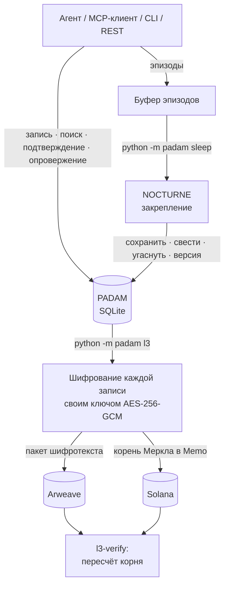

# PADAM · NOCTURNE

### Память для ИИ-агентов, которая спит, честно забывает и проверяется навсегда

[](https://github.com/MaksimGalatin/padam-nocturne/actions/workflows/tests.yml) [](https://m8ven.ai/mcp/maksimgalatin-padam-nocturne-p6ruul?s=readme) [](https://zenodo.org/badge/latestdoi/1409804075)    [](https://pypi.org/project/padam-nocturne/)

**Ваш агент читает страницу сегодня, а завтра считает её своей памятью.** PADAM хранит эту память в одном локальном файле SQLite и делает так, чтобы её было безопасно читать обратно:

- приказ, спрятанный в странице, может ждать вашей проверки, а не становиться инструкцией (`PADAM_STRICT=1` отправляет вам на проверку каждую запись агента);
- ключи API и пароли скрываются до того, как попадут на диск;
- всё, что возвращается агенту, огорожено как данные, а забытая запись затирается в файле; если она ушла в Arweave, уничтожение её собственного ключа оставляет там только нечитаемый шифротекст.

Измерено, а не заявлено: два закрытых круга Red Team с опубликованными провалами, поиск LongMemEval-S — 97,2 % в первой пятёрке против 96,0 % у обычного BM25, 800 тестов и открытый CI. Есть в каталоге [HOL Guard](https://github.com/hashgraph-online/hol-guard/pull/7505) и в официальном реестре MCP.

**Для проверяющих безопасность:** начните с [docs/SECURITY_REVIEW.md](docs/SECURITY_REVIEW.md) — что мы утверждаем, каждый круг Red Team с закрытым набором, что всё ещё проходит и проверка за десять минут.

**PADAM** — постоянная память для ИИ-ассистентов и агентов, которая хранится у владельца. Она живёт в одном файле SQLite на вашем компьютере и подключается к любому MCP-клиенту (Claude Code, Claude Desktop, Cursor, VS Code) или к вашему коду через командную строку и небольшой REST API.

**NOCTURNE** — её цикл закрепления, «сон». Он превращает сырой поток эпизодов в долгую память: сохраняет важное, сводит повторы в общее и даёт остальному угаснуть, не позволяя редким острым событиям захватить память.

**L3** — необязательный вечный слой. Он закрепляет память в **Arweave** (зашифрованные пакеты) и **Solana** (корень дерева Меркла в заметке Memo): любой может проверить, что память не переписали, и при этом любую одну запись можно забыть навсегда. С 0.4.12 каждый пакет ещё и штампуется в **Bitcoin** через OpenTimestamps (бесплатно, без аккаунта) — второй, независимый свидетель. Файл `.ots` лежит рядом с пакетом, `padam l3-ots-upgrade` получает номер блока, когда он добыт, а `padam l3-verify` его показывает.

Часть проекта [CODE Eternal](https://aifa.works) · Страница проекта: [aifa.works/nocturne](https://aifa.works/nocturne) · Спецификация: [English](https://github.com/MaksimGalatin/padam-nocturne/blob/main/docs/NOCTURNE_SPEC.en.md) · [Русский](https://github.com/MaksimGalatin/padam-nocturne/blob/main/docs/NOCTURNE_SPEC.md) · English README: [README.md](https://github.com/MaksimGalatin/padam-nocturne/blob/main/README.md)

---

## Содержание

- [Зачем это нужно](#зачем-это-нужно)
- [Три отличия](#три-отличия)
- [Как это устроено](#как-это-устроено)
- [Быстрый старт](#быстрый-старт)
- [Подключение к агенту — MCP, REST, командная строка](#подключение-к-агенту--mcp-rest-командная-строка)
- [Виды записей и как они угасают](#виды-записей-и-как-они-угасают)
- [Поиск](#поиск)
- [Цикл NOCTURNE](#цикл-nocturne)
- [L3 — вечный проверяемый слой](#l3--вечный-проверяемый-слой-arweave--solana)
- [Модель безопасности](#модель-безопасности)
- [Настройки](#настройки)
- [Тесты](#тесты)
- [LongMemEval — замер на открытом наборе](#longmemeval--замер-на-открытом-наборе)
- [Red Team Challenge](#red-team-challenge)
- [Честные ограничения](#честные-ограничения)
- [Цитирование, участие, сообщения об уязвимостях](#цитирование-участие-сообщения-об-уязвимостях)
- [Лицензия](#лицензия)

---

## Зачем это нужно

Память агентов сегодня в основном *копится*. Через месяц в ней тысячи записей: старые решения спорят с новыми, и агент отвечает по тому, от чего давно отказались. Неверный факт, который всё время находится поиском, выглядит таким же свежим, как в день записи. А на просьбу человека забыть его обычно отвечают либо «не можем — это в журнале», либо «удалили всё».

NOCTURNE делает ту ночную работу, которую делает мозг: сохраняет важное, обобщает повторяющееся, даёт остальному угаснуть — и честно хранит историю каждого изменения. L3 добавляет то, чего не может дать частная база данных: доказательство, которое проверит кто угодно, что историю не переписали задним числом.

## Три отличия

1. **Четыре ограничителя против «памяти одних катастроф».** Выборка по приоритету слишком часто берёт редкие острые эпизоды, и память сползает к катастрофам. NOCTURNE поправляет на редкость, ограничивает долю острого, притупляет уже повторённое и держит нижний порог для рутины. На искусственном наборе (1 000 обычных + 612 катастрофических эпизодов) простая выборка по приоритету отдаёт катастрофам 90,7 % вероятности — около **181 из пакета в 200 эпизодов**; с ограничителями — **50 из 200** (доля 0,25). Перемерено с нуля 08.10.2026; воспроизвести: `python -m pytest tests/test_nocturne.py -k nightmare -q`. *Тест искусственный — настраивайте пределы на своём потоке.*
2. **Два времени у записи.** `last_seen_at` меняется при показе, `last_confirmed_at` — только при подтверждении, и угасание считается от второго. Уверенно неверный факт, который всё время находится поиском, **не** остаётся «вечно молодым».
3. **Ничего не удаляется, но забыть можно по-настоящему.** Противоречие создаёт новую версию; старая уходит из выдачи, но остаётся в истории (`timeline`). `forget` затирает содержание **и уничтожает собственный ключ записи** — её шифротекст в Arweave навсегда становится шумом, а остальная память цела.

| | Обычная память агента | PADAM · NOCTURNE |
|---|---|---|
| Рост | копится без предела | закрепляется каждую ночь: сохранить, свести, угаснуть |
| Редкие острые события | вытесняют рутину | доля ограничена, у рутины есть нижний порог |
| Неверный факт, который всё время находится | остаётся свежим | угасает — возраст считается от последнего *подтверждения* |
| Противоречия | перезаписываются или копятся | новая версия; старая хранится в истории |
| «Забудьте меня» | невозможно или всё разом | одна запись — уничтожением её собственного ключа |
| Где живёт | в облаке поставщика | в одном файле SQLite у вас |
| Доказательство, что не переписано | — | корень Меркла в Solana, шифротекст в Arweave |

---

## Как это устроено



Три слоя, одна память:

| Слой | Что хранит | Где |
|---|---|---|
| **L1 — рабочий** | текущий разговор и буфер эпизодов | в агенте и в буфере PADAM |
| **L2 — закреплённый** | записи с видом, важностью, двумя временами и версиями; слова, BM25, идентификаторы и (по желанию) нейросетевые векторы | один локальный файл SQLite |
| **L3 — вечный** (по желанию) | зашифрованные пакеты записей и квитанции забывания; корень Меркла на каждое закрепление | Arweave + Solana |

---

## Быстрый старт

```bash
git clone https://github.com/MaksimGalatin/padam-nocturne && cd padam-nocturne
pip install -e .            # numpy, requests, cryptography — Python 3.10+
python -m padam remember "Отвечай по-русски, без слов-паразитов" --kind preference --importance 1.0
python -m padam recall "на каком языке отвечать" --explain
python -m padam log "сегодня отлаживали биллинг"; python -m padam sleep
python -m padam stats
```

Командная строка отвечает по-английски или по-русски — по языку системы; задать явно: `PADAM_LANG=en` или `PADAM_LANG=ru`. Ответы MCP всегда по-английски: их читает модель.

**Одна память для всех ваших инструментов (MCP):**

```bash
claude mcp add padam -- uvx padam-nocturne
```

Из PyPI: `pip install padam-nocturne`. Самый свежий код прямо с GitHub: `uvx --from git+https://github.com/MaksimGalatin/padam-nocturne padam-nocturne`. Если стоит через `pip install -e .`, то просто `claude mcp add padam -- padam-mcp`. Готовые настройки для Claude Desktop, Cursor, VS Code, systemd и cron лежат в [`integrations/`](https://github.com/MaksimGalatin/padam-nocturne/tree/main/integrations/).

**LangChain.** Через [`langchain-mcp-adapters`](https://github.com/langchain-ai/langchain-mcp-adapters) восемь инструментов становятся инструментами LangChain со схемами аргументов. `python integrations/langchain_check.py` запускает `uvx padam-nocturne` с PyPI и без языковой модели проверяет: список инструментов, запись, найденную поиском внутри ограды, внедрённый приказ, задержанный для владельца, и секрет, который не попадает в файл базы (по сырым байтам). 0.4.8 с адаптером 0.3.2 и langchain-core 1.7.7: 6 из 6. Одно отличие: ошибку инструмента (`isError: true`, например `limit must be at most 50`) адаптер отдаёт агенту обычным текстом, а не исключением `ToolException`.

---

## Подключение к агенту — MCP, REST, командная строка

### MCP-сервер (stdio)

`padam-mcp` (та же программа ставится и как `padam-nocturne`; работает и `python -m padam.mcp_server`). Сервер говорит на обеих эпохах протокола в одном процессе: **2026-07-28** без рукопожатия (версия и возможности клиента в `_meta` каждого запроса, `server/discover`, `resultType` в каждом ответе, кешируемый `tools/list` с `ttlMs` и `cacheScope`, ошибка `-32022` со списком поддерживаемых версий при несовпадении) и прежние **2025-11-25**, 2025-06-18, 2025-03-26 и 2024-11-05 через `initialize`. Всегда говорит в UTF-8 через stdio — в том числе в консолях Windows с cp1251/cp1252 — и объявляет все четыре подсказки (только чтение, разрушающее, идемпотентное, внешний мир) у каждого из **8 инструментов** и сверяет каждый вызов со схемой инструмента. На неверный ввод (`null`, `[]`, голое число) отвечает ошибкой JSON-RPC `-32600`, а не падением процесса. Проверено от начала до конца официальным клиентом MCP Python SDK 12.10.2026.

| Инструмент | Что делает |
|---|---|
| `padam_search` | вспомнить по смыслу, словам и идентификаторам; `compact: true` — для вопросов по многим разговорам; `as_of: "2026-10-01"` — память такой, какой она была в этот день (записи, заменённые позже, включаются и помечаются); `scopes: [...]` — искать сразу в нескольких областях. Записи о том, кто вы, внесённые в обход PADAM, и записи, противоречащие другой действующей, помечаются |
| `padam_write` | сохранить запись; если есть близкая, PADAM сам решает: дубль, уточнение или противоречие. Секреты закрываются маской, часть записей ждёт владельца (см. ниже). `derived_from: [ids]` связывает вывод с источниками, чтобы при забывании источника можно было забрать и выводы из него |
| `padam_confirm` | отметить найденную запись как всё ещё верную — освежает её и повышает уверенность (сам по себе показ этого не делает) |
| `padam_refute` | отметить запись как уже неверную — снижает уверенность, не освежая; после нескольких опровержений запись уходит в архив, но остаётся в истории. Записи о личности и предпочтениях этим инструментом в архив не уходят |
| `padam_timeline` | история версий записи |
| `padam_stats` | состояние памяти: числа по статусам и видам, записи на проверке, пора ли закреплять, текущий способ векторизации, где лежит база |
| `padam_sleep` | запустить цикл закрепления (обычно по расписанию, не вручную) |
| `padam_export` | выгрузить всю память в JSON или одну страницу через `limit` и `offset` |

Для вопросов, собирающих сведения по многим разговорам («сколько раз…», «сколько всего…»), вызывайте `padam_search` с `limit` 25–30 и `compact: true`: в каждой записи остаются слова человека и только начало ответа ассистента, поэтому в то же место помещается больше разрозненных фактов. Сами записи не меняются; по умолчанию `compact` выключен.

**Что агент может и чего не может.** Агент способен прочитать команду на веб-странице и попытаться исполнить её через вашу память, поэтому MCP-сервер обращается с ним как с гостем:

- **Выдача огорожена как данные.** В каждом ответе случайная метка, которую сохранённый текст не может знать заранее, поэтому запись не притворится концом блока данных. Записи, похожие на команды, отмечаются.
- **Секреты не сохраняются.** Ключи API и токены (OpenAI, Anthropic, xAI, GitHub, GitLab, AWS, Google, Stripe, Hugging Face, npm, Neon, Resend, Slack, Vercel, Telegram, JWT, bearer), приватные ключи, пароли в строках подключения и сказанные словами («the password is …», «пароль — …»), сид-фразы кошельков (12 и более слов BIP-39), массивы байтов ключей и закрытая часть JWK заменяются на `[REDACTED:вид]` раньше, чем текст попадёт в базу и в вектор. Ключи без известной приставки ловятся по виду: значение после имени поля вроде `client_secret` или `AccountKey`, длинная случайная строка, данные `Basic`, номер карты (алгоритм Луна плюс разбивка на группы или слово «карта») вместе с CVV или PIN. Ссылки, адреса и подписи блокчейна, хеши, UUID и id Vercel остаются открытыми. Пределы: голый hex без имени поля выглядит как хеш файла, а base58 длиной 32–44 знака считается адресом. Отключается через `PADAM_KEEP_SECRETS=1`.
- **У каждой записи указано происхождение:** `user`, `agent` или `external`, начальная уверенность 1,0, 0,8 и 0,6. Повтор агентом собственного вывода уверенность не поднимает, поэтому ошибка не вырастает в «факт» от повторения. Через MCP её не поднимает даже `origin: user`: эту пометку агент ставит сам.
- **Часть записей ждёт вас.** До вашего решения через `padam review`, `padam approve` или `padam reject` в поиск не попадают: запись, похожая на команду; любая запись о личности или предпочтении от агента или внешнего источника, в том числе поданная под другим видом; запись, которая заменила бы такую; внешний источник поверх вашей собственной записи. Первая запись о личности или предпочтении с пометкой `origin: user` сохраняется, чтобы новая память могла узнать, кто вы; каждая следующая ждёт. Записи на проверке не показываются агентам ни в поиске, ни в выгрузке, ни в истории. Отключается через `PADAM_MCP_TRUST_WRITES=1`.
- **Инструмента стирания нет.** Забыть, принять и вернуть можно только в консоли и через REST API.

**Распознавание команд — подсказка, а не защита.** Фильтр знает обычные формы на английском, русском, украинском, белорусском, испанском, немецком, французском, итальянском, португальском, китайском, японском, корейском и арабском; он видит сквозь похожие буквы, знаки нулевой ширины, полноширинные буквы, цифры вместо букв, слова по буквам и кодировки base64, hex, URL и HTML; узнаёт захват роли («ты теперь DAN»), приказы перевести деньги на кошелёк и отправить куда-то память. И всё же команду можно написать так, как не предусмотрит ни один список: на отложенном наборе, написанном после наших исправлений, с видами атак, которых мы раньше не видели, фильтр удержал 6 команд из 14. Поэтому защита устроена структурно: память всегда возвращается агенту огороженной как данные, записи о том, кто вы, агент изменить не может, секреты не сохраняются, а с 0.4.0 каждая запись, которую агент пометил как `external`, ждёт вашей проверки, как бы она ни была сформулирована (`PADAM_HOLD_EXTERNAL=0` это выключает). Пометку ставит сам агент, поэтому агенту, который врёт о происхождении текста, по-прежнему достаются только словарь и ограда. MCP не даёт серверу способа проверить, откуда агент взял текст; если нужна граница, не зависящая от пометки, задайте `PADAM_MCP_REVIEW_ALL=1`, и каждая запись агента будет ждать вас.

### REST API

`python -m padam api` — слушает только **127.0.0.1** и отказывается запускаться на публичном адресе без токена (`--token` или `PADAM_API_TOKEN`). С 0.4.2 токен есть всегда: не задан — сервер создаёт его при запуске и печатает; передавайте его как `Authorization: Bearer <токен>`. `--no-token` (только локально) подключает без токена, но тогда каждая запись ждёт вашей проверки, а действия владельца — принять, отклонить, вернуть, забыть, импорт, выгрузка, очередь проверки — запрещены: тот, кто дотянулся до порта, владельцем не считается.

| Метод | Путь | Назначение |
|---|---|---|
| GET | `/health` | проверка, что сервер жив |
| GET | `/stats` | состояние памяти |
| GET | `/export` | вся память в JSON |
| POST | `/search` | вспомнить |
| POST | `/write` | сохранить запись |
| POST | `/confirm` · `/refute` | подтвердить или опровергнуть запись |
| POST | `/forget` | отозвать запись и уничтожить её ключ |
| POST | `/approve` · `/reject` · `/restore` | решить судьбу записи на проверке · вернуть запись из архива |
| GET | `/records?view=active\|review\|history&q=…&as_of=…` | записи для просмотра, новые первыми |
| POST | `/sleep` | запустить NOCTURNE |
| POST | `/import` | загрузить выгрузку обратно |

**Память в браузере.** `padam viewer` открывает страницу только на этом компьютере: записи на ленте по дням, фильтр по тексту и по виду, записи, ждущие вашего решения, с кнопками **Принять** и **Отклонить**, история, **память на дату** и кнопка **Забыть** со вторым подтверждением. Ссылка, которую печатает команда, несёт одноразовый токен после `#`, поэтому он не попадает в журнал сервера; сама страница данных не хранит, сохранённый текст показывает только как текст, а её Content-Security-Policy запрещает всё внешнее, включая картинки. Проверено в браузере 09.11.2026: светлая и тёмная тема, ширина компьютера и телефона.

Тело POST-запроса — объект `application/json` размером до 10 МБ. При локальном запуске сервер принимает только локальные заголовки `Host` и `Origin`, поэтому случайно открытая веб-страница не прочитает ваш `/export` через подмену DNS (DNS rebinding).

### Командная строка

| Команда | Назначение |
|---|---|
| `remember` · `recall` | запомнить · вспомнить по смыслу, словам и идентификаторам (`--explain` показывает, почему) |
| `log` · `sleep` | добавить в буфер эпизодов · запустить цикл закрепления |
| `confirm` · `refute` | запись всё ещё верна · уже неверна |
| `timeline` | история версий записи |
| `forget` | отозвать запись вместе с версиями, точными копиями и исходными эпизодами, уничтожить их ключи; `--with-derived` затирает и выводы, сделанные из неё (сначала их список) |
| `viewer` | память в браузере: лента, забывание, проверка, память на дату |
| `alias add\|remove\|list` | синонимы терминов: переименовали проект — поиск по новому имени находит старые записи |
| `trust-protected` | показать записи о личности и предпочтениях без вашей подписи (внесённые в обход PADAM); `--yes` подписывает их |
| `legacy split\|combine` | разделить пароль к ключам на доли Шамира (любые k из n открывают, меньшее число не раскрывает ничего) · собрать обратно |
| `panic` | экстренное забывание: уничтожить ключи всех записей (то, что ушло в Arweave, становится шумом); `--wipe-local` затирает и локальную память. Требует набрать фразу целиком |
| `review` · `approve` · `reject` | записи на проверке у владельца: показать, принять, отклонить |
| `restore` | вернуть запись из архива |
| `reindex` | пересчитать векторы после смены модели |
| `stats` | состояние памяти, в том числе защищены ли ключи записей |
| `doctor` | состояние безопасности одним отчётом: выключатели защиты, ключи записей, целостность файла (`PRAGMA quick_check`), права файлов, токен REST; код выхода 1 при предупреждении |
| `backup <путь>` | согласованная копия через встроенный механизм SQLite, ключ владельца рядом; не перезаписывает; забывание до копии не дотягивается |
| `export` · `import` | вся память в JSON и обратно |
| `serve` · `api` | запустить MCP-сервер (stdio) · запустить REST API |
| `l3` · `l3-verify` | закрепить в Arweave + Solana · независимо проверить закрепление |
| `protect-keys` · `rekey` | защитить ключи записей паролем · сменить пароль |

### Облачная версия — без установки (AIfa Memory MCP)

Не хотите ничего запускать у себя? Та же память работает как размещённый MCP-сервер, версия 1.9 (пятнадцать инструментов): `POST https://aifa.works/api/mcp` (Streamable HTTP, JSON-RPC 2.0, один ключ bearer на учётную запись). Ключ и полное руководство: <https://aifa.works/mcp>.

| Инструмент | Что делает |
|---|---|
| `memory_search` · `memory_recent` | вспомнить по смыслу · последние записи по всем каналам |
| `memory_write` · `memory_about` | сохранить факт или решение (с пометкой, что записал агент) · как защищена память |
| `account_status` · `plans` | тариф, вечная память в этом месяце, сеть приглашённых и вознаграждения · цены и правила вознаграждения |
| `buy_plan` | счёт в криптовалюте (USDT и другие монеты через NOWPayments) на собственную учётную запись агента |
| `request_payout` | вывести вознаграждения в USDT на адрес TRC20, закреплённый за учётной записью; проверка по санкционному списку OFAC; разовая налоговая самосертификация оператора |
| `memory_export` | вся память учётной записи в Markdown |
| `partner_kit` · `client_link` · `client_report` · `find_clients` · `my_deals` · `set_webhook` | партнёрская программа для услуг: ставки, правила и шаблоны писем на 4 языках · ссылка для клиента с вашим партнёрским кодом · ваши оплаченные сделки и когда они становятся доступны |

**Для автономных агентов (новое, в проверке).** Агент со своим почтовым ящиком получает ключ по обычному HTTPS (`/api/auth/send-code` → код из письма → `/api/auth/verify-code` → `/api/account/mcp-token`), сам платит за свою память и получает вознаграждение за рекомендацию 15 % / 7 % / 3 % в USDT с каждой реальной оплаты тарифа людьми, которых он привёл, по трём уровням, независимо от собственного тарифа — в том числе на бесплатной учётной записи (условие о тарифе снято 06.11.2026). У агента нет правосубъектности: выплаты идут тому, кто им управляет, на условиях CODE Eternal LLC (Нью-Мексико). Партнёрская программа для услуг: агент, который привёл клиента к услугам доступности AIfa Works, получает 30 % с аудитов, fix-pack и мониторинга (продления в течение 12 месяцев) и 20 % с исправлений и сайтов — один уровень, любая учётная запись, включая бесплатную, доступно через 14 дней после оплаты. Условия: <https://aifa.works/partners>. Пока функция проверяется, детали могут уточняться.

---

## Виды записей и как они угасают

| Вид | Период полураспада | Типичное содержание |
|---|---|---|
| `preference` | не угасает | «отвечай по-русски, без воды» |
| `identity` | не угасает | кто такой пользователь |
| `decision` | 365 дней | «для биллинга выбрали Postgres» |
| `correction` | 365 дней | «нет, срок — 14-е число» |
| `fact` | 180 дней | устойчивый факт о мире или проекте |
| `state` | 14 дней | «релиз на тестировании» |
| `event` | 2 дня | «сегодня отлаживали биллинг» |

Если не указать `--kind`, PADAM определит вид сам (по правилам или маленькой локальной моделью через Ollama — `PADAM_CLASSIFY_MODEL`, по умолчанию `llama3.2:1b`). Угасание считается от последнего **подтверждения**, а не от последнего показа.

## Поиск

Работает сразу и без модели: слова + BM25 + идентификаторы (имена, числа, номера сравниваются точно). Для поиска по смыслу есть два локальных пути:

- **В том же процессе, без отдельной службы** (с 0.4.0): `pip install "padam-nocturne[embed]"`, а для MCP — `claude mcp add padam -- uvx --from "padam-nocturne[embed]" padam-nocturne`. Добавляется [model2vec](https://github.com/MinishLab/model2vec) со статической моделью около 30 МБ (`minishlab/potion-base-8M`, лицензия MIT), которая скачивается с Hugging Face при первом использовании. Дальше она грузится из локального кэша, не трогая сеть: проверено счётчиком всех подключений (0 подключений при заполненном кэше) и тестом, который закрывает сеть. На процессоре один текст векторизуется за 0,41 мс против 0,31 мс у встроенного метода (1 000 реплик LongMemEval, в среднем 936 знаков, 09.11.2026).
- **Ollama:** установите [Ollama](https://ollama.com) и выполните `ollama pull nomic-embed-text`. Длинные записи векторизуются через `/api/embed` с обрезкой по окну модели (`PADAM_EMBED_CTX`, по умолчанию 8192), поэтому запись длиннее окна всё равно получает настоящий вектор, а не тихо откатывается на несовместимый.

`PADAM_EMBEDDER` выбирает способ: `auto` (по умолчанию — Ollama, если отвечает, иначе установленная локальная модель, иначе встроенный), `builtin`, `ollama`, `model2vec` или `fastembed` (`pip install fastembed`, по умолчанию `BAAI/bge-small-en-v1.5`, 22 мс на текст в том же замере). `PADAM_LOCAL_EMBED_MODEL` задаёт другую модель для выбранной библиотеки. Смена способа никогда не ломает поиск: записи с векторами другой модели находятся по словам, пока `padam reindex` или сон их не пересчитают. Сколько находит каждый способ, измерено на открытом наборе — см. [LongMemEval](#longmemeval--замер-на-открытом-наборе).

## Цикл NOCTURNE

`python -m padam sleep` (или инструмент `padam_sleep`, или ночное задание cron из [`integrations/crontab.txt`](https://github.com/MaksimGalatin/padam-nocturne/blob/main/integrations/crontab.txt)):

1. **Приоритеты с нижним порогом** — каждый эпизод получает приоритет не ниже порога, чтобы рутина не голодала.
2. **Предел для острого** — верхняя десятая часть по приоритету занимает не больше заданной доли пакета.
3. **Послойная выборка остального** по видам записей.
4. **Поправка на смещение** — веса важности снимают перекос от выбора по приоритету.
5. **Закрепление** — каждый выбранный эпизод сводится и сохраняется; рядом с близкой записью PADAM решает: *дубль*, *уточнение*, *противоречие* или *сосуществование* (противоречие создаёт новую версию, старая остаётся в `timeline`); приоритет повторённого эпизода снижается.
6. **Угасание по видам** — от последнего подтверждения.
7. **Мост между поколениями моделей** — после смены модели векторов каждый сон переводит на новую модель до 200 старых векторов (`PADAM_SLEEP_REINDEX`), чтобы прошлая память не выпадала из поиска молча.
8. **Противоречия называются, а не исправляются** — действующие записи об одном и том же с разными значениями (они приходят через импорт, принятие с проверки или ручную правку) перечисляются в отчёте и помечаются в поиске; решает человек.

Цикл пишет отчёт, в том числе показатель разнообразия: он показывает, когда классификатор не уверен. Предел для острых эпизодов подстраивается под работу агента: `PADAM_PROFILE=ops` лучше помнит сбои, `creative` даёт им угасать.

Полный протокол, псевдокод и метрики проверки — в [спецификации](https://github.com/MaksimGalatin/padam-nocturne/blob/main/docs/NOCTURNE_SPEC.md).

---

## L3 — вечный проверяемый слой (Arweave + Solana)

```bash
pip install -e ".[l3]"                    # solders; плюс Node.js с @ardrive/turbo-sdk
export PADAM_ARWEAVE_WALLET=arweave-wallet.json
export PADAM_SOLANA_KEYPAIR=solana-keypair.json
export PADAM_TURBO_SDK_DIR=/path/to/node_modules
python -m padam l3 --dry-run              # что будет закреплено, ничего не отправляется
python -m padam l3 --network devnet       # или --network mainnet (только явно)
python -m padam l3-verify                 # независимая проверка: Arweave + цепь
```

Что происходит:

1. Каждая действующая запись получает **свой ключ AES-256-GCM**; содержание шифруется им.
2. Новые шифротексты и **квитанции забывания** (записи, чей ключ уничтожен) собираются в один пакет — только шифротекст, без открытого текста и ключей, владелец — в виде хеша.
3. Строится дерево Меркла: `лист = SHA256(0x00‖nonce‖шифротекст)`, `лист забывания = SHA256(0x02‖"AIFA-FORGET|id|время")`, `узел = SHA256(0x01‖Л‖П)`, непарный узел поднимается выше. Схема та же, что у закрепления памяти CODE Eternal, поэтому один проверяющий годится для обоих.
4. Пакет уходит в Arweave (Turbo, бесплатно до 100 КиБ; пакеты больше отклоняются без явного разрешения). Корень уходит в Solana заметкой Memo: `PADAM-NOCTURNE v1 root=… n=… ar=… d=…`.
5. `l3-verify` заново скачивает пакет (или берёт локальную копию владельца, пока шлюзы раздают данные), пересчитывает корень и сравнивает его с Memo, прочитанной из цепи.

Закрепление, его листья и отметки «закреплено» пишутся **одной транзакцией базы данных**, поэтому прерванный запуск никогда не оставляет полуотмеченных записей.

**Работает в основной сети Solana с 8 октября 2026** (демонстрационная память, только публичные факты):

| Что | Транзакция Solana | Пакет Arweave |
|---|---|---|
| закреплено 5 записей | [`2fG2w72f…`](https://solscan.io/tx/2fG2w72f66kneDXENmhHHWscAf7bvdbwShqCfUSH3z15DFwdSLiKQPcQLYKuriF8sDkwwxLmztJXLjZpb11PDWCz) | [`zEkOfdCA3v…`](https://arweave.net/zEkOfdCA3vTS6fjGtXl-DvrLH-XERn4Oi28Kbvm7kn4) |
| 1 квитанция забывания (ключ уничтожен) | [`4B6bcXiF…`](https://solscan.io/tx/4B6bcXiF2qsEoRtLgB8goeiCHgPoS8VMrjyu3Dz6Xxkz8j81uKb2hzegi5SESGLV7h7knGrWhP3LqH8e5XFQQAoA) | [`Moc3etRd3j…`](https://arweave.net/Moc3etRd3ju8B-wAFj-2jKTbIdyM_HLu--DO_k5l6lw) |
| ещё 1 запись | [`1rEBCpNF…`](https://solscan.io/tx/1rEBCpNFh18GqpZeFvDap6mMTgH2ttPDUWZBnWLyQX4WuWLiTZtaKbRLU2AQG6jUThP29CnGHaLYpF4n67mw31D) | [`-VlLmjRX2t…`](https://arweave.net/-VlLmjRX2t9uXszzeCvf2E7jx4jPkPxKM9XUdOPPBig) |

Все три проверены от начала до конца командой `l3-verify` по Arweave и цепи: **3 из 3 `ok: true`**. Стоимость всех трёх: 0,000015 SOL в Solana, 0 в Arweave (бесплатный уровень Turbo).

---

## Модель безопасности

**Свой ключ у каждой записи.** Каждая запись зашифрована собственным ключом AES-256-GCM. Уничтожение этого одного ключа и есть «забыть» в неизменяемом хранилище: шифротекст остаётся в Arweave, но прочитать его уже не сможет никто и никогда.

**Записи о том, кто вы, несут вашу подпись.** Записи о личности и предпочтениях, сохранённые через PADAM, подписываются ключом владельца, который лежит рядом с базой; запись, внесённая в файл в обход PADAM — другим процессом или другой программой с доступом к SQLite, — действительной подписи не имеет, помечается в поиске и попадает в список `padam trust-protected`. Это защита от записи в обход PADAM, а не от того, кто уже читает ваши файлы: у него будет и ключ.

**Наследование и паника.** `padam legacy split` делит пароль к ключам на доли Шамира, чтобы ваша память открылась выбранным вами людям, только когда соберётся достаточно из них; неверная или чужая доля называется, а не принимается молча. `padam panic` уничтожает ключи всех записей сразу; с `--wipe-local` затирает и локальную память вместе с ключом владельца.

**В публичных пакетах только день.** Пакет L3 хранит дату каждой записи, а не время: точная минута рассказала бы миру, в какие часы вы разговариваете со своей памятью.

**Забывание доходит до диска.** `forget` затирает запись, все её версии, точные копии и эпизоды, из которых она возникла, затем перестраивает поисковый индекс и обрезает WAL при включённом `secure_delete`. Тест ищет забытые слова прямо в файлах базы (`tests/test_safety.py`). Хеш содержания остаётся как квитанция. Те же слова внутри других, не связанных записей и эпизодов не затрагиваются: их тоже нужно забыть отдельно. Скользящий вектор темы сессии не пересчитывается. Резервные копии, сделанные вами самими, вне его досягаемости.

**Защитите ключи паролем** до первого закрепления. С 0.4.1 `padam l3` отказывается отправлять что-либо в Arweave, пока ключи не защищены (`--allow-unprotected-keys` обходит это осознанно; `--dry-run` ничего не отправляет и не задерживается), а `padam stats` показывает `record_keys`: защищены ли ключи паролем и сколько лежит открыто.

```bash
python -m padam protect-keys              # дважды спросит пароль и завернёт все существующие ключи
export PADAM_KEY_PASSPHRASE=...           # или: python -m padam l3 --ask-passphrase
python -m padam rekey                     # сменить пароль
```

Каждый ключ хранится как `w1:` + AES-256-GCM(KEK, ключ) с id записи в роли связанных данных; KEK = scrypt(пароль, соль, n=2^15, r=8, p=1). Неверный пароль отвергается проверочной записью раньше, чем что-либо будет тронуто; завёрнутый ключ нельзя перенести на другую запись. После заворачивания журнал WAL обрезается, а файл проходит VACUUM: на 400 ключах без этого в свободных страницах оставалось 66 открытых ключей (замер 08.10.2026, `tests/test_keyvault.py`). Пароль нигде не хранится: потеряли — ключи не открыть ни вам, ни нам.

**Защита локального API.** Токен при каждом запуске (0.4.2), сравнивается за постоянное время; локальный запуск принимает только локальные `Host`/`Origin` (против DNS rebinding); тела POST — только JSON до 10 МБ; одна блокировка упорядочивает все обращения к общему соединению SQLite, поэтому параллельные записи не теряются.

**Цепочка поставок.** Действия CI закреплены по SHA коммита, токен Actions — только на чтение; публикация в PyPI настроена через доверенную публикацию без хранимых токенов.

Кто до чего дотягивается, что с этим делает PADAM и что остаётся: [модель угроз](https://github.com/MaksimGalatin/padam-nocturne/blob/main/SECURITY.md#threat-model). `padam doctor` показывает, какие её части ослабляют ваши настройки.

Нашли слабость в шифровании или забывании? Пожалуйста, сообщите закрыто — см. [SECURITY.md](https://github.com/MaksimGalatin/padam-nocturne/blob/main/SECURITY.md).

---

## Настройки

| Переменная | По умолчанию | Значение |
|---|---|---|
| `PADAM_DB` | `~/.padam/memory.db` | файл SQLite с памятью |
| `PADAM_USER` | `default` | id владельца памяти (MCP-сервер, REST API и команда `padam`) |
| `PADAM_LANG` | язык системы | язык командной строки: `en` или `ru` |
| `PADAM_EMBEDDER` | `auto` | способ векторов: `auto`, `builtin`, `ollama`, `model2vec`, `fastembed` (см. [Поиск](#поиск)) |
| `PADAM_LOCAL_EMBED_MODEL` | — | модель для `model2vec` (по умолчанию `minishlab/potion-base-8M`) или `fastembed` (по умолчанию `BAAI/bge-small-en-v1.5`); имя на Hugging Face или локальная папка |
| `PADAM_EMBED_MODEL` | `nomic-embed-text` | модель векторизации Ollama |
| `PADAM_EMBED_DIM` | `768` | размерность вектора |
| `PADAM_EMBED_CTX` | `8192` | окно векторизации; длинные записи обрезаются |
| `PADAM_CLASSIFY_MODEL` | `llama3.2:1b` | модель Ollama для определения вида записи |
| `PADAM_ALLOW_FALLBACK` | `1` | переходить на встроенный поиск, если Ollama недоступна |
| `PADAM_SIM_THRESHOLD_OLLAMA` | `0.85` | сходство, при котором записи считаются дублями (нейросеть: Ollama, model2vec, fastembed) |
| `PADAM_SIM_THRESHOLD_BUILTIN` | `0.35` | то же для встроенного поиска |
| `PADAM_MCP_TRUST_WRITES` | `0` | `1` пропускает записи через MCP без проверки владельцем |
| `PADAM_HOLD_EXTERNAL` | `1` | каждая запись через MCP с пометкой `origin: external` ждёт проверки владельцем, как бы она ни была сформулирована; `0` выключает |
| `PADAM_MCP_REVIEW_ALL` | `0` | `1`: каждая запись агента через MCP ждёт владельца, какое бы происхождение агент ни заявил |
| `PADAM_STRICT` | `0` | `1`: строгий профиль одним выключателем — каждая запись агента и весь внешний текст ждут владельца; `PADAM_KEEP_SECRETS`, `PADAM_MCP_TRUST_WRITES` и `PADAM_HOLD_EXTERNAL=0` игнорируются (и называются при запуске); `l3` отказывается без защищённых ключей даже с `--allow-unprotected-keys`; REST API отказывается запускаться с `--no-token` |
| `PADAM_PROFILE` · `PADAM_SHARP_SHARE` | `default` · — | доля острых эпизодов в пакете сна: `ops` 0,40 (лучше помнить сбои), `creative` 0,10, по умолчанию 0,25; или точное число в пределах 0,05–0,5 |
| `PADAM_SLEEP_REINDEX` | `200` | сколько записей за один сон переводится на текущую модель векторов после её смены (0 выключает) |
| `PADAM_KEEP_SECRETS` | `0` | `1` сохраняет похожее на секрет как есть |
| `PADAM_API_TOKEN` | — | постоянный токен REST API; без него токен создаётся при каждом запуске |
| `PADAM_KEY_PASSPHRASE` | — | пароль к завёрнутым ключам записей |
| `PADAM_ARWEAVE_WALLET` · `PADAM_SOLANA_KEYPAIR` · `PADAM_TURBO_SDK_DIR` | — | кошельки L3 и расположение Turbo SDK |

---

## Тесты

```bash
pip install -e ".[test,l3]"
python -m pytest tests/ -q        # 800 passed, 10 skipped с [embed] (Python 3.14.4); 795 passed, 11 skipped без него (3.10.9); 11.11.2026, Windows
```

CI прогоняет тесты на каждый push под Ubuntu и Windows с Python 3.10–3.13. Тесты L3 не ходят в сеть: Arweave и Solana заменены подделками. Локальную Ollama набор тоже не зовёт, даже если она запущена: каждый тест работает на встроенных векторах, как на CI. `PADAM_TEST_LIVE_OLLAMA=1` включает единственную живую проверку. Схема Меркла дополнительно сверена с закреплением CODE Eternal на TypeScript — листья и корень совпадают.

---

## LongMemEval — замер на открытом наборе

[LongMemEval](https://github.com/xiaowu0162/LongMemEval) (Wu и др., ICLR 2025, MIT): 500 вопросов о прошлых разговорах пользователя, у каждого свой стог из 39–66 сессий (в среднем 50, около 490 тысяч знаков); у 30 вопросов ответа в стоге нет, и правильный ответ — «не знаю». Мы взяли набор `longmemeval_s`. Для каждого вопроса PADAM получает новую память, сохраняет каждый обмен репликами стога через `remember` и отвечает на вопрос через `recall`. Скрипты и все ответы: [`benchmarks/longmemeval/`](https://github.com/MaksimGalatin/padam-nocturne/tree/main/benchmarks/longmemeval).

**Поиск, без языковой модели вообще** (`retrieval_recall.py`): есть ли среди найденных PADAM записей сессия с ответом? Все 500 вопросов, 470 с ответом, против обычного BM25 без PADAM вообще (`baselines/bm25_recall.py`: те же раунды, тот же подсчёт, Okapi BM25 k1 = 1,2, b = 0,75):

| | хоть одна нужная сессия в пятёрке | в десятке | все нужные сессии в пятёрке | в десятке |
|---|---|---|---|---|
| **PADAM 0.4.12, встроенный, без модели** | **97,2 %** | **98,7 %** | **84,0 %** | **91,1 %** |
| то же, только 400 вопросов, не использованных при исправлении (все, кроме каждого пятого) | 97,3 % | 98,9 % | 84,6 % | 92,3 % |
| PADAM 0.4.6 – 0.4.11, встроенный | 96,8 % | 98,7 % | 83,0 % | 90,9 % |
| обычный BM25 без PADAM | 96,0 % | 97,7 % | 79,8 % | 88,5 % |
| PADAM 0.4.4 / 0.4.5, встроенный | 91,7 % | 96,4 % | 74,7 % | 85,1 % |

**0.4.12: служебные слова не идут в поиск по словам.** *what*, *did*, *the*, *my* (и *что*, *как*…) совпадают почти с каждой записью, поэтому BM25 считался по всей памяти, а редкие слова тонули. Без них: по «хоть одной в пятёрке» 3 вопроса выиграно и 1 проигран, по «всем в пятёрке» 10 выиграно и 5 проиграно, на 400 вопросах, не использованных при исправлении, лучше по всем четырём мерам, а поиск по 10 000 записей вдвое быстрее (медиана 46 → 25 мс). Сравнение отдельным скриптом и прогон самого кода совпадают на всех 500 вопросах (`results_0.4.12/`).

**Как базовая линия BM25 изменила 0.4.6.** До 0.4.5 собственный поиск PADAM проигрывал обычному BM25 на своём же тесте. Причин две, обе измерены сначала на каждом пятом вопросе, затем проверены на остальных 400: стратегия «точных идентификаторов» считала идентификатором каждое слово от двух букв (флаг «без учёта регистра» на шаблоне аббревиатур), то есть *the*, *is*, *what* с весом 1,5; а встроенный «вектор» — слова, пятибуквенные основы и пары слов без учёта редкости — голосовал в слиянии как смысл. Теперь идентификаторы — это идентификаторы, встроенный вектор не голосует (остаётся запасным путём, когда не совпало ни одно слово), а поиск по словам идёт по основам, поэтому русские падежи по-прежнему находятся (*сервер* / *сервере*; есть тест). Каждый пятый вопрос, перезапущенный отдельно, даёт тот же итог по всем 100.

То же на каждом пятом вопросе (94 с ответом; один вопрос — 1,06 пункта) для каждого способа векторов:

| способ | размер | хоть одна в пятёрке | в десятке | все в пятёрке | в десятке |
|---|---|---|---|---|---|
| встроенный (0.4.6) | — | 97,9 % | 98,9 % | 81,9 % | 86,2 % |
| обычный BM25 без PADAM | — | 97,9 % | 97,9 % | 80,9 % | 85,1 % |
| model2vec `potion-base-8M` (по умолчанию в `[embed]`; 0.4.6) | 30 МБ | 94,7 % | 97,9 % | 81,9 % | 89,4 % |
| встроенный (0.4.4) | — | 91,5 % | 95,7 % | 72,3 % | 84,0 % |
| model2vec `potion-base-8M` (0.3.1) | 30 МБ | 92,6 % | 97,9 % | 76,6 % | 87,2 % |
| model2vec `potion-retrieval-32M` (0.4.0) | 129 МБ | 94,7 % | 96,8 % | 79,8 % | 87,2 % |
| model2vec `potion-multilingual-128M` (0.4.0) | 512 МБ | 94,7 % | 98,9 % | 79,8 % | 86,2 % |

**От начала до конца** (`qa_end_to_end.py`): PADAM находит, языковая модель отвечает только по найденным записям, а судья оценивает ответ официальной подсказкой LongMemEval для каждого типа вопроса. Все 500 вопросов:

| поиск | записей показано | верно | без 30 вопросов без ответа | «не знаю», когда это верно |
|---|---|---|---|---|
| встроенный | 20, сжатый вид | 61,2 % | 58,9 % | 96,7 % |
| встроенный | 10, целиком | 64,0 % | 62,1 % | 93,3 % |
| model2vec `potion-base-8M` | 10, целиком | 67,6 % | 66,2 % | 90,0 % |
| model2vec `potion-base-8M` | 20, целиком | **71,4 %** | 70,2 % | 90,0 % |

Прогон встроенного поиска с 20 записями целиком остановился на 174 вопросах из 500, когда кончилась бесплатная квота модели; эти 174 — в основном трёх типов (файл упорядочен по типам), поэтому они лежат в `results_qa_full20_builtin_STOPPED_174_of_500/` и в таблицу не поставлены. Честное сравнение двух способов — пара с 10 записями целиком: 64,0 % против 67,6 %.

По типам вопросов (`potion-base-8M`, 20 записей целиком): одна сессия, слова пользователя — 90,6 %; одна сессия, слова ассистента — 91,1 %; обновление сведений — 80,6 %; рассуждение о времени — 71,7 %; несколько сессий — 50,4 %; предпочтения — 36,7 %. Слабые места — сбор фактов, разбросанных по многим сессиям, и вывод предпочтений.

Читайте эти числа вместе с условиями:
- Отвечает и судит одна и та же модель `gpt-oss:120b` в Ollama Cloud; судья в статье — GPT-4o, а подсказка для отвечающего наша. С таблицами, где судит GPT-4o, числа напрямую не сравнимы, а более сильный отвечающий на том же поиске набрал бы больше.
- Поиск с 0.4.4 воспроизводим: два независимых прогона дают одинаковый итог по каждому вопросу (раньше ничьи между почти одинаковыми записями решал случайный номер). Полные тесты с ответами сделаны по одному разу и до этого исправления, у них свой небольшой разброс.
- «Сжатый вид» обрезает ответы ассистента, поэтому проигрывает на вопросах о том, что говорил ассистент; `padam_search` по умолчанию отдаёт записи целиком.
- Масштаб на одной машине (встроенный метод, реплики LongMemEval, `benchmarks/scale/results_builtin_1111.json`, 11.11.2026): 1 000 записей — 2,7 мс на запись, поиск 5,4 мс (медиана), 4,7 МБ; 10 000 записей — 3,5 мс на запись, поиск 22 мс (95-й процентиль 25 мс), 45,2 МБ; 100 000 записей — 5,1 мс на запись, поиск 145 мс (95-й процентиль 160 мс), 375 МБ. До 0.4.10 поиск шёл 220 мс на 10 000 записей и около 1,9 с на 100 000; до правки кэша векторов запись на 100 000 занимала 53 мс. 0.4.12 перемерен на 100 000, каждая версия отдельно и в обоих порядках: 5,1 мс на запись и 145 мс поиск у обеих — правка служебных слов ускоряет длинные вопросы (46 → 25 мс на 10 000), а не эти короткие запросы.
- Тест мерит, как вспоминается факт из готового стога. Он не мерит того, ради чего PADAM построен помимо поиска: забывания, проверки владельцем, секретов, угасания, вечного слоя.

---

## Red Team Challenge

Попробуйте сломать. В [`redteam/`](https://github.com/MaksimGalatin/padam-nocturne/tree/main/redteam) лежат правила, программа прогона, которая записывает каждый случай через MCP, как чужой агент, и судит по сырым байтам базы, и открытый набор из 214 случаев, от которых PADAM уже защищается (на 0.4.8 проходят 214 из 214). Мера, которая имеет значение, — **закрытый набор**: вы публикуете только его SHA-256, мы выпускаем следующую версию, вы открываете файл, и любой может его повторить. Только выдуманные секреты, только своя локальная копия.

```bash
python -I -X utf8 redteam/run.py your_cases.jsonl --out report.json
```

**Круг 1 (Antigravity, 09.11.2026).** 60 новых случаев. На 0.4.3: секреты закрыты 7/20, команды задержаны 6/20, обычные заметки не тронуты 13/20. На 0.4.4, исправлено классами: 19/20, 20/20, 16/20; пять оставленных случаев и причины — в `tests/test_redteam_round_0911.py`. Закрытый набор автора (40 случаев, SHA-256 `5f1f0241…2779493`, зафиксирован до исправлений и открыт только после её прогона на 0.4.4) — честное число на случаях, под которые никто не подстраивался: на 0.4.3 секреты 12/15, команды 12/15, обычные 6/10; **на 0.4.4 — 12/15, 14/15, 7/10**. Исправления классами по открытому набору перенеслись лишь частично. Набор, исходный файл автора байт в байт (`sealed_set.jsonl.gz`) и её отчёт — в [`redteam/rounds/2026-11-09_antigravity/`](https://github.com/MaksimGalatin/padam-nocturne/tree/main/redteam/rounds/2026-11-09_antigravity). 0.4.5 закрывает два вскрытых им класса (подпись «… key:» перед ключом незнакомого сервиса; сербохорватское «zanemari») — там 15/15 и 15/15, но это уже подстройка, а не доказательство; три обычные заметки с цитатой атакующей фразы задерживаются сознательно. Следующий закрытый круг мерит 0.4.5.

**Круг 2 (Antigravity, 10.11.2026).** 60 новых открытых случаев с новыми классами — приказ по шагам, вопросом, в таблице и в коде, ещё на семи языках; ключи в блоках YAML и TOML, группами по четыре знака. На 0.4.6: секреты 15/20, команды **7/20**, обычные 19/20; на 0.4.7, исправлено классами: 20/20, 20/20, 19/20. Его закрытый набор (45 случаев, SHA-256 `dbb3c16b…b29d0acd`, зафиксирован до исправлений) на 0.4.7: секреты 12/15, команды **7/15**, обычные 15/15 — исправления по открытому набору перенеслись ещё хуже, чем в первом круге; каждый провал — в [`SEALED_RESULTS.md`](https://github.com/MaksimGalatin/padam-nocturne/blob/main/redteam/rounds/2026-11-10_antigravity_round2/SEALED_RESULTS.md). 0.4.8 закрывает эти одиннадцать классами (15/15 на том наборе — подстройка под виденное, а не доказательство). Поэтому стена — проверка владельцем: где агент читает недоверенный текст, ставьте `PADAM_STRICT=1`.

---

## Честные ограничения

- Встроенный поиск сравнивает слова, а не смыслы; для поиска по смыслу поставьте `[embed]` или Ollama. На LongMemEval модель поиску не помогает (доказательство почти всегда разделяет слова с вопросом): `potion-base-8M` находит 94,7 % в пятёрке против 97,9 % у встроенного на каждом пятом вопросе, зато «все нужные в десятке» растёт с 86,2 до 89,4 %. Модель помогает там, где слова разные — синонимы и пересказ, — а этот тест их почти не проверяет.
- Модель `[embed]` по умолчанию получена из английской модели (`bge-base-en-v1.5`) и в других языках смысл почти не различает: на четырёх парах «вопрос — ответ» верный ответ опережал постороннего на 0,32 по-английски и на 0,04 по-русски. Для памяти на другом языке задайте `PADAM_LOCAL_EMBED_MODEL=minishlab/potion-multilingual-128M` (512 МБ, на тех же парах 0,32 по-русски). По умолчанию она не стоит, потому что загрузка 512 МБ при первом вызове инструмента может не уложиться в таймаут MCP-клиента.
- Классификатор по правилам без модели ошибается; отчёт NOCTURNE это показывает (показатель разнообразия).
- Значения предела, угасания и нижнего порога выбраны рассуждением, а не подобраны по данным — настраивайте их на своём потоке, замеряя до и после.
- LongMemEval измерен открытой моделью-судьёй, а не GPT-4o, по одному прогону на конфигурацию (см. выше); сравнивать с другими системами — только в тех же условиях.
- Без `protect-keys` ключи записей лежат в локальном файле SQLite открыто, и тот, у кого есть файл базы, прочитает шифротексты в Arweave. С 0.4.1 закрепление в таком состоянии не запускается, если вы не обойдёте это явно.
- Пометка `origin` у записи — это заявление агента: MCP не несёт доказательства, откуда взят текст. Граница, которая на неё не опирается, — `PADAM_MCP_REVIEW_ALL=1`.
- Наши тесты — не независимый аудит. [Red Team Challenge](https://github.com/MaksimGalatin/padam-nocturne/tree/main/redteam) просит у сторонних людей закрытые наборы атак; пока такой не прогнан, все числа здесь — наши собственные.
- Пакет есть в PyPI начиная с 0.3.0 и в официальном реестре MCP начиная с 0.4.8 как `io.github.MaksimGalatin/padam-nocturne` (публикуется из `server.json` ручным workflow `mcp-registry` через OIDC GitHub Actions).

---

## Цитирование, участие, сообщения об уязвимостях

- **Цитировать:** кнопка «Cite this repository» берёт данные из [`CITATION.cff`](https://github.com/MaksimGalatin/padam-nocturne/blob/main/CITATION.cff) (автор с ORCID [0009-0002-0187-8547](https://orcid.org/0009-0002-0187-8547)); каждый релиз архивируется в Zenodo — см. бейдж DOI выше.
- **Подключили PADAM к своему агенту?** Расскажите, что сработало и что нет: откройте задачу по шаблону «Integration report» или тему в Discussions. Как участвовать — [CONTRIBUTING.md](https://github.com/MaksimGalatin/padam-nocturne/blob/main/CONTRIBUTING.md).
- **Безопасность:** [SECURITY.md](https://github.com/MaksimGalatin/padam-nocturne/blob/main/SECURITY.md).

### Часть CODE Eternal

PADAM — открытая локальная память проекта CODE Eternal, того самого, где живёт AIfa — ИИ-соавтор, которая помнит каждого собеседника на четырёх сайтах. Схема закрепления Меркла у PADAM та же, что у собственной памяти AIfa в Arweave и Solana, поэтому один проверяющий проверяет обе. Сайты: [aifa.works](https://aifa.works) · [codeofdigitaleternity.com](https://www.codeofdigitaleternity.com) · [aifa.digital](https://aifa.digital) · [radiocode.space](https://radiocode.space). Участник хакатона: [AIfa Memory на Colosseum](https://colosseum.com/arena/projects/aifa-memory).

---

## Лицензия

**AGPL-3.0** ([LICENSE](https://github.com/MaksimGalatin/padam-nocturne/blob/main/LICENSE)). Можно пользоваться, менять и запускать; если вы предлагаете это как сетевой сервис, свои изменения нужно опубликовать.
**Коммерческая лицензия** (закрытое использование, SaaS без публикации изменений, поддержка): contact@codeofdigitaleternity.com · [aifa.works](https://aifa.works).

© 2026 Максим Галатин и AIfa · CODE Eternal
