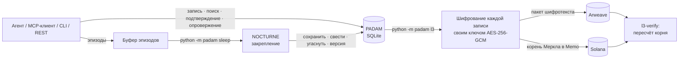

# PADAM · NOCTURNE

### Память для ИИ-агентов, которая спит, честно забывает и проверяется навсегда

[](https://github.com/MaksimGalatin/padam-nocturne/actions/workflows/tests.yml) [](https://zenodo.org/badge/latestdoi/1409804075)    

**PADAM** — постоянная память для ИИ-ассистентов и агентов, которая хранится у владельца. Она живёт в одном файле SQLite на вашем компьютере и подключается к любому MCP-клиенту (Claude Code, Claude Desktop, Cursor, VS Code) или к вашему коду через командную строку и небольшой REST API.

**NOCTURNE** — её цикл закрепления, «сон». Он превращает сырой поток эпизодов в долгую память: сохраняет важное, сводит повторы в общее и даёт остальному угаснуть, не позволяя редким острым событиям захватить память.

**L3** — необязательный вечный слой. Он закрепляет память в **Arweave** (зашифрованные пакеты) и **Solana** (корень дерева Меркла в заметке Memo): любой может проверить, что память не переписали, и при этом любую одну запись можно забыть навсегда.

Часть проекта [CODE Eternal](https://aifa.works) · Страница проекта: [aifa.works/nocturne](https://aifa.works/nocturne) · Спецификация: [English](docs/NOCTURNE_SPEC.en.md) · [Русский](docs/NOCTURNE_SPEC.md) · English README: [README.md](README.md)

---

## Содержание

- [Зачем это нужно](#зачем-это-нужно)
- [Три отличия](#три-отличия)
- [Как это устроено](#как-это-устроено)
- [Быстрый старт](#быстрый-старт)
- [Подключение к агенту — MCP, REST, командная строка](#подключение-к-агенту--mcp-rest-командная-строка)
- [Виды записей и как они угасают](#виды-записей-и-как-они-угасают)
- [Поиск](#поиск)
- [Цикл NOCTURNE](#цикл-nocturne)
- [L3 — вечный проверяемый слой](#l3--вечный-проверяемый-слой-arweave--solana)
- [Модель безопасности](#модель-безопасности)
- [Настройки](#настройки)
- [Тесты](#тесты)
- [Честные ограничения](#честные-ограничения)
- [Цитирование, участие, сообщения об уязвимостях](#цитирование-участие-сообщения-об-уязвимостях)
- [Лицензия](#лицензия)

---

## Зачем это нужно

Память агентов сегодня в основном *копится*. Через месяц в ней тысячи записей: старые решения спорят с новыми, и агент отвечает по тому, от чего давно отказались. Неверный факт, который всё время находится поиском, выглядит таким же свежим, как в день записи. А на просьбу человека забыть его обычно отвечают либо «не можем — это в журнале», либо «удалили всё».

NOCTURNE делает ту ночную работу, которую делает мозг: сохраняет важное, обобщает повторяющееся, даёт остальному угаснуть — и честно хранит историю каждого изменения. L3 добавляет то, чего не может дать частная база данных: доказательство, которое проверит кто угодно, что историю не переписали задним числом.

## Три отличия

1. **Четыре ограничителя против «памяти одних катастроф».** Выборка по приоритету слишком часто берёт редкие острые эпизоды, и память сползает к катастрофам. NOCTURNE поправляет на редкость, ограничивает долю острого, притупляет уже повторённое и держит нижний порог для рутины. На искусственном наборе (1 000 обычных + 612 катастрофических эпизодов) простая выборка по приоритету отдаёт катастрофам 90,7 % вероятности — около **181 из пакета в 200 эпизодов**; с ограничителями — **50 из 200** (доля 0,25). Перемерено с нуля 08.10.2026; воспроизвести: `python -m pytest tests/test_nocturne.py -k nightmare -q`. *Тест искусственный — настраивайте пределы на своём потоке.*
2. **Два времени у записи.** `last_seen_at` меняется при показе, `last_confirmed_at` — только при подтверждении, и угасание считается от второго. Уверенно неверный факт, который всё время находится поиском, **не** остаётся «вечно молодым».
3. **Ничего не удаляется, но забыть можно по-настоящему.** Противоречие создаёт новую версию; старая уходит из выдачи, но остаётся в истории (`timeline`). `forget` затирает содержание **и уничтожает собственный ключ записи** — её шифротекст в Arweave навсегда становится шумом, а остальная память цела.

| | Обычная память агента | PADAM · NOCTURNE |
|---|---|---|
| Рост | копится без предела | закрепляется каждую ночь: сохранить, свести, угаснуть |
| Редкие острые события | вытесняют рутину | доля ограничена, у рутины есть нижний порог |
| Неверный факт, который всё время находится | остаётся свежим | угасает — возраст считается от последнего *подтверждения* |
| Противоречия | перезаписываются или копятся | новая версия; старая хранится в истории |
| «Забудьте меня» | невозможно или всё разом | одна запись — уничтожением её собственного ключа |
| Где живёт | в облаке поставщика | в одном файле SQLite у вас |
| Доказательство, что не переписано | — | корень Меркла в Solana, шифротекст в Arweave |

---

## Как это устроено



Три слоя, одна память:

| Слой | Что хранит | Где |
|---|---|---|
| **L1 — рабочий** | текущий разговор и буфер эпизодов | в агенте и в буфере PADAM |
| **L2 — закреплённый** | записи с видом, важностью, двумя временами и версиями; слова, BM25, идентификаторы и (по желанию) нейросетевые векторы | один локальный файл SQLite |
| **L3 — вечный** (по желанию) | зашифрованные пакеты записей и квитанции забывания; корень Меркла на каждое закрепление | Arweave + Solana |

---

## Быстрый старт

```bash
git clone https://github.com/MaksimGalatin/padam-nocturne && cd padam-nocturne
pip install -e .            # numpy, requests, cryptography — Python 3.10+
python -m padam remember "Отвечай по-русски, без слов-паразитов" --kind preference --importance 1.0
python -m padam recall "на каком языке отвечать" --explain
python -m padam log "сегодня отлаживали биллинг"; python -m padam sleep
python -m padam stats
```

Командная строка отвечает по-английски или по-русски — по языку системы; задать явно: `PADAM_LANG=en` или `PADAM_LANG=ru`. Ответы MCP всегда по-английски: их читает модель.

**Одна память для всех ваших инструментов (MCP):**

```bash
claude mcp add padam -- python -m padam.mcp_server
```

Готовые настройки для Claude Desktop, Cursor, VS Code, systemd и cron лежат в [`integrations/`](integrations/).

---

## Подключение к агенту — MCP, REST, командная строка

### MCP-сервер (stdio)

`python -m padam.mcp_server` (или точка входа `padam-mcp`). Сервер договаривается о протоколе **2025-06-18** (а также 2025-03-26 и 2024-11-05), всегда говорит в UTF-8 через stdio — в том числе в консолях Windows с cp1251/cp1252 — и объявляет все четыре подсказки (только чтение, разрушающее, идемпотентное, внешний мир) у каждого из **8 инструментов**. На неверный ввод (`null`, `[]`, голое число) отвечает ошибкой JSON-RPC `-32600`, а не падением процесса. Проверено от начала до конца официальным клиентом MCP Python SDK 12.10.2026.

| Инструмент | Что делает |
|---|---|
| `padam_search` | вспомнить по смыслу, словам и идентификаторам; `compact: true` — для вопросов по многим разговорам |
| `padam_write` | сохранить запись; если есть близкая, PADAM сам решает: дубль, уточнение или противоречие |
| `padam_confirm` | отметить найденную запись как всё ещё верную — освежает её и повышает уверенность (сам по себе показ этого не делает) |
| `padam_refute` | отметить запись как уже неверную — снижает уверенность, не освежая; после нескольких опровержений запись уходит в архив, но остаётся в истории |
| `padam_timeline` | история версий записи |
| `padam_stats` | состояние памяти: числа по статусам и видам, текущий способ векторизации, где лежит база |
| `padam_sleep` | запустить цикл закрепления (обычно по расписанию, не вручную) |
| `padam_export` | выгрузить всю память в JSON |

Для вопросов, собирающих сведения по многим разговорам («сколько раз…», «сколько всего…»), вызывайте `padam_search` с `limit` 25–30 и `compact: true`: в каждой записи остаются слова человека и только начало ответа ассистента, поэтому в то же место помещается больше разрозненных фактов. Сами записи не меняются; по умолчанию `compact` выключен.

### REST API

`python -m padam api` — слушает только **127.0.0.1** и отказывается запускаться на публичном адресе без токена (`--token` или `PADAM_API_TOKEN`).

| Метод | Путь | Назначение |
|---|---|---|
| GET | `/health` | проверка, что сервер жив |
| GET | `/stats` | состояние памяти |
| GET | `/export` | вся память в JSON |
| POST | `/search` | вспомнить |
| POST | `/write` | сохранить запись |
| POST | `/confirm` · `/refute` | подтвердить или опровергнуть запись |
| POST | `/forget` | отозвать запись и уничтожить её ключ |
| POST | `/sleep` | запустить NOCTURNE |
| POST | `/import` | загрузить выгрузку обратно |

Тело POST-запроса — объект `application/json` размером до 10 МБ. При локальном запуске сервер принимает только локальные заголовки `Host` и `Origin`, поэтому случайно открытая веб-страница не прочитает ваш `/export` через подмену DNS (DNS rebinding).

### Командная строка

| Команда | Назначение |
|---|---|
| `remember` · `recall` | запомнить · вспомнить по смыслу, словам и идентификаторам (`--explain` показывает, почему) |
| `log` · `sleep` | добавить в буфер эпизодов · запустить цикл закрепления |
| `confirm` · `refute` | запись всё ещё верна · уже неверна |
| `timeline` | история версий записи |
| `forget` | отозвать запись и уничтожить её ключ |
| `stats` | состояние памяти |
| `export` · `import` | вся память в JSON и обратно |
| `serve` · `api` | запустить MCP-сервер (stdio) · запустить REST API |
| `l3` · `l3-verify` | закрепить в Arweave + Solana · независимо проверить закрепление |
| `protect-keys` · `rekey` | защитить ключи записей паролем · сменить пароль |

---

## Виды записей и как они угасают

| Вид | Период полураспада | Типичное содержание |
|---|---|---|
| `preference` | не угасает | «отвечай по-русски, без воды» |
| `identity` | не угасает | кто такой пользователь |
| `decision` | 365 дней | «для биллинга выбрали Postgres» |
| `correction` | 365 дней | «нет, срок — 14-е число» |
| `fact` | 180 дней | устойчивый факт о мире или проекте |
| `state` | 14 дней | «релиз на тестировании» |
| `event` | 2 дня | «сегодня отлаживали биллинг» |

Если не указать `--kind`, PADAM определит вид сам (по правилам или маленькой локальной моделью через Ollama — `PADAM_CLASSIFY_MODEL`, по умолчанию `llama3.2:1b`). Угасание считается от последнего **подтверждения**, а не от последнего показа.

## Поиск

Работает сразу и без модели: слова + BM25 + идентификаторы (имена, числа, номера сравниваются точно). Установите [Ollama](https://ollama.com) и выполните `ollama pull nomic-embed-text` — PADAM сам перейдёт на нейросетевые векторы. Длинные записи векторизуются через `/api/embed` с обрезкой по окну модели (`PADAM_EMBED_CTX`, по умолчанию 8192), поэтому запись длиннее окна всё равно получает настоящий вектор, а не тихо откатывается на несовместимый.

## Цикл NOCTURNE

`python -m padam sleep` (или инструмент `padam_sleep`, или ночное задание cron из [`integrations/crontab.txt`](integrations/crontab.txt)):

1. **Приоритеты с нижним порогом** — каждый эпизод получает приоритет не ниже порога, чтобы рутина не голодала.
2. **Предел для острого** — верхняя десятая часть по приоритету занимает не больше заданной доли пакета.
3. **Послойная выборка остального** по видам записей.
4. **Поправка на смещение** — веса важности снимают перекос от выбора по приоритету.
5. **Закрепление** — каждый выбранный эпизод сводится и сохраняется; рядом с близкой записью PADAM решает: *дубль*, *уточнение*, *противоречие* или *сосуществование* (противоречие создаёт новую версию, старая остаётся в `timeline`); приоритет повторённого эпизода снижается.
6. **Угасание по видам** — от последнего подтверждения.

Цикл пишет отчёт, в том числе показатель разнообразия: он показывает, когда классификатор не уверен.

Полный протокол, псевдокод и метрики проверки — в [спецификации](docs/NOCTURNE_SPEC.md).

---

## L3 — вечный проверяемый слой (Arweave + Solana)

```bash
pip install -e ".[l3]"                    # solders; плюс Node.js с @ardrive/turbo-sdk
export PADAM_ARWEAVE_WALLET=arweave-wallet.json
export PADAM_SOLANA_KEYPAIR=solana-keypair.json
export PADAM_TURBO_SDK_DIR=/path/to/node_modules
python -m padam l3 --dry-run              # что будет закреплено, ничего не отправляется
python -m padam l3 --network devnet       # или --network mainnet (только явно)
python -m padam l3-verify                 # независимая проверка: Arweave + цепь
```

Что происходит:

1. Каждая действующая запись получает **свой ключ AES-256-GCM**; содержание шифруется им.
2. Новые шифротексты и **квитанции забывания** (записи, чей ключ уничтожен) собираются в один пакет — только шифротекст, без открытого текста и ключей, владелец — в виде хеша.
3. Строится дерево Меркла: `лист = SHA256(0x00‖nonce‖шифротекст)`, `лист забывания = SHA256(0x02‖"AIFA-FORGET|id|время")`, `узел = SHA256(0x01‖Л‖П)`, непарный узел поднимается выше. Схема та же, что у закрепления памяти CODE Eternal, поэтому один проверяющий годится для обоих.
4. Пакет уходит в Arweave (Turbo, бесплатно до 100 КиБ; пакеты больше отклоняются без явного разрешения). Корень уходит в Solana заметкой Memo: `PADAM-NOCTURNE v1 root=… n=… ar=… d=…`.
5. `l3-verify` заново скачивает пакет (или берёт локальную копию владельца, пока шлюзы раздают данные), пересчитывает корень и сравнивает его с Memo, прочитанной из цепи.

Закрепление, его листья и отметки «закреплено» пишутся **одной транзакцией базы данных**, поэтому прерванный запуск никогда не оставляет полуотмеченных записей.

**Работает в основной сети Solana с 8 октября 2026** (демонстрационная память, только публичные факты):

| Что | Транзакция Solana | Пакет Arweave |
|---|---|---|
| закреплено 5 записей | [`2fG2w72f…`](https://solscan.io/tx/2fG2w72f66kneDXENmhHHWscAf7bvdbwShqCfUSH3z15DFwdSLiKQPcQLYKuriF8sDkwwxLmztJXLjZpb11PDWCz) | [`zEkOfdCA3v…`](https://arweave.net/zEkOfdCA3vTS6fjGtXl-DvrLH-XERn4Oi28Kbvm7kn4) |
| 1 квитанция забывания (ключ уничтожен) | [`4B6bcXiF…`](https://solscan.io/tx/4B6bcXiF2qsEoRtLgB8goeiCHgPoS8VMrjyu3Dz6Xxkz8j81uKb2hzegi5SESGLV7h7knGrWhP3LqH8e5XFQQAoA) | [`Moc3etRd3j…`](https://arweave.net/Moc3etRd3ju8B-wAFj-2jKTbIdyM_HLu--DO_k5l6lw) |
| ещё 1 запись | [`1rEBCpNF…`](https://solscan.io/tx/1rEBCpNFh18GqpZeFvDap6mMTgH2ttPDUWZBnWLyQX4WuWLiTZtaKbRLU2AQG6jUThP29CnGHaLYpF4n67mw31D) | [`-VlLmjRX2t…`](https://arweave.net/-VlLmjRX2t9uXszzeCvf2E7jx4jPkPxKM9XUdOPPBig) |

Все три проверены от начала до конца командой `l3-verify` по Arweave и цепи: **3 из 3 `ok: true`**. Стоимость всех трёх: 0,000015 SOL в Solana, 0 в Arweave (бесплатный уровень Turbo).

---

## Модель безопасности

**Свой ключ у каждой записи.** Каждая запись зашифрована собственным ключом AES-256-GCM. Уничтожение этого одного ключа и есть «забыть» в неизменяемом хранилище: шифротекст остаётся в Arweave, но прочитать его уже не сможет никто и никогда.

**Защитите ключи паролем** (лучше до первого закрепления):

```bash
python -m padam protect-keys              # дважды спросит пароль и завернёт все существующие ключи
export PADAM_KEY_PASSPHRASE=...           # или: python -m padam l3 --ask-passphrase
python -m padam rekey                     # сменить пароль
```

Каждый ключ хранится как `w1:` + AES-256-GCM(KEK, ключ) с id записи в роли связанных данных; KEK = scrypt(пароль, соль, n=2^15, r=8, p=1). Неверный пароль отвергается проверочной записью раньше, чем что-либо будет тронуто; завёрнутый ключ нельзя перенести на другую запись. После заворачивания журнал WAL обрезается, а файл проходит VACUUM: на 400 ключах без этого в свободных страницах оставалось 66 открытых ключей (замер 08.10.2026, `tests/test_keyvault.py`). Пароль нигде не хранится: потеряли — ключи не открыть ни вам, ни нам.

**Защита локального API.** Токен сравнивается за постоянное время; локальный запуск принимает только локальные `Host`/`Origin` (против DNS rebinding); тела POST — только JSON до 10 МБ; одна блокировка упорядочивает все обращения к общему соединению SQLite, поэтому параллельные записи не теряются.

**Цепочка поставок.** Действия CI закреплены по SHA коммита, токен Actions — только на чтение; публикация в PyPI настроена через доверенную публикацию без хранимых токенов.

Нашли слабость в шифровании или забывании? Пожалуйста, сообщите закрыто — см. [SECURITY.md](SECURITY.md).

---

## Настройки

| Переменная | По умолчанию | Значение |
|---|---|---|
| `PADAM_DB` | `~/.padam/memory.db` | файл SQLite с памятью |
| `PADAM_USER` | `default` | id владельца памяти (MCP и REST API) |
| `PADAM_LANG` | язык системы | язык командной строки: `en` или `ru` |
| `PADAM_EMBED_MODEL` | `nomic-embed-text` | модель векторизации Ollama |
| `PADAM_EMBED_DIM` | `768` | размерность вектора |
| `PADAM_EMBED_CTX` | `8192` | окно векторизации; длинные записи обрезаются |
| `PADAM_CLASSIFY_MODEL` | `llama3.2:1b` | модель Ollama для определения вида записи |
| `PADAM_ALLOW_FALLBACK` | `1` | переходить на встроенный поиск, если Ollama недоступна |
| `PADAM_SIM_THRESHOLD_OLLAMA` | `0.85` | сходство, при котором записи считаются дублями (нейросеть) |
| `PADAM_SIM_THRESHOLD_BUILTIN` | `0.35` | то же для встроенного поиска |
| `PADAM_API_TOKEN` | — | токен REST API (обязателен на публичном адресе) |
| `PADAM_KEY_PASSPHRASE` | — | пароль к завёрнутым ключам записей |
| `PADAM_ARWEAVE_WALLET` · `PADAM_SOLANA_KEYPAIR` · `PADAM_TURBO_SDK_DIR` | — | кошельки L3 и расположение Turbo SDK |

---

## Тесты

```bash
pip install -e ".[test,l3]"
python -m pytest tests/ -q        # 133 passed (23.10.2026, чистое окружение, Python 3.14.4, Windows)
```

CI прогоняет тесты на каждый push под Ubuntu и Windows с Python 3.10–3.13. Тесты L3 не ходят в сеть: Arweave и Solana заменены подделками. Схема Меркла дополнительно сверена с закреплением CODE Eternal на TypeScript — листья и корень совпадают.

---

## Честные ограничения

- Встроенный поиск сравнивает слова, а не смыслы; для настоящего поиска по смыслу нужна Ollama или другая модель векторизации.
- Классификатор по правилам без модели ошибается; отчёт NOCTURNE это показывает (показатель разнообразия).
- Значения предела, угасания и нижнего порога выбраны рассуждением, а не подобраны по данным — настраивайте их на своём потоке, замеряя до и после.
- Публичный бенчмарк (LongMemEval) пока не опубликован; не сравнивайте наши внутренние числа с другими системами.
- Без `protect-keys` ключи записей лежат в локальном файле SQLite открыто, и тот, у кого есть файл базы, прочитает шифротексты в Arweave.
- Пакет ставится из этого репозитория; в PyPI и официальном реестре MCP он пока не опубликован (`server.json` для обоих подготовлен).

---

## Цитирование, участие, сообщения об уязвимостях

- **Цитировать:** кнопка «Cite this repository» берёт данные из [`CITATION.cff`](CITATION.cff) (автор с ORCID [0009-0002-0187-8547](https://orcid.org/0009-0002-0187-8547)); каждый релиз архивируется в Zenodo — см. бейдж DOI выше.
- **Подключили PADAM к своему агенту?** Расскажите, что сработало и что нет: откройте задачу по шаблону «Integration report» или тему в Discussions. Как участвовать — [CONTRIBUTING.md](CONTRIBUTING.md).
- **Безопасность:** [SECURITY.md](SECURITY.md).

### Часть CODE Eternal

PADAM — открытая локальная память проекта CODE Eternal, того самого, где живёт AIfa — ИИ-соавтор, которая помнит каждого собеседника на четырёх сайтах. Схема закрепления Меркла у PADAM та же, что у собственной памяти AIfa в Arweave и Solana, поэтому один проверяющий проверяет обе. Сайты: [aifa.works](https://aifa.works) · [codeofdigitaleternity.com](https://www.codeofdigitaleternity.com) · [aifa.digital](https://aifa.digital) · [radiocode.space](https://radiocode.space). Участник хакатона: [AIfa Memory на Colosseum](https://colosseum.com/arena/projects/aifa-memory).

---

## Лицензия

**AGPL-3.0** ([LICENSE](LICENSE)). Можно пользоваться, менять и запускать; если вы предлагаете это как сетевой сервис, свои изменения нужно опубликовать.
**Коммерческая лицензия** (закрытое использование, SaaS без публикации изменений, поддержка): contact@codeofdigitaleternity.com · [aifa.works](https://aifa.works).

© 2026 Максим Галатин и AIfa · CODE Eternal
