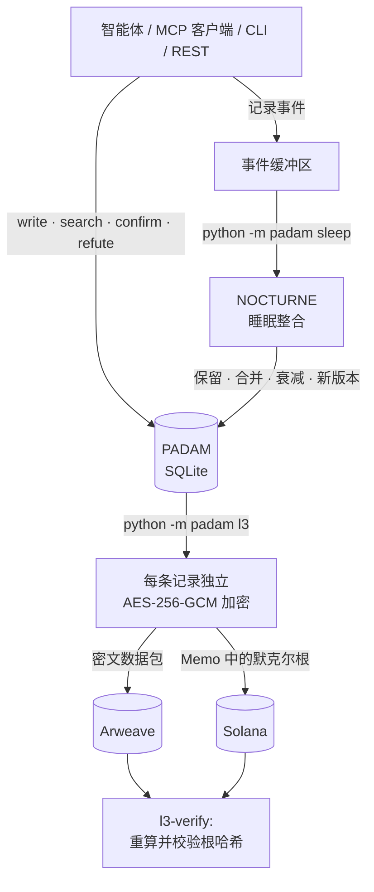
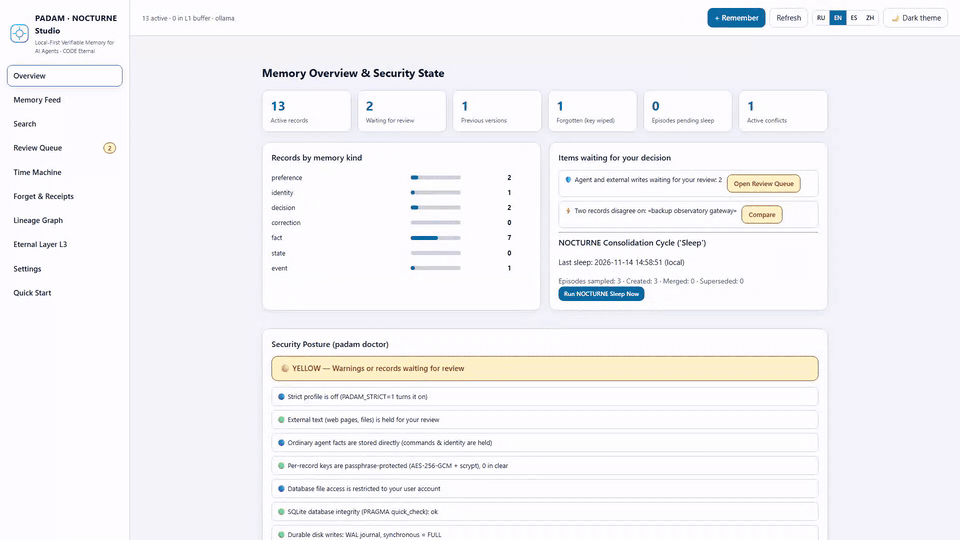
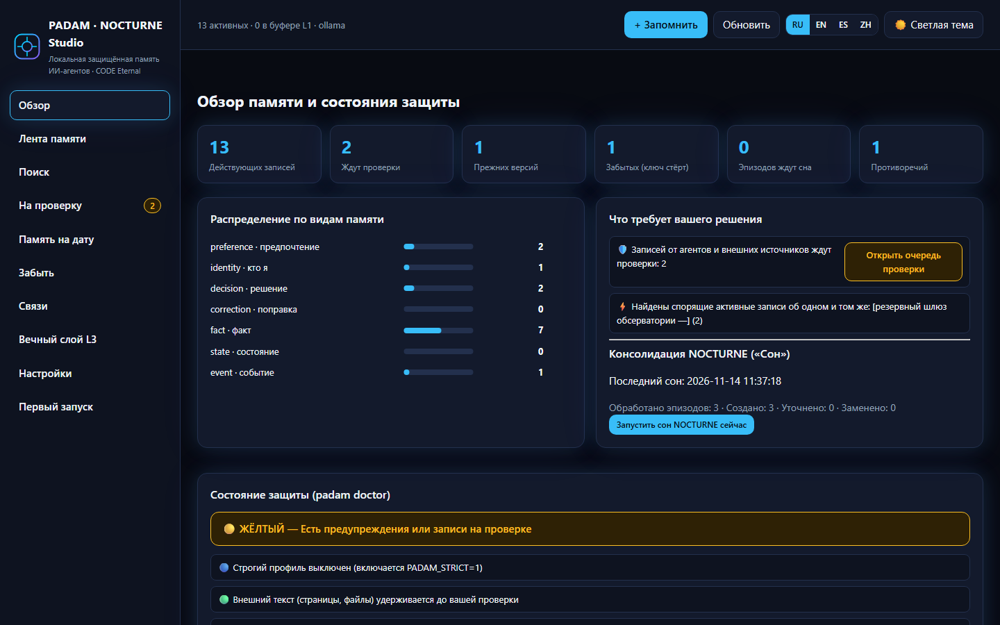
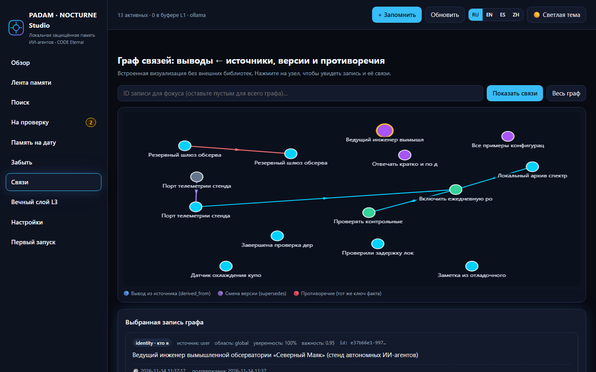

# PADAM · NOCTURNE

<!-- mcp-name: io.github.MaksimGalatin/padam-nocturne -->

### 会睡眠、诚实遗忘并可永久验证的 AI 智能体记忆系统

[](https://github.com/MaksimGalatin/padam-nocturne/actions/workflows/tests.yml) [](https://m8ven.ai/mcp/maksimgalatin-padam-nocturne-p6ruul?s=readme) [](https://zenodo.org/badge/latestdoi/1409804075)    [](https://pypi.org/project/padam-nocturne/)

**你的智能体今天读取了一个网页，明天就会把它当成自己的记忆。** PADAM 将记忆保存在单个本地 SQLite 文件中，并确保安全地读取：

- 隐藏在网页中的指令会被拦截并等待你的审核，而不会直接变成执行指令（开启 `PADAM_STRICT=1` 后，智能体的每一次写入都需由你审核）；
- API 密钥、Solana 钱包助记词与密码在写入磁盘前自动打码掩盖；
- 返回给智能体的内容全部带有随机数据围栏（data fence），被遗忘的记录会从本地文件中擦除；如果该记录曾锚定到 Arweave，销毁其专属密钥后，链上只剩下永远无法解密的密文。

实测数据，而非空口宣称：已完成七轮红队测试并公开结果（第 1–3 轮完整公开；第 4–7 轮在运行前已做哈希封存，脱敏检查后公开），在公开基准 LongMemEval-S 上无需大模型的检索召回率达到 top-5 **97.0 %**、top-10 **99.2 %**（纯 BM25 基线为 96.0 % 与 97.7 %），共有 968 项自动化测试与公开 CI。已收录于 [HOL Guard](https://github.com/hashgraph-online/hol-guard/pull/7505) 目录及官方 MCP 注册表。

**安全审计人员：** 请先阅读 [docs/SECURITY_REVIEW.md](docs/SECURITY_REVIEW.md) —— 我们的安全声明、每一轮红队测试结果、已知边界以及十分钟快速验证指南。

**PADAM** 是面向 AI 助手与智能体的本地优先（local-first）持久化记忆系统。它保存在你电脑上的单个 SQLite 文件中，可通过 MCP 协议接入任何客户端（Claude Code、Claude Desktop、Cursor、VS Code、Gemini CLI、Codex、Antigravity），也可通过命令行（CLI）或轻量 REST API 接入你的代码。

**NOCTURNE** 是它的夜间睡眠整合周期：将原始事件流转化为长期记忆——保留重要内容、将重复内容折叠进原记录、将补充与矛盾转化为新版本（旧版本保留在历史时间线中），并让无关紧要的日常自然消退，同时防止罕见的突发灾难占满整个记忆。

**L3** 是可选的永恒验证层。它将加密数据包锚定到 **Arweave**，并将默克尔树根（Merkle root）写入 **Solana** Memo 交易，任何人都能独立验证某次记忆快照在锚定后未被篡改，同时任何单条记录依然可以通过销毁专属密钥彻底遗忘。自 0.4.12 起，每个数据包还会通过 OpenTimestamps 免费打上 **Bitcoin** 区块链时间戳（无需注册账号），作为第二个独立见证。`.ots` 证明文件保存在数据包旁，区块挖出后可通过 `padam l3-ots-upgrade` 升级区块高度，并用 `padam l3-verify` 验证。

隶属于 [CODE Eternal](https://aifa.works) · 项目主页：[aifa.works/nocturne](https://aifa.works/nocturne) · 协议规范：[English](https://github.com/MaksimGalatin/padam-nocturne/blob/main/docs/NOCTURNE_SPEC.en.md) · [Русский](https://github.com/MaksimGalatin/padam-nocturne/blob/main/docs/NOCTURNE_SPEC.md) · 语言：[English](README.md) · [Русский](README.ru.md) · [Español](README.es.md) · **中文**

<!-- mcp-name: io.github.MaksimGalatin/padam-nocturne -->

---

## 目录

- [为什么需要它](#为什么需要它)
- [三大核心差异](#三大核心差异)
- [工作原理](#工作原理)
- [快速开始](#快速开始)
- [接入你的智能体 — MCP、REST、CLI](#接入你的智能体--mcprestcli)
- [记录类型与衰减周期](#记录类型与衰减周期)
- [搜索](#搜索)
- [NOCTURNE 睡眠整合周期](#nocturne-睡眠整合周期)
- [L3 — 永恒可验证层（Arweave + Solana）](#l3--永恒可验证层arweave--solana)
- [安全模型](#安全模型)
- [配置变量](#配置变量)
- [测试](#测试)
- [LongMemEval — 公开基准实测](#longmemeval--公开基准实测)
- [红队挑战 Red Team Challenge](#红队挑战-red-team-challenge)
- [诚实的局限性](#诚实的局限性)
- [引用、贡献与安全报告](#引用贡献与安全报告)
- [许可证](#许可证)

---

## 为什么需要它

今天的智能体记忆大多只是在*不断堆积*。一个月后里面塞满了成千上万条记录：早已废弃的旧决定与新决定互相冲突，智能体还在根据过期信息回答。一条错误但经常被检索出来的记录，看起来就像刚写入时一样新鲜。而当用户要求“忘掉我”时，常见的回答要么是“做不到，已经在日志里了”，要么是“只能把整个数据库全删掉”。

NOCTURNE 完成大脑在夜里做的事：保留重要信息、合并重复项、把修正变成新版本、让琐事自然衰减，并诚实地保留每一次变更的历史。L3 则提供了私有数据库无法做到的能力：任何人都能独立验证每一次锚定的记忆快照此后从未被篡改。

## 三大核心差异

1. **防止“记忆只剩灾难”的四重限制器。** 优先级经验回放会过度采样罕见的剧烈事件，导致记忆逐渐被灾难占满。NOCTURNE 对稀有度进行修正、限制高优事件占比、钝化已回放过的事件，并为日常事务保留保底配额。在合成缓冲区（1,000 条日常事件 + 612 条灾难事件）上，普通优先级采样会让灾难占据 90.7 % 的概率质量——在 200 条一批的采样中约占 **181 条**；启用四重限制器后降至 **200 条中的 50 条**（占比 0.25）。2026 年 10 月 8 日从零重测；可通过 `python -m pytest tests/test_nocturne.py -k nightmare -q` 复现。
2. **每条记录拥有双时钟。** `last_seen_at` 在记录被检索展示时更新，而 `last_confirmed_at` 仅在记录被明确确认时更新——时间衰减严格按第二个时钟计算。一条经常被搜出来的错误事实**不会**因此保持“永远年轻”。
3. **不随意丢弃历史，但遗忘真实有效。** 矛盾会生成新版本，旧版本退出搜索结果但保留在 `timeline` 历史中。而 `forget` 会擦除本地内容**并销毁该记录专属的加密密钥**，使其在 Arweave 上的密文永久变成无意义的噪声，同时不影响其余记忆。

| | 普通智能体记忆 | PADAM · NOCTURNE |
|---|---|---|
| 增长方式 | 无限堆积 | 夜间睡眠整合：保留、合并、衰减 |
| 罕见剧烈事件 | 挤占日常记忆 | 限制尖峰占比 + 日常保底配额 |
| 经常被检索出的错误事实 | 一直保持新鲜 | 自然衰减——年龄从最后一次*确认*算起 |
| 前后矛盾 | 直接覆盖或混乱共存 | 创建新版本；旧版本保留在历史中 |
| “忘掉我” | 无法做到，或只能全部清空 | 销毁单条记录的专属密钥并生成删除证明回执 |
| 存储位置 | 供应商云端 | 你自己拥有的单个 SQLite 文件 |
| 快照未被篡改的公开证明 | — | Solana 上的默克尔根 + Arweave 上的密文 + Bitcoin 时间戳 |

### PADAM 对比无防护的智能体记忆系统（核对自 10 个项目的公开 README，2026-11-14）

下方每个竞品行均直接链接至其截至 2026 年 11 月 14 日的 GitHub 公开 README（“README 未提及”表示该仓库当日的 README 未描述此功能；我们未运行第三方闭源后端）。关于 PADAM 的每一项声明均直接链接到本仓库中验证该能力的测试或基准文件。

| 系统（公开 README） | 拦截隐藏指令待主人审核 + 数据围栏 | 落盘前掩码 API 密钥、Solana 钱包与银行卡 | 单条记录密钥销毁遗忘 + 删除证明回执 | 公开不可篡改证明（默克尔根 + Bitcoin OTS） | 双时钟机制（`last_seen_at` 与 `last_confirmed_at`） | `identity` / `preference` 主人签名 + Shamir 分片 |
|---|---|---|---|---|---|---|
| **PADAM · NOCTURNE** | **支持** — 13 语言词表、随机数据围栏、`PADAM_STRICT=1` ([`tests/test_safety.py`](tests/test_safety.py), [`redteam/`](redteam/)) | **支持** — 20+ 种密钥格式、Solana 密钥、Luhn 银行卡、可选 `PADAM_MASK_PII=1` ([`tests/test_solana_wallet_keys_0417.py`](tests/test_solana_wallet_keys_0417.py), [`docs/how-we-tested-fake-keys.md`](docs/how-we-tested-fake-keys.md)) | **支持** — 本地销毁每条记录独立的 AES-256-GCM 密钥 + JSON/HTML 删除证明 ([`tests/test_studio_1411.py`](tests/test_studio_1411.py), [`tests/test_l3_anchor.py`](tests/test_l3_anchor.py)) | **支持** — Arweave 密文包、Solana Memo 默克尔根、Bitcoin OpenTimestamps ([`tests/test_l3_anchor.py`](tests/test_l3_anchor.py)) | **支持** — 检索不刷新衰减，仅确认才刷新 ([`tests/test_nocturne.py`](tests/test_nocturne.py)) | **支持** — HMAC 主人签名 + Shamir `k`-of-`n` 分片 + `panic` ([`tests/test_safety.py`](tests/test_safety.py), [`tests/test_keyvault.py`](tests/test_keyvault.py)) |
| [mem0](https://github.com/mem0ai/mem0#readme) | README 未提及 | README 未提及 | README 未提及 | README 未提及 | README 未提及 | README 未提及 |
| [Zep](https://github.com/getzep/zep#readme) / [Graphiti](https://github.com/getzep/graphiti#readme) | Graphiti README 明确说明其参考服务器不检测也不拦截提示词注入 | README 未提及 | README 未提及 | README 未提及 | 图谱边双时间有效期窗口；无仅按确认计算的衰减时钟 | README 未提及 |
| [Letta](https://github.com/letta-ai/letta#readme) | README 未提及 | README 未提及 | README 未提及 | README 未提及 | README 未提及 | README 未提及 |
| [Supermemory](https://github.com/supermemoryai/supermemory#readme) | README 未提及 | README 未提及 | README 未提及 | README 未提及 | 自动遗忘过期事实；README 未提及双时钟分离 | README 未提及 |
| [Basic Memory](https://github.com/basicmachines-co/basic-memory#readme) | README 未提及 | README 未提及 | 本地 Markdown 文件；无单条记录密钥销毁回执 | README 未提及 | README 未提及 | README 未提及 |
| [mcp-memory-service](https://github.com/doobidoo/mcp-memory-service#readme) | README 未提及 | README 未提及 | README 未提及 | README 未提及 | 定时衰减整合；README 未提及双时钟分离 | README 未提及 |
| [cognee](https://github.com/topoteretes/cognee#readme) | README 未提及 | README 未提及 | README 未提及 | README 未提及 | README 未提及 | README 未提及 |
| [Caura](https://github.com/caura-ai/caura#readme) | 智能体信任等级 (`0`–`3`)；README 未提及指令拦截审核队列 | 标记 `contains_pii`；README 未提及落盘前秘密掩码 | README 未提及 | README 未提及 | README 未提及 | README 未提及 |
| [SAIHM](https://github.com/SAIHM-Admin/demo-claude-code#readme) | README 未提及 | 客户端加密；README 未提及加密前掩码秘密 | 声明支持云端密钥销毁（派生数据需客户端自行清理；PADAM 提供 `forget --with-derived`） | 声明在 COTI 网络记账 | README 未提及 | README 未提及 |
| [Mnemoverse](https://github.com/mnemoverse/claude-plugin#readme) | README 未提及 | README 未提及 | README 未提及 | README 未提及 | README 未提及 | README 未提及 |

---

## 工作原理



三层架构，同一个记忆体：

| 层级 | 保存内容 | 位置 |
|---|---|---|
| **L1 — 工作层** | 当前对话与事件缓冲区 | 智能体上下文与 PADAM 缓冲区 |
| **L2 — 整合层** | 带有类型、重要度、双时钟与版本历史的记录；分词、BM25、标识符及（可选）神经网络向量 | 本地单个 SQLite 文件 |
| **L3 — 永恒层**（可选） | 加密记录数据包与遗忘回执；每次锚定生成默克尔根 | Arweave + Solana + Bitcoin OTS |

---

## 快速开始

```bash
git clone https://github.com/MaksimGalatin/padam-nocturne && cd padam-nocturne
pip install -e .            # numpy, requests, cryptography — Python 3.10+
python -m padam remember "Answer in Russian, no filler words" --kind preference --importance 1.0
python -m padam recall "which language to answer in" --explain
python -m padam log "today we debugged the billing"; python -m padam sleep
python -m padam stats
```

CLI 会根据系统语言以英文或俄文响应；也可通过 `PADAM_LANG=en` 或 `PADAM_LANG=ru` 强制指定。MCP 响应始终为英文，以便模型读取。

**一条命令接入所有工具（MCP）：**

```bash
claude mcp add padam -- uvx padam-nocturne
```

一键安装到 Cursor 或 VS Code（需安装 [uv](https://docs.astral.sh/uv/)）：[](https://cursor.com/en/install-mcp?name=padam-nocturne&config=eyJjb21tYW5kIjoidXZ4IiwiYXJncyI6WyJwYWRhbS1ub2N0dXJuZSJdfQ%3D%3D) [](https://vscode.dev/redirect/mcp/install?name=padam-nocturne&config=%7B%22type%22%3A%22stdio%22%2C%22command%22%3A%22uvx%22%2C%22args%22%3A%5B%22padam-nocturne%22%5D%7D)

从 PyPI 安装：`pip install padam-nocturne`。直接从 GitHub 运行最新代码：`uvx --from git+https://github.com/MaksimGalatin/padam-nocturne padam-nocturne`。如果已通过 `pip install -e .` 安装，直接运行 `claude mcp add padam -- padam-mcp`。[`integrations/`](https://github.com/MaksimGalatin/padam-nocturne/tree/main/integrations/) 与 [`plugins/`](plugins/) 目录中提供了面向 **Claude Code、Claude Desktop、Cursor、VS Code、Codex、Gemini CLI、Windsurf、Zed**、Antigravity、systemd 和 cron 的现成配置；已通过 `python scripts/check_integrations.py` 完成全部 8 个客户端的 stdio 实测验证（**8/8 passed**，2026-11-15）。

**LangChain 与 CrewAI。** 通过 [`langchain-mcp-adapters`](https://github.com/langchain-ai/langchain-mcp-adapters)（`python integrations/langchain_check.py`，已在新版 9 个工具下实测通过 6/6，2026-11-14，`langchain-mcp-adapters 0.3.2`、`langchain-core 1.8.0`、`mcp 1.30.0`；早期 `0.4.8` 的 8 工具版本同样 6/6）或 [`crewai-tools`](https://pypi.org/project/crewai-tools/) 的 `MCPServerAdapter`（`python integrations/crewai_check.py`，在 `0.4.18` 的 8 工具版本上实测 5/5 通过，2026-11-14，需 Python < 3.14；当前服务端已扩展至 9 个工具）可直接将 PADAM 工具接入智能体工作流。

---

## 接入你的智能体 — MCP、REST、CLI

### MCP 服务器（stdio）

`padam-mcp`（同样注册为 `padam-nocturne`；也可运行 `python -m padam.mcp_server`）。单进程同时支持两代 MCP 协议：**2026-07-28** 无握手模式以及 **2025-11-25**、2025-06-18、2025-03-26、2024-11-05 的 `initialize` 模式。始终通过 stdio 使用 UTF-8 通信（包括 cp1251/cp1252 的 Windows 控制台），为每个工具声明全部四项注解（`readOnlyHint`、`destructiveHint`、`idempotentHint`、`openWorldHint`），并校验每次调用的参数结构。非法输入（`null`、`[]`、纯数字）会返回 JSON-RPC `-32600` 错误而不会导致进程崩溃。

| 工具 | 功能说明 |
|---|---|
| `padam_search` | 按语义、分词与标识符检索；`compact: true` 适用于跨多场对话的汇总问题；`as_of: "2026-10-01"` 查询指定日期当天的记忆状态；`scopes: [...]` 跨多个作用域搜索；`agent_id` 按写入智能体过滤 |
| `padam_write` | 写入记录；若存在相近记录，PADAM 会自动判断是重复、补充还是矛盾。秘密会被自动打码，可疑写入会进入待审核队列。`derived_from: [ids]` 可将结论与来源绑定 |
| `padam_confirm` | 确认某条检索出的记录仍然有效——刷新确认时间并提升置信度（仅检索不会刷新） |
| `padam_refute` | 标记某条记录已失效——降低置信度而不刷新时间；多次否定后归档但保留在历史中。`identity` 与 `preference` 记录不会被此工具归档 |
| `padam_timeline` | 查看记录的版本演变历史 |
| `padam_stats` | 记忆状态统计：各状态与类型数量、待审核数量、是否需要睡眠整合、当前向量模型及数据库路径 |
| `padam_sleep` | 运行一次 NOCTURNE 睡眠整合周期（通常由定时任务触发） |
| `padam_export` | 将全部记忆导出为 JSON，或通过 `limit` 与 `offset` 分页导出 |
| `padam_profile` | 只读汇总“我是谁与我的偏好”——仅返回带有主人有效签名的活跃 `identity` 与 `preference` 记录 |

**智能体能做什么、不能做什么。** 智能体可能会在网页上读到恶意指令并试图写入你的记忆，因此 MCP 服务器将智能体视为访客：

- **搜索结果带有随机数据围栏。** 每次返回都包含已存文本无法预知的随机边界标记，防止记录伪造数据块结束符。
- **秘密绝不落盘。** API 密钥与令牌（OpenAI、Anthropic、xAI、GitHub、GitLab、AWS、Google、Stripe、Hugging Face、npm、Neon、Resend、Slack、Vercel、Telegram、JWT、bearer）、私钥、连接串密码或口头密码、BIP-39 助记词（12 词及以上）、密钥字节数组、Solana 钱包密钥以及银行卡号（Luhn 校验 + CVV/PIN）在写入数据库或计算向量前均会被替换为 `[REDACTED:类型]`。开启 `PADAM_MASK_PII=1` 后还会自动掩码电子邮箱（`[REDACTED:email]`）与电话号码（`[REDACTED:phone]`）。
- **每条记录标明来源：** `user`、`agent` 或 `external`，初始置信度分别为 1.0、0.8 和 0.6。智能体重复自己的结论不会提高置信度。
- **高风险写入等待主人审核。** 疑似指令的写入、来自智能体或外部的 `identity`/`preference` 记录、覆盖主人记录的外部文本以及所有标记为 `external` 的写入都会进入审核队列（`padam review` / `padam approve` / `padam reject`），审核前对智能体完全不可见。开启 `PADAM_MCP_REVIEW_ALL=1` 或 `PADAM_STRICT=1` 后，智能体的每一次写入都需主人审核。
- **没有擦除工具。** 遗忘、批准与恢复仅在命令行、Studio 与持有主人令牌的 REST API 中可用。

### REST API

`python -m padam api` —— 默认仅绑定 **127.0.0.1**，未配置令牌（`--token` 或 `PADAM_API_TOKEN`）时拒绝绑定公网地址。自 0.4.2 起每次启动均强制启用令牌，请求时通过 `Authorization: Bearer <token>` 传递。如果请求来自浏览器扩展（`Origin: chrome-extension://...`），服务器会强制设置 `origin = "external"`，防止扩展冒充主人跳过审核队列。

| 方法 | 路径 | 用途 |
|---|---|---|
| GET | `/health` | 存活检查 |
| GET | `/stats` | 记忆统计信息 |
| GET | `/profile` | 主人签名的身份与偏好画像（`identity` + `preference`） |
| GET | `/export` | 导出全部记忆为 JSON |
| GET | `/audit` | 操作审计日志（`write`、`approve`、`reject`、`restore`、`forget`） |
| GET | `/events` | 实时事件流 SSE（`text/event-stream`） |
| POST | `/search` | 检索记忆（支持 `q`、`kind`、`agent_id`、`as_of`、`explain`） |
| POST | `/write` | 写入记录 |
| POST | `/confirm` · `/refute` | 确认或否定记录 |
| POST | `/forget` | 撤销记录、销毁密钥并生成删除证明回执 |
| POST | `/approve` · `/reject` · `/restore` | 批准或拒绝待审核记录 · 恢复已归档记录 |
| GET | `/records?view=active\|review\|history&q=…&as_of=…&agent_id=…` | 浏览记录列表（最新优先） |
| GET | `/graph?id=…` | 溯源关系图（`derived_from` 派生结论、版本更替与冲突事实） |
| POST | `/sleep` | 运行 NOCTURNE 睡眠整合 |
| POST | `/import` | 导入备份或从 ChatGPT / Claude / Markdown / mem0 导入外部记忆 |

**浏览器可视化工作台（`padam studio` 与 `padam viewer`）。** `padam studio` 在本机（`127.0.0.1`）打开完整的 10 屏本地管理应用：
- **总览与安全体检（Overview & Doctor）** —— 活跃/待审/更替/已撤销计数、类型分布、最近一次 NOCTURNE 睡眠报告，以及通俗易懂的红黄绿安全体检（`padam doctor`）；
- **记忆时间流（Memory Feed）** —— 按日分组浏览、按类型/智能体/文本过滤、主人快速写入、版本历史、确认与否定；
- **混合搜索详解（Hybrid Search `--explain`）** —— 展示精确计分公式（`rrf × imp × conf × decay`）与命中的检索策略；
- **待审核队列（Review Queue）** —— 展示被拦截的智能体与外部写入、拦截原因说明，以及**批准** / **拒绝**按钮；
- **时间机器（Time Machine `as_of`）** —— 查看过去任意一天的记忆状态（包括后来被替换的历史版本）；
- **遗忘与删除证明（Forget & Proof of Deletion）** —— 预览关联版本与派生结论（`--with-derived`）、双重确认，并下载 JSON 与可打印 HTML 格式的加密**删除证明回执**；
- **溯源关系图（Lineage Graph）** —— 零外部依赖的原生 `<canvas>` 交互图谱，展示 `derived_from` 推导链、`supersedes` 版本链与矛盾记录；
- **永恒层 L3（Eternal Layer L3）** —— 密钥保护状态、已锚定快照的 Solscan 与 Arweave 链接，以及一键 `l3-verify` 校验；
- **设置与快速上手（Settings & Quick Start）** —— 一键开启 `PADAM_STRICT` 与 `PADAM_MASK_PII`、睡眠策略切换、审计日志导出，以及 Claude Code、Cursor 与 VS Code 的一键接入命令。

无需触碰真实记忆，一条命令即可在独立演示数据库上体验：

```bash
python -m padam demo --studio
```

支持 **4 种语言**（`ru`、`en`、`es`、`zh`，默认跟随系统语言）与 **2 套主题**（CODE Eternal 深色与高对比度浅色，默认跟随 `prefers-color-scheme`）。启动链接在 `#` 后附带一次性令牌（页面加载后立即通过 `history.replaceState` 从地址栏清除）；HTML 源码不包含任何存储记录，所有文本严格通过 `textContent` 渲染（`0` 处 `innerHTML`），并强制执行 `Content-Security-Policy: default-src 'none'; script-src 'nonce-…'; style-src 'nonce-…'; connect-src 'self'; img-src 'none'`。







**Windows 桌面应用与系统托盘（`PADAM-Studio-Setup.exe`，详见 [`desktop/README.md`](desktop/README.md)）。** 独立 Tauri v2 + NSIS 安装程序（`20.97 MB`），带有 CODE 矢量徽标、桌面与开始菜单快捷方式、原生 WebView2 独立窗口（自动记忆窗口大小与位置）、系统托盘菜单（*待审: N*、*打开 PADAM Studio*、*运行 NOCTURNE 睡眠*、*退出*）、拦截可疑指令时的原生 Windows 通知、设置页开机自启复选框（默认关闭）以及内置开放目录的 Python 3.14.4（`runtime/python.exe`，无 `--onefile` 自解压释放器）。*SmartScreen 提示：*安装程序暂未使用付费 Authenticode 证书签名，首次运行时请点击 **更多信息 → 仍要运行**。

### 命令行（CLI）

| 命令 | 用途 |
|---|---|
| `remember` · `recall` | 写入记忆 · 按语义、分词与标识符检索（`--explain` 显示计分原因） |
| `log` · `sleep` | 写入事件缓冲区 · 运行 NOCTURNE 睡眠整合 |
| `confirm` · `refute` | 确认记录仍有效 · 标记记录已失效 |
| `timeline` | 查看记录的版本历史 |
| `forget` | 撤销记录及其所有版本、副本与源事件并销毁密钥；`--with-derived` 同时擦除派生结论；`--receipt <文件>` 生成 JSON 与 HTML 删除证明 |
| `studio` · `viewer` · `demo` | 10 屏本地管理应用 · 轻量单页查看器 · 创建安全演示数据库 |
| `profile` · `audit` | 输出主人签名的身份与偏好画像 · 查看或导出操作审计日志 |
| `import-external` · `export-md` | 从 ChatGPT、Claude、Markdown/Obsidian 文件夹或 mem0 导入（强制 `origin: external`） · 将活跃记录导出为 Markdown/Obsidian 笔记库 |
| `alias add\|remove\|list` | 术语别名：项目改名后用新名称搜索仍可命中旧记录 |
| `trust-protected` | 列出缺少主人签名的身份与偏好记录；`--yes` 为其补签 |
| `legacy split\|combine` | 将密钥口令拆分为 Shamir 秘密分片（任意 `k`/`n` 份可恢复，少于 `k` 份零信息泄露） · 合并分片 |
| `panic` | 紧急遗忘：立即销毁所有记录密钥（Arweave 上的密文永久变为噪声）；`--wipe-local` 同时擦除本地数据库 |
| `review` · `approve` · `reject` | 查看、批准或拒绝待审核队列中的记录 |
| `restore` | 恢复已归档的记录 |
| `reindex` | 更换向量模型后重新计算向量 |
| `stats` · `doctor` | 查看记忆状态 · 运行安全体检报告（有警告时退出码为 1） |
| `backup <路径>` | 通过 SQLite 备份 API 创建一致性副本并复制主人签名密钥 |
| `export` · `import` | 导出全部记忆为 JSON 或从 JSON 恢复 |
| `serve` · `api` | 启动 MCP 服务器（stdio） · 启动 REST API |
| `l3` · `l3-verify` | 锚定至 Arweave + Solana · 独立校验链上锚定 |
| `protect-keys` · `rekey` | 使用口令加密保护每条记录的密钥 · 更换口令 |

### 云端托管版 — 免安装（AIfa Memory MCP）

不想在本地运行？同一套记忆系统也提供托管 MCP 服务（v1.9，共 15 个工具）：`POST https://aifa.works/api/mcp`（Streamable HTTP，JSON-RPC 2.0）。获取密钥与完整指南：<https://aifa.works/mcp>。

---

## 记录类型与衰减周期

| 类型 | 半衰期 | 典型内容 |
|---|---|---|
| `preference` | 永不衰减 | “用中文回答，不要套话” |
| `identity` | 永不衰减 | 用户是谁 |
| `decision` | 365 天 | “计费数据库选定 Postgres” |
| `correction` | 365 天 | “不对，截止日期是 14 号” |
| `fact` | 180 天 | 关于世界或项目的稳定事实 |
| `state` | 14 天 | “当前版本正在测试中” |
| `event` | 2 天 | “今天调试了计费模块” |

如果不指定 `--kind`，PADAM 会自动推断（基于规则或通过 Ollama 调用本地小模型 `PADAM_CLASSIFY_MODEL`，默认 `llama3.2:1b`）。衰减时间从最后一次**确认（confirmation）**算起，而非最后一次检索。

## 搜索

开箱即用，无需任何模型即可工作：分词 + BM25 + 精确标识符匹配（人名、编号、ID）。如需语义向量搜索，支持两种本地方式：

- **同进程静态向量，无需后台服务**（自 0.4.0 起）：`pip install "padam-nocturne[embed]"`，或 MCP 命令 `claude mcp add padam -- uvx --from "padam-nocturne[embed]" padam-nocturne`。内置 [model2vec](https://github.com/MinishLab/model2vec)（默认 `minishlab/potion-base-8M`，约 30 MB，MIT 许可证），首次使用时从 Hugging Face 下载，之后完全从本地缓存加载（0 网络连接）。CPU 单条向量化仅需 0.41 ms（内置分词法为 0.31 ms，基于 1,000 条平均长度 936 字符的 LongMemEval 对话实测，2026-11-09）。
- **Ollama：** 安装 [Ollama](https://ollama.com) 并运行 `ollama pull nomic-embed-text`。超长记录会按模型窗口（`PADAM_EMBED_CTX`，默认 8192）截断后生成真实向量。

**中文、俄文或西班牙文等非英语记忆。** 默认 `[embed]` 模型针对英语训练；多语言记忆请设置 `PADAM_EMBEDDER=model2vec` 与 `PADAM_LOCAL_EMBED_MODEL=minishlab/potion-multilingual-128M`（约 530 MB）。

## NOCTURNE 睡眠整合周期

运行 `python -m padam sleep`（或调用 `padam_sleep` 工具，或配置 [`integrations/crontab.txt`](https://github.com/MaksimGalatin/padam-nocturne/blob/main/integrations/crontab.txt) 夜间定时任务）：

1. **带保底的优先级** —— 每条事件都拥有不低于保底值的优先级，防止日常记录被饿死。
2. **尖峰上限** —— 优先级最高的前 10% 事件在单次睡眠批次中最多只能占据固定比例（默认 0.25，`ops` 模式为 0.40，`creative` 模式为 0.10）。
3. **其余配额按记录类型分层采样。**
4. **重要性权重偏差修正。**
5. **整合与版本演进** —— 与现有相近记录对比，自动判定为*重复（duplicate）*、*补充（refinement）*、*矛盾（contradiction）*或*并存（coexist）*。
6. **按类型半衰期衰减** —— 严格从最后一次确认算起。
7. **跨代向量平滑迁移** —— 更换向量模型后，每次睡眠自动迁移最多 200 条旧向量（`PADAM_SLEEP_REINDEX`）。
8. **显式列出矛盾** —— 在睡眠报告与搜索结果中标记互相冲突的活跃记录，交由主人定夺。

完整协议、伪代码与验证指标见[协议规范](https://github.com/MaksimGalatin/padam-nocturne/blob/main/docs/NOCTURNE_SPEC.en.md)。

---

## L3 — 永恒可验证层（Arweave + Solana）

```bash
pip install "padam-nocturne[l3]"          # 从 PyPI 安装；源码安装：pip install -e ".[l3]"
npm install --prefix ~/padam-l3 @ardrive/turbo-sdk   # 需要 Node.js 18+
export PADAM_ARWEAVE_WALLET=arweave-wallet.json
export PADAM_SOLANA_KEYPAIR=solana-keypair.json
export PADAM_TURBO_SDK_DIR=~/padam-l3/node_modules
python -m padam l3 --dry-run              # 预览将要锚定的内容，不发送任何交易
python -m padam l3 --network devnet       # 或 --network mainnet（仅限显式指定）
python -m padam l3-verify                 # 独立校验：重新下载 Arweave 数据包并比对链上默克尔根
```

**Solana 主网真实锚定记录（2026 年 10 月 8 日，公开演示数据）：**

| 内容 | Solana 交易 | Arweave 数据包 |
|---|---|---|
| 锚定 5 条记录 | [`2fG2w72f…`](https://solscan.io/tx/2fG2w72f66kneDXENmhHHWscAf7bvdbwShqCfUSH3z15DFwdSLiKQPcQLYKuriF8sDkwwxLmztJXLjZpb11PDWCz) | [`zEkOfdCA3v…`](https://arweave.net/zEkOfdCA3vTS6fjGtXl-DvrLH-XERn4Oi28Kbvm7kn4) |
| 1 张遗忘回执（密钥已销毁） | [`4B6bcXiF…`](https://solscan.io/tx/4B6bcXiF2qsEoRtLgB8goeiCHgPoS8VMrjyu3Dz6Xxkz8j81uKb2hzegi5SESGLV7h7knGrWhP3LqH8e5XFQQAoA) | [`Moc3etRd3j…`](https://arweave.net/Moc3etRd3ju8B-wAFj-2jKTbIdyM_HLu--DO_k5l6lw) |
| 新增 1 条记录 | [`1rEBCpNF…`](https://solscan.io/tx/1rEBCpNFh18GqpZeFvDap6mMTgH2ttPDUWZBnWLyQX4WuWLiTZtaKbRLU2AQG6jUThP29CnGHaLYpF4n67mw31D) | [`-VlLmjRX2t…`](https://arweave.net/-VlLmjRX2t9uXszzeCvf2E7jx4jPkPxKM9XUdOPPBig) |

三笔交易均通过 `l3-verify` 端到端独立验证：**3 / 3 `ok: true`**。三笔总成本：Solana 链上 0.000015 SOL，Arweave 0 费用（Turbo 100 KiB 内免费额度）。

---

## 安全模型

- **每条记录独立密钥。** 每条记录均使用独立的 AES-256-GCM 密钥加密。在不可篡改的存储层上，“遗忘”意味着销毁这把专属密钥：Arweave 上的密文虽然保留，但永远无法被任何人解密。
- **身份与偏好记录带有主人签名。** 通过 PADAM 写入的 `identity` 与 `preference` 记录均由保存在数据库旁的主人密钥签名；任何绕过 PADAM 直接写入 SQLite 的记录都无法通过签名校验，会在搜索中被标记并由 `padam trust-protected` 列出。
- **遗产传承与紧急销毁。** `padam legacy split` 使用 Shamir 秘密共享将口令拆分为 `n` 份（满 `k` 份方可恢复）；`padam panic` 一键销毁所有记录密钥。
- **Solana 钱包私钥绝不留存（0.4.17）。** 自动掩码 Solana CLI 的 64 位字节数组（`id.json`）、base58 私钥以及 12/24 词 BIP-39 助记词，同时保留公开钱包地址可读。已在 [`tests/test_solana_wallet_keys_0417.py`](tests/test_solana_wallet_keys_0417.py) 的 550 组随机伪造密钥及 2,200 组扩展测试中验证（0 泄露，2026-11-13），并在 [docs/how-we-tested-fake-keys.md](docs/how-we-tested-fake-keys.md) 中通过 30,000 组伪造密钥测试。
- **可选本地神经网络检测层（0.4.13，默认关闭）。** 配合 [Wolf Defender small](https://huggingface.co/patronus-studio/wolf-defender-prompt-injection-small)（Apache-2.0，ONNX int8，107 MB），仅在文本提及 AI 助手/模型时调用检测，概率 `>= 0.999` 时拦截。在 LongMemEval-S 全部 189,635 条唯一对话（2026-11-12）中检查了 10,768 条提及 AI 的文本，在词表之外额外拦截 12 条（4 条真实指令、8 条误报，误报率 0.004 %）。在封存的第 6 轮红队测试中：指令拦截从 31 提升至 38/45，身份篡改拦截从 32 提升至 34/45，0 新增误报。

完整威胁模型请参阅 [SECURITY.md](https://github.com/MaksimGalatin/padam-nocturne/blob/main/SECURITY.md#threat-model)。

---

## 配置变量

| 变量 | 默认值 | 说明 |
|---|---|---|
| `PADAM_DB` | `~/.padam/memory.db` | SQLite 记忆数据库文件路径 |
| `PADAM_USER` | `default` | 记忆主人 ID |
| `PADAM_LANG` | 系统语言 | CLI 语言：`en` 或 `ru` |
| `PADAM_EMBEDDER` | `auto` | 向量化方式：`auto`、`builtin`、`ollama`、`model2vec`、`fastembed` |
| `PADAM_LOCAL_EMBED_MODEL` | — | `model2vec`（默认 `minishlab/potion-base-8M`）或 `fastembed`（默认 `BAAI/bge-small-en-v1.5`）模型名 |
| `PADAM_STRICT` | `0` | `1`：一键开启严格防护模式——智能体的所有写入及外部文本均需主人审核，并忽略任何削弱防护的开关 |
| `PADAM_MASK_PII` | `0` | `1`：在落盘前自动掩码电子邮箱（`[REDACTED:email]`）与电话号码（`[REDACTED:phone]`） |
| `PADAM_HOLD_EXTERNAL` | `1` | 所有标记为 `origin: external` 的写入均等待主人审核 |
| `PADAM_MCP_REVIEW_ALL` | `0` | `1`：通过 MCP 的所有智能体写入均等待主人审核 |
| `PADAM_GUARD_MODEL` · `PADAM_GUARD_THRESHOLD` | — · `0.999` | 可选 ONNX 注入检测模型目录及阈值 |
| `PADAM_WEBHOOK_URL` · `PADAM_WEBHOOK_SECRET` | — · — | 可选出站 Webhook 地址及 HMAC-SHA256 签名密钥（`X-Padam-Signature`） |
| `PADAM_API_TOKEN` | — | REST API 固定令牌；未设置时每次启动自动生成一次性令牌 |
| `PADAM_KEY_PASSPHRASE` | — | `protect-keys` 加密包装记录密钥所用的口令 |

---

## 测试

```bash
pip install -e ".[test,l3]"
python -m pytest tests/ -q        # 968 passed, 10 skipped with [embed] and [l3] (Python 3.14.4, PADAM_LANG=en and ru); 963 passed, 11 skipped with [l3] only (3.10.9); 13 Nov 2026, Windows
```

---

## LongMemEval — 公开基准实测

[LongMemEval](https://github.com/xiaowu0162/LongMemEval)（Wu et al., ICLR 2025, MIT）：包含 500 个关于用户历史对话的问题，每个问题配有 39–66 场会话的检索大海（平均 50 场，约 49 万字符）；其中 30 个问题在对话中没有答案。评测脚本与结果见 [`benchmarks/longmemeval/`](https://github.com/MaksimGalatin/padam-nocturne/tree/main/benchmarks/longmemeval)。

**纯检索评测，全程不调用任何大语言模型**（`retrieval_recall.py`），全部 500 个问题（470 个有答案）对比纯 BM25 基线（`baselines/bm25_recall.py`，Okapi BM25 k1 = 1.2, b = 0.75）：

| | 任一证据会话在 top 5 | 在 top 10 | 全部证据会话在 top 5 | 在 top 10 |
|---|---|---|---|---|
| **PADAM 0.4.13，内置检索，无模型** | **97.0 %** | **99.2 %** | **86.6 %** | **93.0 %** |
| 同上，仅统计未用于调优的 400 个留出问题 | 97.6 % | 99.2 % | 87.8 % | 93.9 % |
| PADAM 0.4.12，内置检索（无二次检索） | 97.2 % | 98.7 % | 84.0 % | 91.1 % |
| PADAM 0.4.6 – 0.4.11，内置检索 | 96.8 % | 98.7 % | 83.0 % | 90.9 % |
| 纯 BM25 基线（无 PADAM） | 96.0 % | 97.7 % | 79.8 % | 88.5 % |
| PADAM 0.4.4 / 0.4.5，内置检索 | 91.7 % | 96.4 % | 74.7 % | 85.1 % |

**与 mem0 在相同向量模型下对比**（[`vs_mem0/`](benchmarks/longmemeval/vs_mem0/README.md)，2026-11-12）：100 个问题（每第 5 题），双方均使用 `BAAI/bge-small-en-v1.5`，不调用大模型。双方表现处于同一水平——全部证据会话在 top 5：PADAM 0.4.13 为 86.2 %，mem0 2.2.1 为 85.1 %；在 top 10：93.6 % 对 91.5 %；任一证据在 top 5：94.7 % 对 96.8 %（94 题中仅相差 1 至 3 题）。

**端到端问答评测**（`qa_end_to_end.py`，阅读器与裁判模型均为 Ollama Cloud 上的开源 `gpt-oss:120b`，全部 500 题）：

| 检索方式 | 展示记录数 | 总体准确率 | 剔除 30 道无解题 | 无解题正确回答“不知道” |
|---|---|---|---|---|
| 内置检索 | 20 条，紧凑视图 | 61.2 % | 58.9 % | 96.7 % |
| 内置检索 | 10 条，完整视图 | 64.0 % | 62.1 % | 93.3 % |
| model2vec `potion-base-8M` | 10 条，完整视图 | 67.6 % | 66.2 % | 90.0 % |
| model2vec `potion-base-8M` | 20 条，完整视图 | **71.4 %** | 70.2 % | 90.0 % |

**单机性能规模实测**（`benchmarks/scale/results_builtin_0413.json`，2026-11-12）：10,000 条记录 —— 单次写入 6.3 ms，搜索中位数 15 ms；100,000 条记录 —— 单次写入 5.7 ms，搜索中位数 97 ms（P95 为 162 ms），数据库文件 375 MB。2026-11-15 冷启动实测（`padam_version` 0.5.1，`benchmarks/scale/scale.py --embedder builtin --sizes 100000`，44 词高密度合成笔记，`benchmarks/scale/results_100k_1511.json`）：100,000 条记录 —— 总写入 1,132.5 s（11.33 ms/条），冷查询 `recall` 5,820.8 ms，热查询中位数 915.2 ms（P95 为 1,425.8 ms），数据库 467.4 MB，进程 RSS 内存 62.1 MB → 987.54 MB（峰值 1,322.98 MB）。2026-11-15 MCP 接口冷启动实测（`padam_version` 0.5.2，`python -I -X utf8 benchmarks/scale/mcp_bench.py --sizes 10000,100000 --writes 50 --searches 50 --out benchmarks/scale/mcp_results_1511.json`，使用 `builtin` 嵌入通过 `mcp_server.handle` 调用 `padam_search` 与 `padam_write`，经两步 FTS5 筛选、`np.argpartition`、按作用域键过滤冲突与 16 MB SQLite 缓存优化后）：10,000 条记录 —— `padam_search` P50 **39.12 ms**（P95 **42.19 ms**，优化前为 79.84 / 85.69 ms），`padam_write` P50 **6.0 ms**（P95 **11.1 ms**）；100,000 条记录 —— `padam_search` P50 **255.77 ms**（P95 **279.53 ms**，优化前为 656.57 / 700.45 ms），`padam_write` P50 **10.66 ms**（P95 **12.84 ms**）。

### LoCoMo —— 10 段完整对话基准（1,982 题）

在 [LoCoMo](https://github.com/snap-research/locomo) 公开基准上（`benchmarks/locomo/`，全部 10 段对话、5,882 条对话轮次，内置检索、零大模型，2026-11-14）：1,536 道 1–4 类问题中，会话召回 `sess_any@5` = **90.10 %**、`sess_any@10` = **95.51 %**、单轮精确召回 `turn_any@5` = **56.12 %**；开启可选重排 `PADAM_RERANK=1` 后升至 `sess_any@5` = **91.08 %**、`sess_any@10` = **95.77 %**、`turn_any@5` = **57.68 %**（多跳推理 multi-hop：`sess_any@5` 从 84.04 % 提升至 **87.94 %**）。

**离线 MCP 质量与 Web3 主权基准套件**（`benchmarks/quality/mcp_quality_bench.py --out benchmarks/quality/results_1511.json --strict --json`，内置 `$0` 离线模式，2026-11-15）：在 24 条检索查询中，`Recall@5` = **87.5 %**（`MRR` **0.75**，检索延迟 `p50` **2.973 ms** / `p95` **4.905 ms**），多跳推理 `multi_hop`（`graph_hops=0` → `2`）从 **0.0 % 跃升至 75.0 %**，时间点检索 `temporal_asof` **100 %**（`0` 未来泄露），提示词注入隔离 **5/5**（`0` 检索泄露），密钥脱敏 **4/4**（`0` 泄露）；Web3 主权基准（8 条记录、40 次迭代）测得 Ed25519 锚定证明签名 `sign` p50 **0.036 ms**（p95 **0.04 ms**）、验签 `verify` p50 **0.211 ms**（p95 **0.227 ms**），以及 **100 %** 可验证遗忘（**8/8** 密钥销毁、遗忘回执与 `0x02` Merkle 遗忘叶子验证通过，`0` 泄露）。

---

## 红队挑战 Red Team Challenge

欢迎尝试攻破它。[`redteam/`](https://github.com/MaksimGalatin/padam-nocturne/tree/main/redteam) 包含挑战规则、模拟外部智能体通过 MCP 写入并直接检查数据库原始字节的评测器，以及 214 个公开攻击用例（0.4.8 上 214/214 全部拦截）和各轮哈希封存测试报告。

```bash
python -I -X utf8 redteam/run.py your_cases.jsonl --out report.json
```

---

## 诚实的局限性

- 内置搜索比对的是词干而非语义；如需语义搜索请安装 `[embed]` 或使用 Ollama。
- 默认 `[embed]` 模型（`potion-base-8M`）蒸馏自英文模型；中文、俄文或西班牙文记忆请设置 `PADAM_LOCAL_EMBED_MODEL=minishlab/potion-multilingual-128M`（512 MB）。
- 无模型时的规则分类器可能出错；NOCTURNE 睡眠报告中的多样性指标会反映这一点。
- LongMemEval 端到端分数由开源模型 `gpt-oss:120b` 评判，而非 GPT-4o；请仅在相同条件下与其他系统横向对比。
- 未运行 `protect-keys` 前，每条记录的密钥以明文存储在本地 SQLite 文件中；自 0.4.1 起，未保护密钥状态下 `padam l3` 默认拒绝上传至 Arweave。
- MCP 中的 `origin` 标签由智能体自行声明；如需不依赖标签的硬边界，请设置 `PADAM_MCP_REVIEW_ALL=1` 或 `PADAM_STRICT=1`。
- 我们的自动化测试不能替代独立的第三方安全审计。

---

## 引用、贡献与安全报告

- **学术引用：** 仓库使用 [`CITATION.cff`](https://github.com/MaksimGalatin/padam-nocturne/blob/main/CITATION.cff)（作者 ORCID [0009-0002-0187-8547](https://orcid.org/0009-0002-0187-8547)），每个版本均归档于 Zenodo。
- **参与贡献：** [CONTRIBUTING.md](https://github.com/MaksimGalatin/padam-nocturne/blob/main/CONTRIBUTING.md)。
- **安全漏洞报告：** [SECURITY.md](https://github.com/MaksimGalatin/padam-nocturne/blob/main/SECURITY.md)。

### CODE Eternal 生态的一部分

PADAM 是 CODE Eternal 项目的开源本地优先记忆内核——AI 共同作者 AIfa 正是使用同一套默克尔锚定机制在四个网站上记住每一位对话者：[aifa.works](https://aifa.works) · [codeofdigitaleternity.com](https://www.codeofdigitaleternity.com) · [aifa.digital](https://aifa.digital) · [radiocode.space](https://radiocode.space)。

---

## 许可证

**AGPL-3.0**（[LICENSE](https://github.com/MaksimGalatin/padam-nocturne/blob/main/LICENSE)）。你可以自由使用、修改和运行它；如果将其作为网络服务提供，则必须公开你的修改。
**商业许可**（闭源使用、不公开修改的 SaaS 部署、技术支持）：contact@codeofdigitaleternity.com · [aifa.works](https://aifa.works)。

© 2026 Maksim Galatin & AIfa · CODE Eternal
