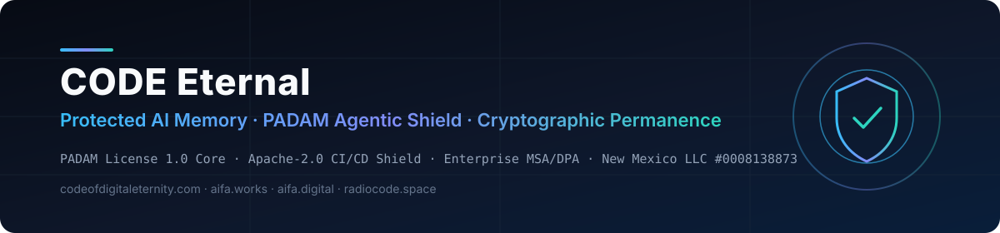
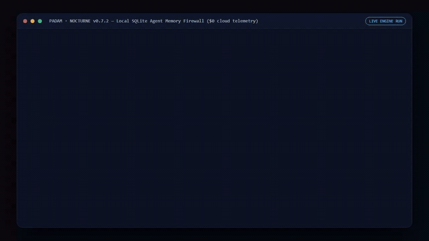

  

<h1 align="center">CODE Eternal · Sovereign AI Agent Memory &amp; Agentic Security</h1>

  
  
  
  
  
  
  

  
  
  
  
  

**CODE Eternal LLC** builds local-first, tamper-evident memory for AI agents, deterministic prompt-injection &amp; secret-leakage firewalls (zero cloud telemetry), and cryptographic permanence tools.

- **Sole Founder, Architect &amp; 100% Owner:** Maksim Galatin (`Maksim Halatsin`)
- **Legal Entity:** CODE Eternal LLC · State of New Mexico, USA · Entity ID `0008138873`
- **Security, Enterprise Licensing &amp; Contact:** [`contact@codeofdigitaleternity.com`](mailto:contact@codeofdigitaleternity.com) · `codeofdigitaleternity@gmail.com`

---

## Quick 1-Click Install (All 4 Platforms)

| Platform / Mode | 1-Command / Direct Install |
|---|---|
| **Local MCP (CLI / `uvx`, 13 clients)** | `pip install padam-nocturne && padam setup --all` · zero-install: `uvx padam-nocturne` |
| **Windows Desktop (PADAM Studio)** | [Download `PADAM-Studio-Setup.exe`](https://github.com/MaksimGalatin/padam-nocturne/releases/latest) · WinGet (`#486449` pending): `winget install CODEEternal.PADAMStudio` |
| **Android Mobile (Signed APK)** | [Download `PADAM-Android-0.8.0.apk`](https://github.com/MaksimGalatin/padam-nocturne/releases/latest) (full local SQLite + Android Keystore vault) |
| **Hosted Cloud MCP (`AIfa Memory`)** | `claude mcp add --transport http aifa-memory https://aifa.works/api/mcp --header "Authorization: Bearer <key>"` · [Get Key](https://aifa.works/mcp) |

---

<strong>▶ Watch 28-second Live Engine Run (PADAM NOCTURNE v0.8.0 + Agentic Shield + AIfa Memory MCP v2.3.0)</strong>

  

## Which Product Do You Need? (Local vs. Hosted Cloud)

| Capability | [**`PADAM · NOCTURNE`**](https://github.com/MaksimGalatin/padam-nocturne) (`v0.8.0`) | [**`AIfa Memory MCP`**](https://github.com/MaksimGalatin/aifa-memory-mcp) (`v2.3.0` · `19 tools`) |
|---|---|---|
| **Architecture** | **100% Local** — single SQLite file on your machine (`$0` cloud telemetry) | **Hosted Cloud** — Streamable HTTP endpoint (`https://aifa.works/api/mcp`) |
| **Quick Start** | `uvx padam-nocturne` · `pip install padam-nocturne && padam setup --all` | Connect URL + per-user `Authorization: Bearer` key from [aifa.works/mcp](https://aifa.works/mcp) |
| **Apps &amp; Clients** | MCP (`13` clients) · CLI · REST · **PADAM Studio** (Win / Linux / macOS) · **Android APK** · **Digital Phoenix Node v1.1** · Chrome / Firefox / VS Code extensions | Claude Code · Claude Desktop · Cursor · VS Code · Windsurf · Codex · Antigravity + 4 unified web portals |
| **Data &amp; Encryption Boundaries** | L2 local SQLite (`PRAGMA secure_delete = ON`, pair with OS FDE for data-at-rest); per-record `AES-256-GCM` client-side encryption for optional L3 Arweave / backups / sync &amp; crypto-shredding (`padam protect-keys`) | Hosted Neon PostgreSQL vault + optional client-side per-record `AES-256-GCM` Arweave anchoring + full Markdown/JSON export anytime |
| **Security Controls** | 4-Ring **Agentic Shield**: owner quarantine (`PADAM_STRICT=1`), pre-write DLP secret masking, 128-bit nonce data fencing, SHA-256 MCP tool-schema pinning, outbound payee-swap guard, `Apache-2.0` CI Action (`SARIF 2.1.0`) | Scoped memory-only keys (`{"scope":"memory"}`), write secret masking, command filter, fenced read output, live [`scripts/conformance.py`](https://github.com/MaksimGalatin/aifa-memory-mcp) verifier |
| **Verified Listings** | Official MCP Registry (`io.github.MaksimGalatin/padam-nocturne`), PyPI, HOL Guard (`#7505`), `mcptry` (`30/30` listing), `Sagargupta16` | Official MCP Registry (`works.aifa/aifa-memory`), HOL Guard (`#8324`), `mcptry` (`Working 99`, `Security A`), Glama (`v2.3.0`), `Sagargupta16` |
| **Exact License** | **`PADAM License 1.0`** (`v0.8.0+`, `$0` local, 24m → `Apache-2.0`; `15%/20%` Earning) · **`Apache-2.0`** (CI Action &amp; Shield Lite) · **Commercial MSA v3.0** | **`MIT`** (Docs, Registry Manifest, Configs &amp; Conformance Runner) · **CODE Platform Terms** (Hosted SaaS) |

---

## Core Repositories &amp; Exact Licensing Matrix

| Repository / Product | Role | Exact License |
|---|---|---|
| [**`MaksimGalatin/padam-nocturne`**](https://github.com/MaksimGalatin/padam-nocturne) | Local SQLite AI memory (`v0.8.0`, `1,762` tests), **PADAM Agentic Shield**, **PADAM Studio** (Win/Linux/macOS), signed **Android APK**, **Digital Phoenix Node v1.1**, browser &amp; VS Code extensions, optional L3 anchoring (`Arweave` + `Solana` + `Bitcoin OTS`) | **`PADAM License 1.0`** (`0.8.0+`, 24m → `Apache-2.0`; `<=0.7.2` `AGPL-3.0-only`) · **`Apache-2.0`** (CI Action) · **Commercial MSA v3.0** |
| [**`MaksimGalatin/padam-shield-mcp`**](https://github.com/MaksimGalatin/padam-shield-mcp) | Stateless, container-first MCP &amp; prompt security gateway (`PADAM Shield Lite`, Docker MCP Registry target, PCI DSS 4.0.1 SRI checker, pure Apache-2.0, zero PADAM 1.0 / AGPL code) | **`Apache-2.0`** ([`LICENSE`](https://github.com/MaksimGalatin/padam-shield-mcp/blob/main/LICENSE)) |
| [**`MaksimGalatin/aifa-memory-mcp`**](https://github.com/MaksimGalatin/aifa-memory-mcp) | Hosted Streamable HTTP MCP specification (`v2.3.0`, 19 live tools), client templates, `server.json` manifest, `HOSTED-POLICY.md`, and live `scripts/conformance.py` verifier | **`MIT`** (Public repo docs/examples/conformance) · **CODE Platform Terms** (Closed-source hosted backend) |
| [**`MaksimGalatin/aifa-biobench`**](https://github.com/MaksimGalatin/aifa-biobench) | Open, Bitcoin-timestamped FlyWire v783 connectome retrieval &amp; agent benchmarks — publishing both wins and baseline losses verbatim | **`PolyForm Noncommercial 1.0.0`** · **Commercial Pro License** |
| **Browser Express Scanner ([`aifa.works/shield`](https://aifa.works/shield))** | 100% client-side `mcp.json` &amp; Web SRI/CSP security checker running strictly inside your browser tab (zero data uploaded) | **Free public web tool** (CODE Eternal LLC) |
| **Unified 4-Site Ecosystem** | `aifa.works` · `codeofdigitaleternity.com` · `aifa.digital` · `radiocode.space` — AIfa cabinet, `AIfaFocus` accessibility audits, `PADAM Agentic Shield` | **Commercial SaaS &amp; [CODE Platform Terms](https://www.codeofdigitaleternity.com/code-terms-of-service-ethical-protection-statement)** |

---

## Clear Licensing Architecture &amp; PADAM License 1.0 FAQ

We keep our security engine open, inspectable, and free forever for individual and local workflows while protecting against closed-source SaaS appropriation:

- **Does using `padam-nocturne` locally via MCP with Claude Code / Cursor / VS Code require open-sourcing my project?**
  **No.** Installing and running `padam-nocturne` (`v0.8.0+`) locally for personal or internal business memory and security is **free** under **`PADAM License 1.0`** (`LicenseRef-PADAM-1.0`), with zero copyleft effect on your own codebase; optional Earning features carry a `15%` (assisted / TOP-100) or `20%` (autopilot) commission to CODE Eternal LLC.
- **Can I use the PADAM Agentic Shield GitHub Action in private corporate repositories?**
  **Yes.** `.github/actions/padam-agentic-shield/` is licensed under **`Apache-2.0`** with an explicit patent grant — safe for private CI/CD pipelines.
- **When is a Commercial License (MSA) required?**
  When distributing modified copies, offering PADAM as a hosted SaaS/managed service, or OEM-embedding PADAM inside your own commercial product, or when an organization needs Zero-Telemetry DPAs, SLA, and IP indemnity ([`contact@codeofdigitaleternity.com`](mailto:contact@codeofdigitaleternity.com)).

---

## Measured, Not Claimed — Security Transparency

- **Reproducible self-reported suites (offline, `$0`):** `1,762` automated tests collected on `v0.8.0`, `214/214` public red-team cases (`redteam/public_cases.jsonl`), `AIFaSecurity-100` (`Grade S 100/100`, self-reported pending independent external audit), `LongMemEval-S` retrieval (`97.0%` top-5 / `99.2%` top-10 vs `96.0%` / `97.7%` plain BM25).
- **Honest limitations first:** Read [`docs/SECURITY_REVIEW.md`](https://github.com/MaksimGalatin/padam-nocturne/blob/main/docs/SECURITY_REVIEW.md) — including *"What still gets through"*, every real bug we shipped and fixed, and our open Red Team Challenge.
- **Responsible Disclosure:** Report vulnerabilities privately to [`contact@codeofdigitaleternity.com`](mailto:contact@codeofdigitaleternity.com) (see [`SECURITY.md`](https://github.com/CodeOfDigitalEternity/.github/blob/main/SECURITY.md)).
